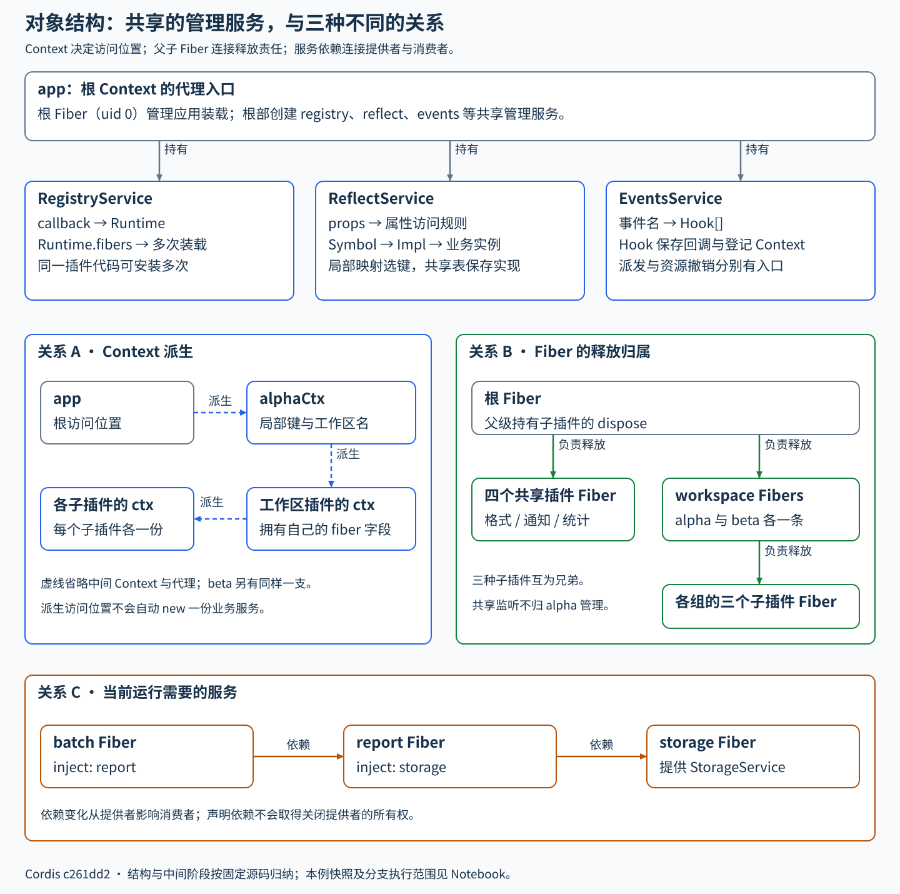

# Cordis 源码导读：从插件到完整应用

通过一个持续演进的 **ReportDesk 内容报告工具**，学习 Cordis 的使用方式与内核运行机制。共 14 课，中文讲解，配有可执行 Notebook、独立示例、固定版本源码和对象图。

ReportDesk 从文本生成 Markdown 报告，逐步加入可复用服务、完成通知、统计、内存存储、格式扩展、配置更新、多入口调用和独立工作区。报告生成采用确定性规则，不需要模型、API Key 或在线业务服务。

适合能阅读 JavaScript / TypeScript、希望理解插件框架的开发者。需要了解函数与对象、原型、模块、Promise / async-await、基本 TypeScript 类型；涉及 Cordis 的代理与上下文行为会结合代码解释。

## 从哪里开始

- **直接阅读**：点击下方课名，在 GitHub 阅读包含讲解、代码和图的正文。
- **边读边运行**：每课的 `LearningTask.ipynb` 使用 JavaScript（jslab）内核；初始化与实验按正文顺序执行。
- **设置断点**：单独用 VS Code 打开某一课目录，使用本课 `.vscode/launch.json`，可进入 `materials/cordis/src/`。

完整安装与 Notebook 配置见 [SETUP.md](SETUP.md)。从第 1 课开始运行：

```bash
git clone https://github.com/goosmanlei/cordis-source-reading.git
cd cordis-source-reading/lessons/2001.Cordis-Context-and-Function-Plugins
npm ci
npm run check
npm run demo
```

每课先读具体调用与对象，再观察行为，最后回到支撑它的源码；不必一次通读整个内核。目录编号 `2001–2014` 对应第 1–14 课。每课通常可按 2–3 小时安排，也可分多次阅读。

## 课程目录

| 课次 | 主题 | 本课重点 |
| --- | --- | --- |
| 1 | [Context 与函数插件](lessons/2001.Cordis-Context-and-Function-Plugins/README.md) | 函数身份、Runtime、Fiber、装载与等待 |
| 2 | [根 Context 装配与方法转发](lessons/2002.Cordis-Root-Context-and-Method-Dispatch/README.md) | 管理对象、入口定义表、effect 与当前上下文 |
| 3 | [Context 派生与 shadow](lessons/2003.Cordis-Context-Views-and-Method-Binding/README.md) | 原型、普通属性、定义位置与调用位置 |
| 4 | [第一个报告插件](lessons/2004.Cordis-ReportDesk-First-Plugin/README.md) | 把报告函数装入框架，传入业务配置 |
| 5 | [可复用报告服务](lessons/2005.Cordis-ReportDesk-Reusable-Service/README.md) | Service、provide、inject 与服务读取 |
| 6 | [事件、通知与统计](lessons/2006.Cordis-ReportDesk-Events-and-Observers/README.md) | 监听登记、完成事件与回调执行 |
| 7 | [观察插件卸载与重装](lessons/2007.Cordis-ReportDesk-Observer-Lifecycle/README.md) | 监听归属、effect、dispose 与资源释放 |
| 8 | [存储依赖的停用与恢复](lessons/2008.Cordis-ReportDesk-Storage-Dependency/README.md) | 依赖通知、运行状态、实例重建 |
| 9 | [可插拔的格式处理](lessons/2009.Cordis-ReportDesk-Format-Plugins/README.md) | waterfall、next、进入与返回顺序 |
| 10 | [运行中的配置更新](lessons/2010.Cordis-ReportDesk-Config-Update/README.md) | update、restart、同一 Fiber 的新一轮执行 |
| 11 | [同一服务的两个调用视图](lessons/2011.Cordis-ReportDesk-Service-Views/README.md) | 不同代理与共享实现，调用 Context 的来源 |
| 12 | [方法调用中的 this 与依赖上下文](lessons/2012.Cordis-ReportDesk-Method-Context/README.md) | 方法代理、shadow、调用标签与定义处依赖 |
| 13 | [两个独立工作区](lessons/2013.Cordis-ReportDesk-Workspace-Isolation/README.md) | isolate、Symbol 登记键与组内资源归属 |
| 14 | [完整流程与对象图解](lessons/2014.Cordis-ReportDesk-Full-Flow/README.md) | 用五张图连接整个系列 |

第 14 课完整沿用第 13 课的业务代码，只增加用于解释框架的数据快照。对象图、装载图、业务时序图、数据图与生命周期图分别说明结构、执行和变化，帮助把分课机制重新连起来。



## 版本与目录

本课程针对 **Cordis 4.0.0-rc.10**。2001–2003 固定在上游提交 `f8ea3cd50f1a5724e8e715995bcde131c9c12b2c`；2004–2014 固定在 `c261dd2c13d65b1994adb1cdc10d7dba61542523`。同一包版本字符串不保证两份提交完全相同，源码位置以各课清单为准。

每课都包含自己的源码、依赖清单和锁文件。`app/` 是业务插件，`examples/` 是运行入口，`shared/` 是辅助代码，`materials/cordis/src/` 是实际加载的框架实现。可直接在本课源码中加注释、打印或断点；修改不会影响其他课程。安装依赖后生成的文件位于 `node_modules/` 和 `runs/`，不进入版本库。

本系列覆盖示例用到的主要路径；复杂并发、全部异常恢复、装饰器及所有插件生态 API 不在完整覆盖承诺内。它是独立社区学习资料，与 Cordis 官方项目没有隶属关系。

## 来源、验证与维护

- [Cordis 官方仓库](https://github.com/cordiverse/cordis)；各课 `materials/source-index.json` 保存固定来源和文件哈希。
- [第三方归属](THIRD_PARTY_NOTICES.md)保留上游版权与许可证；课程原创内容采用 [MIT](LICENSE)。
- [验证范围](VALIDATION.md)说明实际执行过的入口与未覆盖环境。
- [贡献说明](CONTRIBUTING.md)说明正文、Notebook 与示例的同步方式。欢迎通过 Issues 提供具体课次、源码位置与可复现问题。

课程由 goosmanlei 整理，使用 Codex 辅助编写、修订和验证。讲解以固定源码及可观察运行结果为依据。
