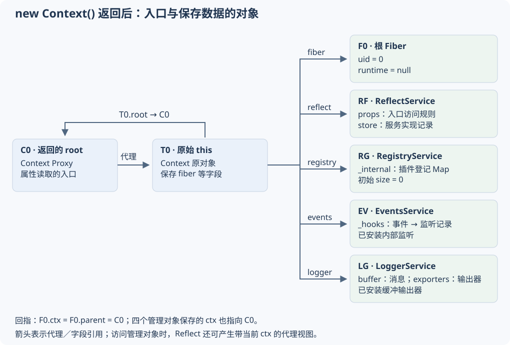

<!-- Generated from LearningTask.ipynb by scripts/render-lessons.py. -->

[运行此课 Notebook](LearningTask.ipynb) · [课程目录](../../README.md)

**Cordis 2002 · 根 Context 装配与方法转发**

[课程目录](../../README.md) · [环境与运行](../../SETUP.md)

# 本课导览

从 new Context() 的对象装配，跟到 branch.plugin() 的属性读取与方法转发。

本课先给具体代码和预期行为，再沿本课固定版本的源码解释原因。读到所选路径即可，不要求通读整个内核。

M1 认识根对象；M2 追踪 plugin 入口和 effect；M3 运行对象快照。运行编号与章节编号分别使用：示例 01 是构造器实验，示例 03 是 effect 实验，00 用于准备示例 02。

建议按 2–3 小时安排首次阅读、运行与回看；可分多次完成。

# 源码与阅读导航

| 源码与配套资料 | 阅读入口与用途 | 版本／日期 |
|---|---|---|
| [S1 · Context 构造器与派生入口](materials/cordis/src/context.ts) | constructor 36–49；extend 55–63；确定根对象的创建顺序与派生关系 | 4.0.0-rc.10 / f8ea3cd50f1a；访问 2026-10-09 |
| [S2 · 根 Fiber 的初始化与同步 effect](materials/cordis/src/fiber.ts) | 字段与构造参数 103–131；根分支 200–212；133–135 定位插件上下文；M2.2 摘录 effect 的执行、清理与等待入口；本地 effect/_execute 已逐段注释，先读同步登记路径，再按 M2.2.4 对照清理关系 | 4.0.0-rc.10 / f8ea3cd50f1a；初始化核对 2026-10-09，effect 核对 2026-10-10 |
| [S3 · 入口定义与读取转发](materials/cordis/src/reflect.ts) | handler.get 62–77；constructor 137–150；accessor/mixin 231–267；解释 plugin 入口如何写入 props、如何找到 registry.plugin | 4.0.0-rc.10 / f8ea3cd50f1a；访问 2026-10-09 |
| [S4 · 跟随调用上下文的代理](materials/cordis/src/utils.ts) | getTraceable 110–118；createTraceable 161–193 中本课摘录的分支；解释共享管理对象为何能带入当前 Context | 4.0.0-rc.10 / f8ea3cd50f1a；访问 2026-10-09 |
| [S5 · 插件登记与创建边界](materials/cordis/src/registry.ts) | Runtime 94–99；RegistryService 125–155；plugin 193–208；把动态 ctx 的结果定位到 new Fiber(this.ctx, ...) | 4.0.0-rc.10 / f8ea3cd50f1a；访问 2026-10-09 |
| [S6 · EventsService 的初始化位置](materials/cordis/src/events.ts)（选学） | 45–70 的字段与构造器；对照本课职责表；不必通读事件派发或日志格式化 | 4.0.0-rc.10 / f8ea3cd50f1a；访问 2026-10-09 |
| [S7 · LoggerService 的初始化位置](materials/cordis/src/logger.ts)（选学） | 170–204；只看返回的对象与初始输出器；对照本课职责表；不必通读事件派发或日志格式化 | 4.0.0-rc.10 / f8ea3cd50f1a；访问 2026-10-09 |

按下面的具体入口和停止点阅读，结合正文中的注释摘录理解。

所有必读实现已在下文精选摘录；链接用于定位和回看，表中多个文件不是通读任务。固定基线为 Cordis 4.0.0-rc.10，提交 `f8ea3cd50f1a5724e8e715995bcde131c9c12b2c`。本课独立副本的初始内容已与上游来源清单核对；版本与提交作为阅读基线。

直接打开本课的 [materials/cordis/src/](materials/cordis/src/) 阅读或修改实现。你可以在其中添加注释、打印和实验性改动；其他课程保留各自独立的源码。本课依赖和锁文件也在当前目录，具体入口见 [源码说明](materials/README.md)。

下文摘录与行号对应初始上游基线。修改本地源码后按文件中的符号定位，固定提交链接用于对照原实现；你的修改会保留，不会因与原始校验值不同而自动恢复。

# 沿场景理解源码

按根对象装配 → 方法转发 → 对象快照阅读。先在本课目录执行 `npm ci`、`npm run check`。M1 的示例 01 与 M2 的示例 03 可直接在 Notebook 运行；M3 的示例 02 先执行相邻的 00。终端入口为 `npm run demo` 和 `npm run demo:effect`。

## M1 · 根 Context 装配：先把对象分开

**必做 · 阅读与操作约 35 分钟**

**从这里开始**：从下方对象图和 context.ts 的 36–49 行进入。

### M1.1 · 从一张对象图进入

你在 2001 已见过 `ctx.plugin(fn)`。这次先停在更早的时刻：`const root = new Context()` 刚返回，还没有装入你的插件。`root` 是访问入口；保存插件登记、事件和日志数据的，是它连接的其他对象。



图中的 C0、T0、F0、RG、RF、EV、LG 是本课为对象取的阅读标签，不是 Cordis 自动生成的编号。只有 Fiber 的 `uid` 是实际字段。T0 是构造器中的原始 `this`，C0 是返回给调用方的 Proxy；画开这两个对象，是为了看清“字段存在哪里”和“读取经过谁”。

| 对象／文件 | 负责什么 | 本课要记住的数据与关系 |
|---|---|---|
| Context／context.ts | 给当前代码提供访问框架能力的入口 | 原对象 T0 持有 `root`、`fiber`、`reflect`、`registry`、`events`、`logger`；访问 C0 时可经代理转发 |
| Fiber／fiber.ts | 表示一个执行与资源归属范围；插件的一次装载有自己的 Fiber | 根 F0 的 `uid = 0`、`runtime = null`、`ctx = C0`；`_disposables` 保存要在相应生命周期调用的清理函数 |
| ReflectService／reflect.ts | 解释 Context 上的动态属性如何读写 | `props` 是“入口名 → 访问规则”；例如 `plugin → { type: 'accessor', get, set }`。`store` 则放实际提供的服务记录，两者不能混为一张表 |
| RegistryService／registry.ts | 登记插件及其装载记录 | `_internal: Map<Function, Plugin.Runtime>`；键是回调函数引用，值是 Runtime；初始为空 |
| EventsService／events.ts | 保存监听记录并派发事件 | `_hooks` 按事件名组织记录；根初始化已经登记两个内部事件的监听，不是一张完全空表 |
| LoggerService／logger.ts | 创建 Logger，保存消息缓冲和输出器 | `buffer` 保存日志消息，`exporters` 保存输出器；默认先安装一个写入 buffer 的输出器 |

这里的 **Runtime 是一条普通对象记录**，`Plugin.Runtime` 是 TypeScript 接口，不是要 `new` 的类。其主要成员是 `callback`、`fibers` 和可选配置校验器；只有登记插件时才出现。**Logger** 是按名称等选项创建的日志对象，和管理日志的 **LoggerService** 分开；根初始化只建立 LoggerService 入口，本课不会为它另造日志练习。

### M1.2 · 按构造器顺序把对象放回去

来源：[context.ts:36–49](materials/cordis/src/context.ts) · [固定提交行号](https://github.com/cordiverse/cordis/blob/f8ea3cd50f1a5724e8e715995bcde131c9c12b2c/packages/core/src/context.ts#L36-L49)。下面完整保留构造器。

```typescript
  constructor() {
    this[symbols.isolate] = Object.create(null)
    this[symbols.intercept] = Object.create(null)
    const self = new Proxy<this>(this, ReflectService.handler)
    this.root = self
    this.baseUrl = undefined
    this.fiber = new Fiber(self, {}, Object.create(null), null, () => [])
    this.reflect = new ReflectService(self)
    this.registry = new RegistryService(self)
    this.events = new EventsService(self)
    this.logger = new LoggerService(self)
    this.fiber._disposables.clear()
    return self
  }
```

读这段时按四步看：

1. 两个 `Object.create(null)` 是没有原型的字典，分别存放服务隔离标签和上下文配置覆盖。此刻为空；这里先识别它们是什么数据容器。
2. `new Proxy(this, ReflectService.handler)` 建立 C0。Proxy 是属性访问的入口，`handler` 是处理读取等操作的规则。后续 `this.root = self` 把根引用存到 T0；所以 `root.root` 仍能回到 C0。
3. 先建立根 Fiber，再依次建立 Reflect、Registry、Events、Logger 管理对象；它们都接收 C0。这样 Reflect 登记入口时，已经有可使用的根 Fiber。
4. 最后清空根 Fiber 的 `_disposables` 并返回 C0。`clear()` 只取出并清空清理记录，不执行这些函数，因此已经登记的内置入口、监听和日志缓冲输出器仍存在；它们不会跟随这批根初始化清理记录被撤销。

第四步可在 [utils.ts:26–29](materials/cordis/src/utils.ts) 对照：`clear()` 返回原列表的反向数组，构造器没有使用这个返回值。读到这里即可，不必追入整套清理流程。

#### M1.2.1 · 构造器返回对象：new 最终拿到谁

`return self` 会决定 `new Context()` 的结果。JavaScript 在执行这个构造器之前先建立原始对象，让构造器里的 `this` 指向它；构造器显式返回一个对象时，`new` 表达式最终得到这个返回对象。这里的 `self` 是包装原始 `this` 的 Proxy，因此调用方拿到的是 C0，构造器中保存字段的原始对象仍是 T0。

下面保留 `new Proxy(this, ...)`、`this.root = self` 和 `return self` 三个关键动作，用空的代理处理规则 `{}` 隔离观察语言行为。它是简化示例，不会创建或修改 Cordis；M2 再解释 Cordis 的属性访问规则。直接运行下一格即可，不依赖后面的 00 初始化，可重复运行。

语言依据：[ECMAScript 10.2.2：构造调用的返回处理](https://tc39.es/ecma262/multipage/ordinary-and-exotic-objects-behaviours.html#sec-ecmascript-function-objects-construct-argumentslist-newtarget)，只看第 12 步及紧随其后的 base 构造器返回分支即可；2026-10-09 核对。

```javascript
// M1.2.1 · 示例 01 · 构造器返回对象：区分原始 this、返回的 Proxy 与 new 的结果。
(() => {
    /** @type {any} 记录构造器内的原始 this，便于在外面观察。 */
    let rawThis;
    let returnedSelf;

    class ContextReturnDemo {
        constructor() {
            rawThis = this;
            this.label = "原始对象上的字段";
            const self = new Proxy(this, {});
            this.root = self;
            returnedSelf = self;
            return self;
        }
    }

    const result = new ContextReturnDemo();
    console.log("01 · result === returnedSelf（new 得到构造器返回的 Proxy）:", result === returnedSelf);
    console.log("01 · result === rawThis（new 的结果与原始 this 是否为同一对象）:", result === rawThis);
    console.log("01 · result.root === result（root 字段指回同一个 Proxy）:", result.root === result);

    result.label = "通过 Proxy 修改后的值";
    console.log("01 · rawThis.label（通过 Proxy 写入后，原始对象中的字段）:", rawThis.label);
})();
```

这四行输出对应四个关系：

- 第一行为 `true`：`new` 表达式的结果就是 `return self` 返回的 Proxy。
- 第二行为 `false`：原始 `this` 和 Proxy 是两个不同对象。
- 第三行为 `true`：`this.root = self` 把 Proxy 保存到原始对象上；经 Proxy 读到 `root`，仍会得到这个 Proxy。
- 最后一行是“通过 Proxy 修改后的值”：这个例子的空处理规则把字段写入转发给原始对象，并没有复制一套字段。

对应回 Cordis：`rawThis` 是图中的 T0，`returnedSelf` 和 `result` 都是 C0。`return self` 改变的是调用方拿到哪个对象，不会把构造器内已有的 `this` 改成 Proxy；本课这个基类构造器如果没有显式返回对象，`new` 默认返回原始 `this`。

### M1.3 · 根 Fiber 为什么没有 Runtime

构造参数的 `public parent`、`public inject`、`public runtime` 会保存成实例字段；这里的 `parent` 是创建它时传入的 Context。见 [fiber.ts:122–131](materials/cordis/src/fiber.ts) · [固定提交行号](https://github.com/cordiverse/cordis/blob/f8ea3cd50f1a5724e8e715995bcde131c9c12b2c/packages/core/src/fiber.ts#L122-L131)。根调用明确传入 `runtime = null`，走下面的分支。

```typescript
    } else {
      this.uid = 0
      this.ctx = this.context = parent
      this.state = FiberState.ACTIVE
      this.store = Object.create(null)
      this._runner = {
        epoch: '',
        getOuterStack,
        execute: () => {},
        collect,
      }
      this.dispose = () => this.restart()
    }
```

来源：[fiber.ts:200–212](materials/cordis/src/fiber.ts) · [固定提交行号](https://github.com/cordiverse/cordis/blob/f8ea3cd50f1a5724e8e715995bcde131c9c12b2c/packages/core/src/fiber.ts#L200-L212)；仅摘录无 Runtime 的分支。

根范围在用户插件执行以前就需要管理入口和资源，所以先有 F0。`state = ACTIVE` 表示其当前状态；`uid = 0` 是标识；`runtime = null` 表示它不对应某个插件登记。这些字段属于 `root.fiber`，不是 Context 自己的 uid 或状态。

`this.ctx = parent` 还说明根 Fiber 直接使用 C0；插件分支的 `parent.extend({ fiber: this })` 则会为本次装载派生一个 Context。我们在第三段只观察这个差异带来的引用关系。

### M1.4 · 管理对象初始化到什么程度

无需再通读四个文件。先按这张快照表理解构造器的结果；第三段会用真实运行对应它。

| 初始化结果 | 写入位置 | 当前含义 |
|---|---|---|
| `registry.size = 0` | registry.ts:125–134 创建空 `_internal` | 内置管理对象没有通过 `ctx.plugin()` 登记成用户插件 Runtime |
| `reflect.props.plugin.type = 'accessor'` | reflect.ts 的 constructor → mixin → accessor | 属性读取规则已经准备好，方法的实际调用还没发生 |
| `events._hooks` 有 `internal/listener`、`internal/update` | events.ts:48–70 | 内部监听已安装；这里仅识别容器和初始化行为 |
| `logger.exporters.size = 1` | logger.ts:179–203 | 默认输出器把消息写入 buffer，不等于已输出一条日志 |
| `root.fiber._disposables.length = 0` | context.ts:47 | 根初始化的清理记录已移出列表，已建立的能力仍存在 |

LoggerService 构造器在内部创建一个可调用的函数对象，给它装上字段与方法后返回，所以 `ctx.logger('name')` 和 `ctx.logger.info(...)` 都有入口。这里认识这个返回形态即可；日志消息的完整传递不影响本课的 `plugin` 路径。

### M1.5 · 跟读与必要观察

- 沿构造顺序对照对象图；再看根 Fiber 的无 Runtime 分支。

**这一段要理解的关系或变化**

- Context 是访问入口；根 Fiber 保存根作用域的运行状态与资源归属。
- 四个管理对象各持有自己的数据；初始化结束时尚无插件 Runtime。

**提示与停止点**：读到 constructor 的 return self 和根 Fiber 的 else 分支末尾即可；先用职责表定位其余模块。

## M2 · ctx.plugin 的入口：定义表、代理和当前上下文

**必做 · 阅读与操作约 55 分钟**

**从这里开始**：接着第一段已有的 reflect、registry 与根 Fiber，先看 props 的一条记录。

### M2.1 · 一条入口记录解决什么问题

`Context` 类正文没有 `plugin()` 实现，类型声明却允许调用它。`declare module './context'` 只补充编译期签名；运行时的入口来自 ReflectService。此处 **ReflectService** 是 Cordis 的类，后文 **`Reflect.get` / `Reflect.has`** 则是 JavaScript 自带的反射操作，二者名字相近但职责不同。

来源：[reflect.ts:137–150](materials/cordis/src/reflect.ts) · [固定提交行号](https://github.com/cordiverse/cordis/blob/f8ea3cd50f1a5724e8e715995bcde131c9c12b2c/packages/core/src/reflect.ts#L137-L150)。`props` 先建立，随后登记四组入口。

```typescript
  public store: Dict<Impl, symbol> = Object.create(null)
  public props: Dict<Property> = Object.create(null)

  constructor(public ctx: Context) {
    defineProperty(this, symbols.tracker, {
      property: 'ctx',
      noShadow: true,
    })

    this.mixin('reflect', ['get', 'set', 'provide', 'accessor', 'mixin'])
    this.mixin('fiber', ['runtime', 'effect'])
    this.mixin('registry', ['inject', 'plugin'])
    this.mixin('events', ['on', 'once', 'parallel', 'emit', 'serial', 'bail', 'waterfall'])
  }
```

`mixin('registry', ['inject', 'plugin'])` 的意思是：为 Context 增加访问规则，读到 `plugin` 时转到当前 Context 的 `registry.plugin`。`mixin` 并没有把整个 registry 模块混进 Context 类，更没有把 RegistryService 的数据复制过去。`logger` 没在这四组中，因为根 Context 已直接保存 `logger` 入口。

为便于理解，把 `plugin` 这一条规则的形状写成示意如下；**它不是原始源码的逐字复制**：

```typescript
props.plugin = {
    type: 'accessor',
    get: function () { /* 读取当前 Context 的 registry.plugin 并绑定接收者 */ },
    set: function (value) { /* 转发写入 */ },
}
```

### M2.2 · mixin 登记的是稍后执行的读取函数

这一节要解释：根 Context 装配时，`mixin('registry', ['inject', 'plugin'])` 怎样把入口写进 `reflect.props`。先看执行登记动作的 `Fiber.effect`，再看单个入口的 `accessor`，最后看批量登记的 `mixin`。这样进入 M2.3 时，已经知道 `props.plugin` 从哪里来。

下面沿本课正常的同步登记路径阅读，区分三个时刻：**现在执行登记、读取属性时调用 getter、撤销登记时调用清理函数**。源码基线均为本课 Cordis 4.0.0-rc.10 / `f8ea3cd50f1a`。

#### M2.2.1 · effect：执行登记，保存撤销动作

这里 `effect(execute)` 接收一个函数，立即调用它，并收集它返回的清理函数。**清理函数表示以后怎样撤销本次改变**，例如删除刚登记的属性入口；保存函数本身不会执行删除。`effect` 最后返回统一的清理入口 `wrapper`。

在 [fiber.ts](materials/cordis/src/fiber.ts) 中，`effect` 把参数保存为 `runner.execute`（297–308），再调用 `this._execute(runner)`（312）。`runner` 是本次执行的记录，其中 `execute` 负责执行动作，`collect` 把清理函数放入本次的 `disposables` 列表。`_execute` 的关键分支如下，来源为 239–242 行，仅增加注释并统一缩进：

```typescript
const effect: Effect = runner.execute.call(this) // 现在调用传入的函数
if (typeof effect === 'function') {
    return runner.collect(effect)               // 保存它返回的清理函数
}
```

此处局部变量 `effect` 是回调的返回值。`runner.collect(effect)` 保存它，**没有调用这个返回的函数**。方法末尾建立并返回 `wrapper`；以后调用 `wrapper` 才会进入 `dispose()`，执行已收集的清理函数（322–339）。

| 函数 | 本段何时执行 | 负责什么 |
|---|---|---|
| 传给 `effect` 的 `execute` | 调用 `effect` 时 | 执行登记，并返回清理函数 |
| `execute` 返回的清理函数 | 以后撤销时 | 撤销已经发生的登记 |
| `effect` 返回的 `wrapper` | 调用者主动撤销或所属 Fiber 清理时 | 统一调用收集到的清理函数 |

先把这三个函数分开，再看 `accessor` 具体登记什么。

#### M2.2.2 · accessor：现在写 props，稍后才读属性

来源：[reflect.ts:231–239](materials/cordis/src/reflect.ts)。以下完整保留方法逻辑，仅统一缩进并补充注释：

```typescript
accessor(name: string, options: Omit<Property.Accessor, 'type'>) {
    return this.ctx.fiber.effect(() => {
        if (name in this.props) {
            throw new Error(`property "${name}" is already declared as ${this.props[name].type}`)
        }
        this.props[name] = { type: 'accessor', ...options } // 现在登记
        return () => delete this.props[name]              // 返回以后撤销的函数
    }, `ctx.accessor(${JSON.stringify(name)})`)
}
```

把 `name` 代为 `'plugin'`：

1. `effect` 立即执行箭头函数，检查名称并写入 `props.plugin`。
2. `options.get` 和 `options.set` 随对象一起保存；**登记时不调用它们**。
3. 箭头函数返回删除 `props.plugin` 的清理函数，`effect` 保存它并返回 `wrapper`；`accessor` 再把这个 `wrapper` 返回给调用者。

因此 `accessor(...)` 返回时，入口已经存在，getter 尚未运行，删除也尚未发生。回调使用箭头函数，所以其中的 `this` 仍是调用 `accessor` 的 ReflectService；`_execute` 中的 `.call(this)` 不会改变箭头函数的 `this`。

#### M2.2.3 · mixin：由 effect 推进生成器，逐个登记

来源：[reflect.ts:241–266](materials/cordis/src/reflect.ts)。下面省略写入分支和错误参数，为当前普通调用路径补充注释；读取函数的转发在 M2.3–M2.4 展开。

```typescript
mixin(source, mixins) {
    const self = this                         // ReflectService
    return this.ctx.fiber.effect(function* () {
        const entries = Array.isArray(mixins)
            ? mixins.map(key => [key, key])
            : Object.entries(mixins)
        const getTarget = (ctx) => ctx[source] // source 为 'registry'
        for (const [key, value] of entries) {
            yield self.accessor(value, {     // 先完成 accessor，再交出其清理入口
                get(receiver, error) {
                    const service = getTarget(this)
                    if (isNullable(service)) return service
                    const mixin = receiver ? withProps(receiver, service) : service
                    const value = Reflect.get(service, key, mixin)
                    if (typeof value !== 'function') return value
                    return value.bind(mixin ?? service)
                },
                // 省略 set 分支
            })
        }
    }, /* 省略调试标签 */)
}
```

这次传入的是生成器函数 `function*`。调用它先得到迭代器，函数体由 `next()` 推进；`effect` 通过 `_execute` 的同步迭代分支持续推进，直到结束。来源：[fiber.ts:248–254](materials/cordis/src/fiber.ts)，下面仅摘录取得迭代器后的循环并补充注释：

```typescript
const iter = effect[Symbol.iterator]()
while (true) {
    const result = iter.next() // 执行到下一次 yield 或生成器结束
    safeCollect(result.value)  // 收集这次交出的清理函数
    if (result.done) return
}
```

`safeCollect` 在值为函数时调用 `runner.collect`，结束时的空值则忽略（232–238）。对 `mixin('registry', ['inject', 'plugin'])`，每轮依次发生：

```text
next() 推进生成器
  → 先执行 self.accessor(value, options)
  → accessor 内的 effect 立即写入 props[value]，返回单项清理入口
  → yield 将这个清理入口交给外层 effect
  → 外层收集它，再调用 next()，继续下一项
```

`yield` 交出的是清理入口，不是登记的 getter；外层收到后也不执行清理。因此 `mixin` 返回时，`inject`、`plugin` 两条入口都已登记。外层清理入口统一管理内层清理入口；实际收集时还会将内层入口从 Fiber 顶层清理列表移入这组管理（300–305）。

在本课普通的 `branch.plugin(...)` 读取中，getter 的 `receiver` 参数未设置，局部变量 `mixin` 就是取出的 service 视图；getter 的 `this` 由 M2.3 的 `.call(ctx, ...)` 指定为当前 Context。这里 `receiver` 是 getter 自己的参数，与 Proxy handler 接收并命名为 `ctx` 的参数分开。

**阅读停止点**：确认 `props.plugin` 已经保存 getter，并且 `yield` 没有让登记停住，就进入 M2.3，看属性读取怎样调用这个 getter。根装配末尾的 `_disposables.clear()` 只清空清理记录，不执行这些函数，因此内置入口仍然保留，和 M1.2 的结果一致。

#### M2.2.4 · effect 精读：两张清理列表与两个使用入口

本课 [fiber.ts](materials/cordis/src/fiber.ts) 的 `effect` 与 `_execute` 已添加逐段中文注释。先按 `effect` 的步骤 1–7 阅读，在调用 `_execute` 时再进入它的返回值分支；下面把函数之间的关系放在一起。注释版仅增加说明，原始来源清单与基线哈希保留；本地按符号定位，下文行号仍指初始基线。

| 对象或函数 | 属于谁 | 保存什么或负责什么 |
|---|---|---|
| `disposables` | 单次 `effect()` 调用 | 本次收集到的清理函数；外层 effect 可以收集内层的清理入口 |
| `this._disposables` | 整个 Fiber | 尚由 Fiber 直接管理的各组清理入口；Fiber 清理时从这里取出并调用 |
| `runner` | 单次 effect 执行 | `execute` 执行初始化，`collect` 收集清理函数，`epoch` 标记这一次 effect 是否仍有效 |
| `dispose` | 单次 effect 的内部函数 | 取走并清空本次列表，逆序执行清理；遇到异步项就串接等待 |
| `wrapper` | 返回给调用者的函数对象 | 直接调用可发起清理；它的 `then` 还支持等待初始化完成 |
| `disposeAsync` | 同一次 effect 的另一清理入口 | 初始化完成后交给等待者，调用时直接进入本次清理 |

`effect` 里的 `task` 保存 `_execute` 的完成结果：同步初始化通常是 `undefined`，异步初始化则是 Promise。内部 `dispose` 也有名为 `task` 的局部变量，它保存的是**清理过程**的等待链。两个作用域中的变量分别跟踪初始化和清理。

嵌套时，`runner.collect` 先把内层清理入口放入外层 `disposables`，再从同一 Fiber 的顶层列表移除该内层入口。这样 Fiber 只需调用外层入口，外层再统一调用内部各项。`meta.children` 保存这层关系的标签，供 `getEffects()` 查看；实际清理函数保存在列表中。

```text
Fiber 的顶层清理列表
  → 外层 effect 的 wrapper
      → 外层的 disposables
          → 内层 accessor 的 wrapper
              → 删除 props[name] 的清理函数
```

箭头表示管理与调用关系。清理按后登记先执行的顺序进行；前一个异步清理成功后才进入后一个。初始化失败时，`effect` 也会尝试调用 `dispose` 撤销已经收集的动作。

返回入口这部分最容易混淆，下面摘录原始 `effect` 的 322–339 行，统一缩进并添加就地说明。`defineProperty` 在 `wrapper` 上保存 `symbols.effect → meta`，让外层 effect 能识别嵌套关系；`AsyncDisposable` 是同时支持函数调用和 `then` 的类型。

```typescript
// 直接调用 wrapper：使本次 effect 失效，随后清理。
const wrapper = defineProperty(() => {
    if (!runner.epoch) return
    runner.epoch = false
    return task ? task.then(dispose) : dispose()
}, symbols.effect, meta) as AsyncDisposable

// 等初始化完成后交给调用者的清理函数，与 wrapper 共用同一个有效标记。
const disposeAsync = () => {
    if (!runner.epoch) return
    runner.epoch = false
    return dispose()
}

// await wrapper 会调用 then：等待初始化，得到 disposeAsync 这个函数。
wrapper.then = async (onFulfilled, onRejected) => {
    return Promise.resolve(task)
        .then(() => disposeAsync) // 返回函数，等调用者稍后执行清理
        .then(onFulfilled, onRejected)
}

// 内层 push 将 wrapper 登记到 Fiber，并返回“从列表移除它”的函数；
// 外层 push 把这个移除函数也纳入本次清理，避免已清理入口残留在 Fiber 上。
disposables.push(this._disposables.push(wrapper))
return wrapper
```

两种使用方式因此具有不同用途：

- `wrapper()`：现在发起撤销；同步路径直接清理，异步路径在初始化正常结束后清理。它会先把 `epoch` 置为 `false`；异步迭代分支据此停止发起下一次 `next()`。
- `const cleanup = await wrapper`：等待初始化完成并取得清理函数，此时初始化产生的效果仍然保留；随后调用 `cleanup()` 才撤销。`cleanup` 是不带 `then` 的普通函数，Promise 可以直接把它作为结果交出。

两个入口共享 `epoch`，通过其中一个发起清理后，另一个不会再次执行清理。`epoch` 的检查发生在异步迭代的两次 `next()` 之间，已发起的 `next()` 仍需结束。异常处理与这些等待边界已在本地源码对应分支中注释。

按本课实现，等待 `wrapper` 只完成初始化；调用返回的清理函数后才撤销；同步与异步清理混合时，按逆序串行执行。

#### M2.2.5 · 独立示例：逐步观察 effect 的登记与清理

直接调用本课源码的 `root.fiber.effect`：外层 group 创建自己的业务资源，再管理 A、B 两个内层 effect，观察“先登记 group → 登记并收集 A、B → 清理 B、A → 最后清理 group”的过程。`resources` 是示例创建的 `Map`；登记时写入 `"已登记"`，清理时删除对应键。数据怎样修改由回调决定，`effect` 负责执行回调并管理返回的清理函数。

每个快照同时打印四项实际数据：

| 输出 | 观察什么 |
|---|---|
| `resources` | 业务登记表当前有哪些键和值 |
| `fiber._disposables` | Fiber 顶层保存了哪些清理函数；为便于阅读，打印函数上的标签和 `typeof` |
| `fiber.getEffects()` | 顶层 effect 的标签与 `children` 嵌套关系 |
| `cleanupOrder` | 哪些业务清理函数已经执行，顺序是什么 |

**区分两个清理函数**：`cleanupGroupResource` 只删除 group 自身的业务资源；`disposeGroup` 是外层 effect 返回的统一入口，负责依次清理 B、A 和 group。先 `yield cleanupGroupResource`，再收集 A、B，便能让 group 的资源保留到子资源清理完成。

单次 `effect` 的局部 `disposables` 数组由闭包持有，外部没有直接读取入口。本例直接读取上表中的数据，再结合 `runner.collect` 的源码解释清理入口怎样转移。`getEffects()` 返回的是关系说明，清理函数本身保存在清理列表中。

**运行**：使用本课的 JavaScript（jslab）内核，cwd 为本课一级目录；下一格可独立、重复执行，每次都新建一个进程和根 Context。本例全部登记与清理均为同步，便于按快照顺序观察。示例 03 是本次新增的补充，直接在此运行即可，无需先运行 M3 的 00 或 02。

下面保留完整示例，末尾“运行外壳”负责把函数交给本课 Node 进程。终端等价入口为 `npm run demo:effect`，文件为 [examples/03-fiber-effect.mjs](examples/03-fiber-effect.mjs)。输出及结构化快照写入 `runs/fiber-effect/`；重跑只替换这个目的目录。

本格保留你此前的执行输出与计数。重新运行后会生成扩展场景的 10 个快照，最终 `cleanupOrder` 为 `["B", "A", "group"]`。

```javascript
// M2.2.5 · 示例 03 · Fiber.effect：group 自身资源、嵌套收集与逆序清理。
(() => {
    function inspectFiberEffect({ Context }) {
        const root = new Context();
        const fiber = root.fiber;
        // 业务数据由本例维护；effect 负责保存“怎样撤销这些修改”的函数。
        const resources = new Map();
        const cleanupOrder = [];
        const snapshots = [];

        function snapshot(description) {
            const stage = `${snapshots.length + 1} · ${description}`;
            // _disposables 中实际存函数，这里只提取它们的标签与运行时类型。
            // Context.effect 是源码 symbols.effect 对应的 Symbol，用于读取函数上的 meta。
            const state = {
                stage,
                resources: Object.fromEntries(resources),
                fiberDisposables: [...fiber._disposables].map((fn) => ({
                    label: fn[Context.effect]?.label ?? "无 effect 标签",
                    type: typeof fn,
                })),
                // getEffects() 只提供标签关系。复制它，防止后续修改改变之前的快照。
                effectTree: JSON.parse(JSON.stringify(fiber.getEffects())),
                cleanupOrder: [...cleanupOrder],
            };
            snapshots.push(state);
            console.log("\n" + stage);
            console.log("resources（业务登记表）：", JSON.stringify(state.resources));
            console.log("fiber._disposables（顶层清理函数）：", JSON.stringify(state.fiberDisposables));
            console.log("fiber.getEffects()（标签与嵌套关系）：", JSON.stringify(state.effectTree));
            console.log("cleanupOrder（已执行的业务清理顺序）：", JSON.stringify(state.cleanupOrder));
        }

        // 每调用一次，就建立一个内层 effect：立即登记资源，以后调用返回的入口来清理。
        function register(name) {
            return fiber.effect(() => {
                resources.set(name, "已登记");
                // effect 现在保存这个函数；resources.delete 要到清理阶段才执行。
                return () => {
                    resources.delete(name);
                    cleanupOrder.push(name);
                    snapshot(`清理 ${name} 后`);
                };
            }, name);
        }

        snapshot("调用 effect 前");
        const disposeGroup = fiber.effect(function* () {
            // 外层也创建自己的业务资源，并先交出它的清理函数。
            // 这是普通清理函数，负责删除 group 自身；后面的 disposeGroup 管理整组。
            resources.set("group", "已登记");
            const cleanupGroupResource = () => {
                resources.delete("group");
                cleanupOrder.push("group");
                snapshot("清理 group 自身资源后");
            };
            // 先收集的后清理：等 A、B 都清理完，才执行 cleanupGroupResource。
            yield cleanupGroupResource;
            snapshot("group 自身资源已登记，清理函数已收集");

            // register 返回 A 的 wrapper，此时它暂存在 Fiber 顶层清理列表中。
            const disposeA = register("A");
            snapshot("A 已登记，尚未 yield 给外层");

            // _execute 接收 yield 的值，collect 将 A 的 wrapper 收入外层局部数组，
            // 同时从 Fiber 顶层移除它；随后 next() 继续运行到下一行。
            yield disposeA;
            snapshot("yield A 后，继续执行外层生成器");

            // B 走相同路径：先登记，再把清理入口交给外层。
            yield register("B");
        }, "group");

        // 同步生成器已走完，group、A、B 三份资源都存在；顶层只登记 group 的 wrapper。
        snapshot("外层 effect 返回后");
        const groupIsTopLevel = [...fiber._disposables][0] === disposeGroup;
        console.log("Fiber 顶层保存的函数 === disposeGroup：", groupIsTopLevel);

        // 先移除 group 的顶层登记，再清理 B、A，最后清理 group 自身的业务资源。
        disposeGroup();
        snapshot("disposeGroup() 返回后");

        // 同一个 wrapper 的有效标记已经关闭，不会再次执行这三个业务清理函数。
        disposeGroup();
        snapshot("再次调用 disposeGroup() 后");
        return { groupIsTopLevel, snapshots };
    }

    // 运行外壳：把上面的完整函数送入独立进程，直接加载本课 Cordis 源码。
    const lessonRoot = process.cwd();
    if (require("node:path").basename(lessonRoot) !== "2002.Cordis-Root-Context-and-Method-Dispatch") {
        throw new Error("请在 Cordis 2002 目录打开本 Notebook；内核 cwd 应为本课一级目录。");
    }
    const result = require("node:child_process").spawnSync(
        process.execPath, ["scripts/lesson.mjs", "--effect", "--stdin"],
        { cwd: lessonRoot, input: inspectFiberEffect.toString(), encoding: "utf8" }
    );
    if (result.stdout) console.log(result.stdout);
    if (result.stderr) console.error(result.stderr);
    if (result.error) throw result.error;
    if (result.status !== 0) throw new Error("effect 示例未运行成功，请保留上方错误。");
})();
```

**按快照看实际变化**

先对照 1、5、9：业务登记表从空变为 group、A、B，再恢复为空；Fiber 顶层清理列表从空变为只含 group 的 wrapper，再恢复为空。业务资源与清理入口各有自己的登记、清理时机。

| 快照 | 业务登记表的键 | Fiber 顶层清理入口 | 这一刻发生了什么 |
|---|---|---|---|
| 1 · 调用前 | 空 | 空 | 根 Context 初始化已完成，本例尚未登记 |
| 2 · group 自身登记后 | group | 空 | 外层已创建业务资源，并收集 `cleanupGroupResource`；自己的 wrapper 尚未登记 |
| 3 · A 登记后、yield 前 | group、A | A | 内层 effect 已执行回调，并返回、登记了 A 的 wrapper |
| 4 · yield A 后 | group、A | 空 | 外层 collect 已接管 A 的清理入口；外层 wrapper 尚未登记，业务数据继续保留 |
| 5 · 外层返回后 | group、A、B | group | 生成器已走完；`getEffects()` 显示 `group.children` 包含 A、B |
| 6 · B 清理后 | group、A | 空 | group 已移除自身顶层登记；B 的业务清理已执行，group 的资源仍保留 |
| 7 · A 清理后 | group | 空 | A 随后删除，`cleanupOrder` 为 `["B", "A"]` |
| 8 · group 自身清理后 | 空 | 空 | 最后执行 `cleanupGroupResource`，顺序成为 `["B", "A", "group"]` |
| 9 · 整组清理返回后 | 空 | 空 | 三份业务资源均已删除 |
| 10 · 重复清理后 | 空 | 空 | 有效标记已关闭，B、A、group 的业务清理各执行一次 |

第 5 步还会打印 `Fiber 顶层保存的函数 === disposeGroup: true`，用引用比较确认返回给调用者的函数就是顶层登记的入口。每个快照都会复制并序列化当时的数据，可回看登记前后的状态。

**为什么 group 最后清理？** 外层局部 `disposables` 先收集 `cleanupGroupResource`，再收集 A、B 的 wrapper，最后自动加入“从 Fiber 顶层移除 group”的函数。清理时逆序执行，所以先移除顶层入口，再依次清理 B、A、group 的业务资源。快照 6、7 中，顶层入口已移除，但 group 的业务资源仍保留。

`cleanupGroupResource` 是普通清理函数，没有 `Context.effect` 描述信息，所以只进入外层局部清理数组。`getEffects()` 仍显示 `group → children: [A, B]`；group 自身的资源清理不会再产生一个同名子 effect。

联系 M2.2.3：这里的 `register("A")` 对应 `mixin` 调用一次 `accessor`，`resources.set/delete` 对应写入／删除 `props[name]`。`yield` 把内层返回的清理入口交给外层收集，后续由外层统一撤销。本例还先收集 group 自身的普通清理函数，用同一套逆序机制安排外层资源的清理时机。

### M2.3 · 属性读取怎样走到真实方法

现在根 Context 的装配已经完成：M2.2 的 `effect` 已推进登记，`props.plugin` 中保存了 getter，但还没有因为登记而调用它。这一节从读取 `branch.plugin` 开始：Proxy 查到这条记录，再执行其中的 `def.get`。**登记入口与读取入口是前后两次不同的动作。**

来源：[reflect.ts:62–77](materials/cordis/src/reflect.ts) · [固定提交行号](https://github.com/cordiverse/cordis/blob/f8ea3cd50f1a5724e8e715995bcde131c9c12b2c/packages/core/src/reflect.ts#L62-L77)。只保留找到 accessor 为止的读取路径，下面尚有其他属性的处理。

```typescript
  static handler: ProxyHandler<Context> = {
    get: (target, prop, ctx: Context) => {
      if (isSpecialProperty(prop)) {
        return Reflect.get(target, prop, ctx)
      }
      if (Reflect.has(target, prop)) {
        return getTraceable(ctx, Reflect.get(target, prop, ctx))
      }

      const error = new Error(`cannot get property "${prop}" without inject`)

      try {
        const def = target.reflect.props[prop]
        if (def?.type === 'accessor') {
          return def.get.call(ctx, ctx[symbols.receiver], error)
        }
```

把 `prop` 代为 `'plugin'` 逐行看：

1. 它不是特殊属性；T0 及其原型链上也没有 `plugin` 方法，所以不能走普通成员分支。
2. `target.reflect.props.plugin` 找到刚才保存的 accessor 记录。
3. `def.get.call(ctx, ...)` 让 getter 的 `this` 是本次访问的 Context。`root.plugin` 时是 C0，`branch.plugin` 时是 C1。
4. getter 读取 `this.registry`，再取其 `plugin`，并把函数绑定到这个 registry 视图；真正调用后进入 `RegistryService.plugin`。

**读取 `registry` 本身会走另一个分支**：T0 已有这个字段，因此走第 67–68 行的 `getTraceable(ctx, ...)`。这个区别把“原始管理对象”和“本次调用带入的 Context”连接了起来。

### M2.4 · 同一个 Registry，怎样带上当前 Context

以下原材料保留；本课相关运行快照不表示本节机制已经掌握。

RegistryService 构造器用 `symbols.tracker` 给自身标记 `{ property: 'ctx', noShadow: true }`，意思是这个对象有一个需要跟随访问位置的 `ctx` 字段。`getTraceable` 看到这个标记后，给管理对象建立访问代理。它保留原对象的数据，读取 `ctx` 时返回使用它的 Context。

来源：[utils.ts:110–118](materials/cordis/src/utils.ts) · [固定提交行号](https://github.com/cordiverse/cordis/blob/f8ea3cd50f1a5724e8e715995bcde131c9c12b2c/packages/core/src/utils.ts#L110-L118)，摘录当前 Registry 经过的路径；省略已有包装对象的提前返回分支。

```typescript
export function getTraceable<T>(ctx: Context, value: T): T {
  if (!isObject(value)) return value
  // 省略已有包装对象的提前返回分支；本例继续读取 tracker。
  const tracker = value[symbols.tracker]
  if (!tracker) return value
  return createTraceable(ctx, value, tracker)
}
```

再看 `createTraceable` 的当前路径。下面是 **当前 Registry 访问路径的教学化简**：只保留 ctx 转发及其他成员仍取自原对象的关系。构造时的 `noShadow: true` 表示这里不再给取出的方法添加一层调用包装；方法接收者由 mixin 最后的 bind 确定。完整实现见 [utils.ts:161–193](materials/cordis/src/utils.ts) · [固定提交行号](https://github.com/cordiverse/cordis/blob/f8ea3cd50f1a5724e8e715995bcde131c9c12b2c/packages/core/src/utils.ts#L161-L193)。

```typescript
// 教学化简：保留本例的关键数据关系，不是可替换上游实现的代码。
function registryView(currentContext, rawRegistry) {
    return new Proxy(rawRegistry, {
        get(target, prop) {
            if (prop === 'ctx') return currentContext
            return Reflect.get(target, prop)
        },
    })
}
```

原实现的关键判断是 `if (prop === tracker.property) return useSite`（utils.ts:168）；`tracker.property` 在这里就是 `'ctx'`。因而：

- 原始 Registry 存储的 `ctx` 仍是根 C0。
- 经 `branch.registry` 取得的代理视图，读 `ctx` 得到 C1。
- `_internal` 仍取自同一个原始 Registry，所以没有新建第二张插件登记表。

getter 最后把 `plugin` 函数绑定到这个视图。于是执行真实方法时，`this.ctx` 取到 C1：

```typescript
    let runtime = this._internal.get(callback)
    if (!runtime) {
      let name = plugin.name
      if (name === 'apply') name = undefined
      runtime = { name, callback, fibers: new DisposableList(), Config: plugin.Config }
      this._internal.set(callback, runtime)
    }

    const fiber = new Fiber(this.ctx, config, Inject.resolve(plugin.inject), runtime, getOuterStack)
```

来源：[registry.ts:199–207](materials/cordis/src/registry.ts) · [固定提交行号](https://github.com/cordiverse/cordis/blob/f8ea3cd50f1a5724e8e715995bcde131c9c12b2c/packages/core/src/registry.ts#L199-L207)。本课就在这句 `new Fiber(this.ctx, ...)` 停止向下追：它把 C1 作为 parent 传入。Fiber 随后通过 `parent.extend({ fiber: this })` 得到本次插件的 C2。

整个路径可以按下面五步回看：

```text
C1.plugin(leaf, config)
  → Context 代理：从 props.plugin 找到 accessor
  → accessor.get 的 this = C1：取得 C1.registry 视图
  → 绑定并执行 RegistryService.plugin：方法里的 this.ctx = C1
  → 共享 Map 登记 leaf → Runtime R1
  → new Fiber(C1, ...)：F1.parent = C1，F1.ctx = C2
```

这条转发让“使用同一套管理数据”和“把资源归到正确调用上下文”同时成立。第三段把这些引用关系对应到实际运行。

### M2.5 · 跟读与必要观察

- 按 props 注册 → Proxy 读取 → mixin 取方法 → 绑定当前服务视图的顺序读。
- 用 branch.plugin 这条路径对照 getTraceable 的局部摘录。

**这一段要理解的关系或变化**

- mixin 写入访问规则，并没有把 RegistryService 的方法复制到 Context。
- 同一个原始 Registry 可以通过不同访问代理使用当前 Context，同时共享 _internal Map。

**提示与停止点**：到 registry.ts 的 new Fiber(this.ctx, ...) 就停；后面的插件装载过程用前课已解释的“创建本次 Fiber”衔接。

## M3 · 一个运行案例：把图上的引用对应到真实对象

**必做 · 阅读与操作约 35 分钟**

**从这里开始**：先执行 00，再运行 02；也可从本课目录执行 npm run demo。

### M3.1 · 先明确这次运行的疑问

我们要把第二段不直观的关系看成真实数据：**Registry 没有复制，它为何还能在 `branch.plugin()` 中带上 branch？**

同一个案例先创建根 C0，记录初始化快照；再派生带 `label: 'branch-A'` 的 C1，从 C1 装入一个只接收上下文与配置的箭头函数 `leaf`。它获得的新上下文记为 C2，对应本次 Fiber F1。这里不切换条件，也不增加第二套插件场景。

`branch = root.extend(...)` 是派生上下文，沿已有根入口取得共享能力；它不是再次执行 `new Context()`。本例 C1 尚未自带新 Fiber，调用 plugin 后才为这次插件创建 F1，并由 `extend({ fiber: this })` 派生 C2。可对照 [context.ts:55–63](materials/cordis/src/context.ts) 与 [fiber.ts:133–135](materials/cordis/src/fiber.ts)。

### M3.2 · 运行入口与顺序

| 正文位置／运行序号 | 主题 | 入口与用途 |
|---|---|---|
| M3.3.1／00 | 连接本课运行入口 | 执行下面的初始化 Code cell；确认当前工作目录，定义独立进程调用函数 |
| M3.3.2／02 | 根装配与调用上下文快照 | 执行随后完整示例；CLI 等价入口为本课目录下的 `npm run demo`，源文件是 [examples/02-context-assembly.mjs](examples/02-context-assembly.mjs) |

本课使用 **JavaScript（jslab）** 内核。内核只把示例函数送进独立 Node 进程；该进程通过本课安装的 tsx 直接加载 `materials/cordis/src/index.ts`。这样可直接修改下面示例并重跑，也避免把框架源码导入 Notebook 常驻进程。每次 02 都建立全新的进程和根对象；修改本课源码并保存后，重新运行 02 即可生效，无需重启内核。终端入口 `npm run demo` 使用同一份源码。

所有路径以本课一级目录为 cwd；运行代码和输出只写 `runs/context-assembly/`，重跑替换该目的目录。源码实际文件、`package-lock.json` 和安装依赖均归本课所有，运行不依赖上一课目录。

00 与 02 在下面的独立 Code cell 中。需要调试时，可在已有的 Node 调试环境中从本课目录执行 `npm run demo`；这是可选入口，普通运行已足以对照快照。

### M3.3 · 跟读与必要观察

- 对照运行前后的对象快照，重点看原始 Registry.ctx 与 branch.registry.ctx。
- 把 F1.parent 和 F1.ctx 对回第二段的调用链；需要时按正文三个位置设置断点。

**这一段要理解的关系或变化**

- 根装配快照与第一段一致；props 已有 plugin 入口，而 registry 尚为空。
- 一次 branch.plugin 后，F1.parent 是 C1、F1.ctx 是 C2，管理对象的原始 ctx 仍指向 C0。

**提示与停止点**：对照关系已经清楚即可结束；自由记录疑问，不增加参数切换或强制作答。

#### M3.3.1 · 初始化运行入口

先执行下一格，再运行 M3.3.2 的完整场景。

```javascript
// M3.3.1 · 初始化 00 · 连接 Cordis 2002 的独立运行入口（先执行本单元）。
var cordis2002Root = process.cwd();
if (require("node:path").basename(cordis2002Root) !== "2002.Cordis-Root-Context-and-Method-Dispatch") {
    throw new Error("请在 Cordis 2002 目录打开本 Notebook；不要从仓库根目录启动内核。");
}
var runContextAssembly2002 = (example) => {
    var result = require("node:child_process").spawnSync(
        process.execPath, ["scripts/lesson.mjs", "--stdin"],
        { cwd: cordis2002Root, input: example.toString(), encoding: "utf8" }
    );
    if (result.stdout) console.log(result.stdout);
    if (result.stderr) console.error(result.stderr);
    if (result.error) throw result.error;
    if (result.status !== 0) throw new Error("案例未运行成功，请保留上方错误。");
};
console.log("00 已就绪：cwd 为 Cordis 2002；02 的结果写入本课 runs/context-assembly。");
```

#### M3.3.2 · 执行完整场景

先运行 00，再执行本单元。示例最后释放本例插件，打印的 B 快照取自释放前。

```javascript
// M3.3.2 · 示例 02 · 根 Context 装配与方法转发：一个场景，两张对象快照。
runContextAssembly2002(async function inspectAssembly({ Context }) {
    const root = new Context();
    const original = Symbol.for("cordis.original");
    // 调试用：拿到真正保存数据的管理对象，避开访问时生成的代理视图。
    const registry = root.registry[original];
    const reflect = root.reflect[original];
    const before = {
        root: "C0",
        rootPointsToSelf: root.root === root,
        rootFiber: { id: "F0", uid: root.fiber.uid, runtime: root.fiber.runtime },
        registryEntries: registry.size,
        pluginEntry: reflect.props.plugin.type,
        rootDisposables: root.fiber._disposables.length,
        eventNames: Object.keys(root.events._hooks),
        loggerExporters: root.logger.exporters.size,
    };
    console.log("02 · A：new Context() 完成后的数据（尚未装入插件）");
    console.log(JSON.stringify(before, null, 4));

    // C1 是派生入口：同一个根、同一个根 Fiber，增加一个便于观察的 label。
    const branch = root.extend({ label: "branch-A" });
    /** @type {any} 由 leaf 回调记录本次收到的 Context。 */
    let receivedContext;
    let receivedConfig;
    const leaf = (ctx, config) => {
        receivedContext = ctx;
        receivedConfig = config;
    };
    // 跟踪重点：入口从 C1 发起，因此新 Fiber 的 parent 应为 C1。
    const fiber = await branch.plugin(leaf, { message: "hello" });
    if (!receivedContext) throw new Error("leaf 尚未执行，无法生成插件上下文快照。");
    const runtime = registry.get(leaf);
    const contexts = new Map([[root, "C0：root"], [branch, "C1：branch"], [fiber.ctx, "C2：插件上下文"]]);
    const label = (ctx) => contexts.get(ctx) ?? "未标记的对象";
    const after = {
        registryShared: branch.registry[original] === registry,
        registryStoredCtx: label(registry.ctx),
        registryViewCtx: label(branch.registry.ctx),
        fiberParent: label(fiber.parent),
        fiberCtx: label(fiber.ctx),
        callbackCtx: label(receivedContext),
        pluginRoot: label(receivedContext.root),
        inheritedLabel: receivedContext.label,
        config: receivedConfig,
        registryEntries: registry.size,
        runtimeFibers: [...runtime.fibers].map((item) => ({ uid: item.uid, isThisFiber: item === fiber })),
    };
    console.log("\n02 · B：一次 branch.plugin() 完成后的引用与登记数据");
    console.log(JSON.stringify(after, null, 4));
    // 运行入口为独立进程；这里释放本例插件，快照记录的是释放前状态。
    await fiber.dispose();
    return { before, after };
});
```

### M3.4 · 对照快照读结果

02 输出 A、B 两块数据。`Symbol.for('cordis.original')` 是 Cordis 用于取回代理原对象的内部调试标记（utils.ts:166）；例子用它区别原始管理对象与访问代理。这是读源码用的观察手段，不是要求记住的新业务 API。

| 看哪里 | 本例预期 | 怎样联系源码 |
|---|---|---|
| A：rootFiber | `uid: 0`、`runtime: null` | 根 Fiber 的 else 分支；尚无插件登记 |
| A：registryEntries / pluginEntry | `0` / `accessor` | 注册表尚空，Reflect 已登记入口；两张表职责不同 |
| A：eventNames / loggerExporters / rootDisposables | 两个内部事件 / `1` / `0` | 内置能力已建立，初始化清理记录已清空；不是能力消失 |
| B：registryShared | `true` | C0 和 C1 访问的原始 Registry 是同一个对象 |
| B：registryStoredCtx / registryViewCtx | C0 / C1 | 原字段没改；`getTraceable` 的访问代理返回当前上下文 |
| B：fiberParent / fiberCtx / callbackCtx | C1 / C2 / C2 | `new Fiber(this.ctx, ...)` 接收 C1，再为插件派生 C2 |
| B：pluginRoot / inheritedLabel | C0 / `branch-A` | C2 沿派生关系继承根引用和本例标签 |
| B：registryEntries / runtimeFibers | `1` / 包含 uid 为 `1` 的 F1 | Map 按 leaf 回调登记一条 R1，R1 的 fibers 列表记录这次装载 |

本例没有为 leaf 提供 Config 校验器，所以 `{ message: 'hello' }` 直接成为本次配置，输出帮助把调用参数与接收处连接起来。箭头函数在此走普通回调路径；与上课“函数可被判定为构造器”的分支保持区别。

这次装载后的关系可收束为：

```text
C0（root） ← C1.root；C0.fiber = F0
C1（branch） → 访问同一个 RG，RG 视图的 ctx = C1
RG._internal：[leaf → R1]；R1.fibers：[F1]
F1.parent = C1；F1.ctx = C2；C2.fiber = F1；C2.root = C0
```

若想在运行中定位，只设这三个断点就够：`reflect.ts:76`（getter 使用哪个 ctx）、`utils.ts:168`（registry 的 ctx 如何读取）、`registry.ts:207`（传给 Fiber 的 parent）。它们会被初始化与其他内部访问多次触发；可分别关注 `prop === 'plugin'`、`prop === 'ctx'` 以及 `callback.name === 'leaf'` 对应的本次调用。默认运行不依赖断点。

源码已经解释的入口类型不再追加验证。把本例的 C0、C1、C2 与 RG、F0、F1 分开后，本课就到停止点；需要记录的疑问写在后面的自由笔记即可。

# 本课收束

根 Context 的代理把公开入口连接到管理服务。Registry 保存插件登记，Fiber 表示一次装载；方法转发既复用管理对象的数据，也保留当前 Context。effect 登记资源并保存相应撤销动作。
