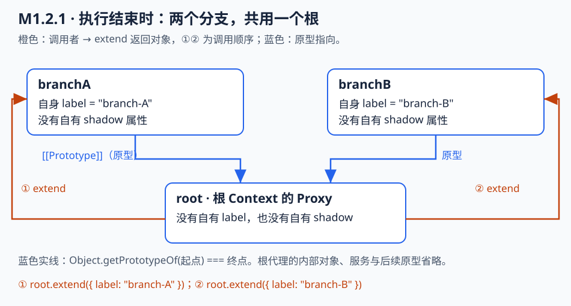
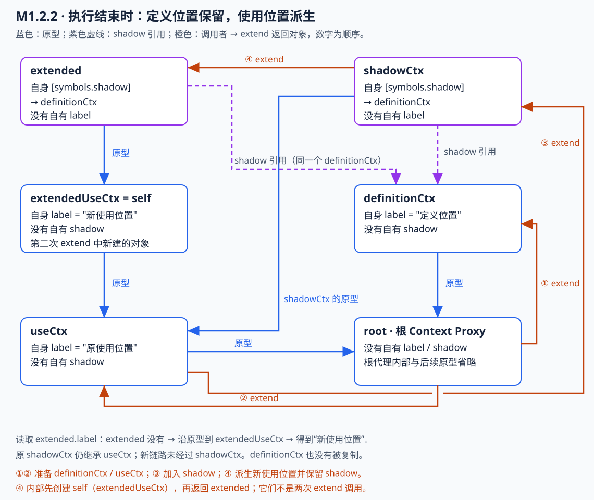
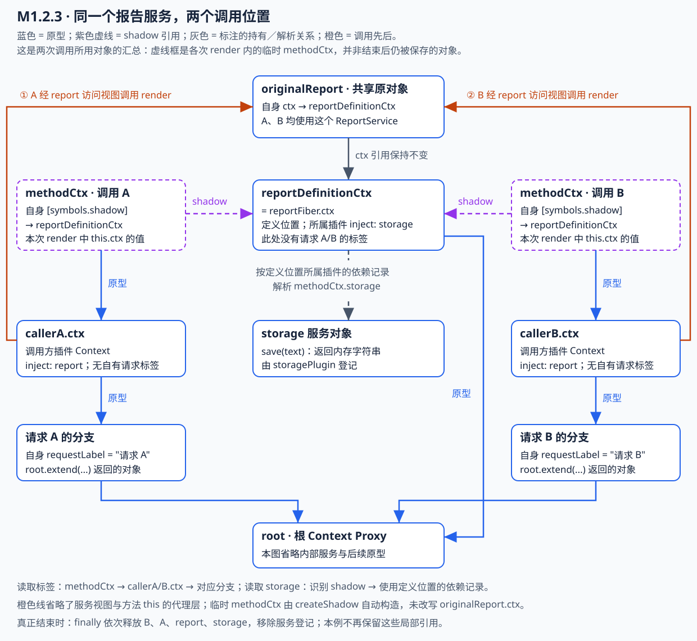

<!-- Generated from LearningTask.ipynb by scripts/render-lessons.py. -->

[运行此课 Notebook](LearningTask.ipynb) · [课程目录](../../README.md)

**Cordis 2003 · Context 派生与 shadow**

[课程目录](../../README.md) · [环境与运行](../../SETUP.md)

# 本课导览

通过原型、普通属性与 shadow 标记，区分调用位置和服务定义位置。

本课先给具体代码和预期行为，再沿本课固定版本的源码解释原因。读到所选路径即可，不要求通读整个内核。

本课聚焦 M1：普通 extend → 已有 shadow 的派生 → 报告服务场景 → 属性读取入口。服务视图和方法代理将在 2011、2012 中结合完整应用继续展开。

建议按 2–3 小时安排首次阅读、运行与回看；可分多次完成。

## 学习顺序与运行入口

阅读顺序为：根与分支 → 普通 extend → shadow 派生 → 报告服务应用 → 属性读取入口。可按需要回查具体源码。

| 运行序号 | 正文位置与主题 | 独立入口（本课目录） |
|---|---|---|
| 00 | 分段准备 | Notebook 先运行一次；刷新本课 runner 缓存 |
| 01 · M1 | M1.2.1：分支与原型 | `npm run demo:m1` |
| 01 · shadow | M1.2.2：定义位置与新使用位置 | `npm run demo:shadow` |
| 02 | M1.2.3：共享报告服务的依赖与调用标签 | `npm run demo:shadow-application` |

全部示例使用 JavaScript/jslab，分段入口在独立 Node 进程中加载本课 TypeScript 源码。运行 00 后各例可以独立、重复执行。`npm run demo` 默认运行 M1.2.1；VS Code 不需要 Notebook 的准备单元。

进程 cwd 为本课一级目录；三个分段只打印，不写产物。声明生成写 `runs/cordis-types/`，验证结果写 `runs/verification/`，均由 `/runs/` 忽略。不清空历史运行目录或笔记输出。

## Notebook 与 VS Code 两种运行方式

Notebook 中执行对应 Code cell，适合边读边观察；深入追踪时打开同名的独立文件，在“运行和调试”选择对应配置并按 F5。VS Code 请单独打开本课目录，配置从本课目录运行；不需要执行 Notebook 的 00。F10 逐行执行，F11 跟入调用，F12 查看定义。代码文件直接导入本课 `materials/cordis/src/`，断点也可以设在这份 TypeScript 源码中。

| Notebook 位置 | VS Code 文件 | 调试配置 / 终端入口（本课目录） |
|---|---|---|
| M1.2.1 | [01-m1-context-branches.mjs](examples/01-m1-context-branches.mjs) | Cordis 2003 · M1.2.1 · 分支与原型 / `npm run demo:m1` |
| M1.2.2 | [01-m1-shadow-extend.mjs](examples/01-m1-shadow-extend.mjs) | Cordis 2003 · M1.2.2 · shadow 与 extend / `npm run demo:shadow` |
| M1.2.3 | [02-shadow-application.mjs](examples/02-shadow-application.mjs) | Cordis 2003 · M1.2.3 · shadow 应用场景 / `npm run demo:shadow-application` |

例如研究 shadow 时，在独立文件的 `shadowCtx.extend(...)` 行和 `context.ts` 的 extend 内设断点，查看 this、shadow、self 以及返回值。00 是 Notebook 的进程调用准备，不是另一个教学案例，VS Code 配置已经负责对应的启动准备。

Notebook 保留可直接修改的完整教学代码，独立文件也可编辑；两处共用同一套本课源码与依赖，教学函数主体以 `npm run check:examples` 核对。临时试验可以只改正在使用的一处；确定要保留的改动后同步另一处。检查只指出差异，不覆盖代码、笔记或输出。

# 源码与阅读导航

本课使用 Cordis 4.0.0-rc.10，固定提交 f8ea3cd50f1a5724e8e715995bcde131c9c12b2c。行号以初始基线为准；修改后请按符号定位。

| 资料 | 阅读范围与停止点 |
|---|---|
| [S1 · context.ts](materials/cordis/src/context.ts) | constructor 的根代理；extend 的属性复制、普通返回与 shadow 包装 |
| [S2 · reflect.ts](materials/cordis/src/reflect.ts) | handler.get 的 receiver 与 defSite；对应 M1.3 和报告场景，停止于当前属性的读取路径 |
| [S3 · utils.ts](materials/cordis/src/utils.ts) | getTraceable 的 shadow 解包；createShadow、createShadowMethod 及方法包装分支；对照两个位置与 this |
| [S6 · service.ts](materials/cordis/src/service.ts) | Service constructor 的 ctx、tracker、provide；说明报告服务的包装来源 |
| [S4 · registry.ts](materials/cordis/src/registry.ts) | 已发生问答的辅助定位：plugin 中 callback、new Fiber 与 then；不要求通读 |
| [S5 · fiber.ts](materials/cordis/src/fiber.ts) | 已发生问答的辅助定位：parent.extend、_runner.execute、_reload 与 _execute；不要求通读 |

必要摘录在正文，源文件用于断点与追踪。

## 本课的源码基线与阅读边界

固定版本为 **Cordis 4.0.0-rc.10，提交 f8ea3cd50f1a5724e8e715995bcde131c9c12b2c**；2026-10-10 已核对本课独立文件。下文行号以这份初始基线为准，添加注释后可按符号定位。完整文件在 [materials/cordis/src](materials/cordis/src/)，来源与初始哈希见 [source-index.json](materials/source-index.json)。

正文针对本例实际使用的路径：由根 Context 派生普通分支，访问 Registry 的 ctx、_internal 与 plugin。省略分支均在摘录旁说明；教学化简只用于解释，不替换本地原实现。读到新 Fiber 的 parent/ctx 对应关系即可结束本课。

# 沿场景理解源码

先运行 00，再依次运行分支、shadow 派生和报告服务场景。三段代码都加载本课源码，独立终端命令见上方索引；Code cell 与独立文件的主体由 `npm run check:examples` 核对。

## 00 · 准备分段运行入口

先执行下面一格，再按阅读位置运行 M1.2.1、M1.2.2、M1.2.3 的示例；使用 **JavaScript（jslab）** 内核。此格只加载公共运行函数，不执行案例。每个示例都在独立进程中重新加载本课源码，可单独重跑，不必先运行其他示例。

片段里的 root、branchA 等变量只属于该次执行；修改条件时直接改对应片段，不引用其他 cell 的局部变量。输出显示在片段下方，不写入或清理 runs。各示例的 VS Code 入口见就近链接。

运行入口更新后，重新执行这格 00 即可让当前内核使用新版入口，无需重启内核。此后每次运行片段都会刷新本课入口模块；源码仍由独立进程重新加载。

```javascript
// 00 · 分段准备：只加载一次公共入口，各个片段可分别重跑。
var cordis2003Path = require("node:path");
var cordis2003Task = "2003.Cordis-Context-Views-and-Method-Binding";
var cordis2003Root = cordis2003Path.basename(process.cwd()) === cordis2003Task
    ? process.cwd()
    : cordis2003Path.join(process.cwd(), cordis2003Task);
// 内核会缓存 require 的模块；每次运行片段前仅刷新本课入口，便于继续使用新增片段。
var cordis2003Require = require("node:module").createRequire(cordis2003Path.join(cordis2003Root, "package.json"));
var cordis2003RunnerPath = cordis2003Path.join(cordis2003Root, "shared/run-fragment.cjs");
var runCordisFragment2003 = (section, callback) => {
    delete cordis2003Require.cache[cordis2003Require.resolve(cordis2003RunnerPath)];
    return cordis2003Require(cordis2003RunnerPath)(section, callback);
};
console.log("00 分段入口已就绪：现在可以运行各段的 01 片段。");
```

## M1 · Context 派生、shadow 与调用位置

从 root 与普通分支进入，区分属性与原型；再沿 shadow 派生和报告服务应用解释定义位置、使用位置及临时方法上下文。

### M1.1 · 具体问题：共享数据，保留调用位置

先看本课一直使用的三个变量。下面是 [01-m1-context-branches.mjs](examples/01-m1-context-branches.mjs) 中创建对象的阅读摘录，省略了导入、函数外壳和输出辅助代码；本段可运行片段在 M1.2.1。

```javascript
const root = new Context();
const branchA = root.extend({ label: "branch-A" });
const branchB = root.extend({ label: "branch-B" });
```

`root` 是根上下文。`extend` 从它派生两个分支：`branchA` 和 `branchB`。`label` 是示例自己添加的普通属性，两个字符串只用来辨认分支，不是 Cordis 的配置项。我们要解释：**两分支共用插件登记数据，为什么从 A 装入的插件仍能读到 A 的 label，从 B 装入的则读到 B 的 label？**

先恢复 `new Context()` 与本课有关的三步。来源：[context.ts 的 constructor，36–48 行](materials/cordis/src/context.ts)。下面是保留实际语句的摘录，省略其他成员初始化；不是可独立替换的构造器。

```typescript
constructor() {
    // 此处 this 是正在构造的原始对象。
    const self = new Proxy<this>(this, ReflectService.handler)
    // ……省略其他成员初始化；执行到下面时 self 已经存在。
    this.registry = new RegistryService(self)
    // ……省略其余初始化。
    return self
}
```

`Proxy` 是 JavaScript 的对象代理：可以在属性读取等操作发生时执行指定处理函数。这里的 `ReflectService.handler` 是保存这些处理函数的配置对象，定义在 `reflect.ts`；M1.3 会读其中处理属性读取的 `get`。构造器返回的 `self` 就是示例中的 `root`，而被它代理的原始对象持有 `registry` 字段。

`RegistryService` 管理插件登记数据。根构造器只在这里创建一次它，并把 `root` 传入；后面派生分支时是否又创建一份，接下来直接看 `extend`。本节先认准 **root、branchA、branchB 与根创建的 Registry**，本段对象图放在相应 Code cell 后，直接对照分支与原型关系。

### M1.2 · 分支继承根，receiver 仍然是分支

现在跟踪上节的 `root.extend({ label: "branch-A" })`：调用时方法里的 `this` 是 `root`，参数 `meta` 就是包含 label 的对象。

来源：[context.ts 的 extend，55–63 行](materials/cordis/src/context.ts)。以下是普通分支路径的教学化简，省略本例不进入的分支；保留原表达式并添加注释。

```typescript
extend(meta = {}): this {
    const self = Object.create(getTraceable(this, this))
    for (const prop of Reflect.ownKeys(meta)) {
        Object.defineProperty(self, prop, Reflect.getOwnPropertyDescriptor(meta, prop)!)
    }
    return self
}
```

在这次调用中，`getTraceable(root, root)` 返回 `root` 本身，所以第一行的效果是 `Object.create(root)`：新对象的原型指向 root。`getTraceable` 会按对象上的标记决定是否包装；root 没有要求它包装的标记，这时 getTraceable 检查不到 tracker，直接返回原对象。接着循环把 meta 的自有属性及描述信息复制到新对象，最后将它返回给 `branchA`。因此 `branchA.label` 是自己的属性，值为 `"branch-A"`；这里没有调用 Context 构造器，也没有重新创建 Registry。

接下来要读的调用语句是示例中的 `const viewA = branchA.registry`。`branchA` 自己没有 registry，于是属性查找沿原型到达 root。这里需要区分两个位置：**查找经过了哪个对象，和这次读取以哪个对象为起点**。

JavaScript 调用 Proxy 的读取处理函数时，第三个参数叫 `receiver`。对这次普通的 `branchA.registry` 读取，它仍是 **branchA**，不会因为查找到 root 就变成 root。下一节将直接把这两个对象对应到 handler 的参数，停止在 Registry 被交给包装函数的位置。

已有 shadow 的情况单独放在 M1.2.2；若普通 extend 已理解，可以直接阅读该补充。

#### M1.2.1 · 01 的 M1 片段：创建分支后，属性放在哪里

先执行前面的“00 · 准备分段运行入口”，再运行本格。它直接使用本课 Context，帮助把 `Object.create(root)` 对应到实际对象：branchA、branchB 各有自己的 label，而两者的原型都是同一个 root。

本格只创建对象，不装载插件。输出中的 `Object.hasOwn` 表示属性是否直接保存在对象自身。
**VS Code 调试**：打开 [01-m1-context-branches.mjs](examples/01-m1-context-branches.mjs)，在“运行和调试”中选择 **Cordis 2003 · M1.2.1 · 分支与原型**，设断点后按 F5。独立文件与下面 Code cell 的教学函数主体对应；可用 `npm run check:examples` 检查是否同步。

```javascript
// 01 · M1 片段：创建分支与原型关系。
runCordisFragment2003("M1", ({ Context }) => {
    const root = new Context();
    const branchA = root.extend({ label: "branch-A" });
    const branchB = root.extend({ label: "branch-B" });

    console.log("branchA.label（A 自己的标签）：", branchA.label);
    console.log("branchB.label（B 自己的标签）：", branchB.label);
    console.log("Object.hasOwn(branchA, 'label')（A 自己保存 label）：", Object.hasOwn(branchA, "label"));
    console.log("Object.hasOwn(root, 'label')（根没有被添加 label）：", Object.hasOwn(root, "label"));
    console.log("Object.getPrototypeOf(branchA) === root（A 的原型是 root）：", Object.getPrototypeOf(branchA) === root);
    console.log("Object.getPrototypeOf(branchB) === root（B 也继承同一个 root）：", Object.getPrototypeOf(branchB) === root);
});
```

**M1.2.1 执行完成后的对象结构**



每个框表示一个对象，框名对应变量；蓝色箭头表示原型关系；橙色箭头表示 `调用者 → extend 返回的对象`，①② 是执行顺序。本图截取回调执行完最后一条语句时的结构，省略根 Context 内部与本例无关的服务、字段及后续原型。

`branchA` 与 `branchB` 是两个不同对象，各自保存 `label`，所以读取标签时在自身就能找到；它们的原型都指向同一个 `root`。`extend` 没有把标签写回 `root`，也没有为每个分支复制一个根对象。

标签应分别为 `branch-A`、`branch-B`；两个 hasOwn 结果依次为 true、false，两个原型比较都为 true。对应上面的 extend：循环把 label 复制给新对象，Object.create 决定它的原型。下一节从这个原型关系继续解释 branchA.registry 的查找，先不展开后面的视图实现。

#### M1.2.2 · 01 的 M1 补充：已有 shadow 时，extend 保留了什么

你已理解普通分支的 extend；本节只观察已有 shadow 的情况。先执行“00 · 准备分段运行入口”，下面一格可独立运行，无需先执行 M1.2.1。如果曾出现“请传入 M1/M2/M3”的旧入口错误，重新执行已更新的 00，再运行本格即可，不用重启内核。

`symbols.shadow` 是一个 Symbol 属性键，它保存的值是 **另一个 Context 对象**，不是 true/false。Cordis 用它区分两个位置：定义位置表示相关代码属于哪个上下文，使用位置表示本次从哪个上下文使用它。在带标记的上下文中，前者存在自身的 `[symbols.shadow]` 上，后者是它的原型。

这个对象形态来自 [utils.ts 的 createShadow](materials/cordis/src/utils.ts) 中的 `useSite.extend({ [symbols.shadow]: defSite })`。本例直接沿用这条构造语句准备输入，专门观察 extend；没有模拟完整的服务注册、依赖解析或调用过程。

下面是 [context.ts 的完整 extend](materials/cordis/src/context.ts)，仅添加注释。注意第一行在复制 meta **之前**执行：它查的是调用者 this 已有的自有属性，不是这次 meta 中准备加入的字段。

```typescript
extend(meta = {}): this {
    const shadow = Reflect.getOwnPropertyDescriptor(this, symbols.shadow)?.value
    const self = Object.create(getTraceable(this, this))
    for (const prop of Reflect.ownKeys(meta)) {
        Object.defineProperty(self, prop, Reflect.getOwnPropertyDescriptor(meta, prop)!)
    }
    if (!shadow) return self
    // 已有定义位置时，多包一层，将它与新使用位置 self 组合起来。
    return Object.assign(Object.create(self), { [symbols.shadow]: shadow })
}
```

这里需要用到 getTraceable 的一条实际分支：当参数 value **自身**有 symbols.shadow 属性时，它返回 `Object.getPrototypeOf(value)`。因此 `getTraceable(shadowCtx, shadowCtx)` 会得到原使用位置 useCtx；它不是直接返回 shadowCtx。

本例分两步：先在普通 useCtx 上加入标记，得到 shadowCtx；再调用 shadowCtx.extend 添加新的 label，进入末尾的 Object.assign 分支。下面所有对象均由本课实际 Context.extend 创建，不另写一个仿制实现。
**VS Code 调试**：打开 [01-m1-shadow-extend.mjs](examples/01-m1-shadow-extend.mjs)，在“运行和调试”中选择 **Cordis 2003 · M1.2.2 · shadow 与 extend**，设断点后按 F5。独立文件与下面 Code cell 的教学函数主体对应；可用 `npm run check:examples` 检查是否同步。

```javascript
// 01 · M1 shadow 补充：已有定义位置时，派生新的使用位置并保留标记。
runCordisFragment2003("M1-shadow", ({ Context, symbols, getTraceable }) => {
    const root = new Context();
    const definitionCtx = root.extend({ label: "定义位置" });
    const useCtx = root.extend({ label: "原使用位置" });

    // 第一次：useCtx 原来没有 shadow，本次只是把标记作为 meta 复制进去。
    const shadowCtx = useCtx.extend({ [symbols.shadow]: definitionCtx });
    console.log("第一次：shadowCtx 自身保存 shadow：", Object.hasOwn(shadowCtx, symbols.shadow)); // extend的时候指定的shadow
    console.log("第一次：shadow 的值就是 definitionCtx：", shadowCtx[symbols.shadow] === definitionCtx); // extend的时候指定的shadow
    console.log("第一次：shadowCtx 的原型是 useCtx：", Object.getPrototypeOf(shadowCtx) === useCtx); // 从useCtx extend的

    // 第二次：this 已有 shadow，第一行就能取到 definitionCtx，最后会多返回一层对象。
    console.log("第二次起点：getTraceable(shadowCtx, shadowCtx) === useCtx：", getTraceable(shadowCtx, shadowCtx) === useCtx); // 因为shadowCtx有symbols.shadow，所以返回它的shadow也就是useCtx
    const extended = shadowCtx.extend({ label: "新使用位置" });
    const extendedUseCtx = Object.getPrototypeOf(extended); // 对应 extend 内部的 self。
    console.log('Object.getPrototypeOf(extended) === shadowCtx: ', Object.getPrototypeOf(extended) === shadowCtx);
    console.log("第二次：extended 自身仍保存同一个 definitionCtx：", Object.hasOwn(extended, symbols.shadow) && extended[symbols.shadow] === definitionCtx);
    console.log("第二次：extendedUseCtx 的原型是 useCtx：", Object.getPrototypeOf(extendedUseCtx) === useCtx);
    console.log("第二次：label 自己保存在 extendedUseCtx 上：", Object.hasOwn(extendedUseCtx, "label"));
    console.log("第二次：extended 自己没有 label，而是继承它：", !Object.hasOwn(extended, "label"));
    console.log("读取 extended.label（沿原型取得新值）：", extended.label);
    console.log("原来的 useCtx.label（未被覆盖）：", useCtx.label);
});
```

**M1.2.2 执行完成后的对象结构**



图中六个框是六个不同对象；`extendedUseCtx` 和第二次 `extend` 内部的 `self` 是**同一个对象的两个名称**。这是最后一条打印语句执行后的结构快照，不表示回调返回后局部变量仍可在外部访问。根代理内部与无关字段省略。

先沿蓝色原型箭头看两条链：旧的 `shadowCtx → useCtx → root` 保持不变；新的 `extended → extendedUseCtx → useCtx → root` 在原使用位置上增加了两层。再沿紫色虚线看属性值：`shadowCtx` 与 `extended` 各自保存一个 `[symbols.shadow]`，两者引用同一个 `definitionCtx`。

因此，你新增的 `Object.getPrototypeOf(extended) === shadowCtx` 输出是 **false**：`extended` 的直接原型是 `extendedUseCtx`。另外，`getTraceable(shadowCtx, shadowCtx)` 返回的是 `shadowCtx` 的**原型 `useCtx`**；`shadowCtx[symbols.shadow]` 的值则是 **`definitionCtx`**，这两条箭头指向不同对象。

图中橙色箭头直接连接调用者与返回对象，按本格的全部 `extend` 调用编号：①② 准备定义位置与使用位置，③ 创建 `shadowCtx`，④ 创建并返回 `extended`。原代码注释中的“第一次／第二次”分别对应这里的③／④。④ 内部还创建了 `extendedUseCtx`（`self`），但它不是另一次 `extend` 的返回值。橙色箭头表示调用来源与返回结果，蓝色箭头才表示最终原型关系。

除新增的 `Object.getPrototypeOf(extended) === shadowCtx` 为 **false** 外，其余八项布尔观察均为 **true**；最后两个标签分别是 `新使用位置`、`原使用位置`。第二次调用中的变量可以这样对应：

| extend 中的值 | 本例对应对象 | 作用 |
|---|---|---|
| this | shadowCtx | 已有自有 shadow 标记的调用者 |
| shadow | definitionCtx | 需要保留的定义位置 |
| getTraceable(this, this) | useCtx | 取回原使用位置 |
| self | extendedUseCtx | 继承 useCtx，并直接保存本次 meta 中的新 label |
| 最后 return 的对象 | extended | 自身保存 shadow，原型指向 extendedUseCtx |

**最后多包一层，是为了继续同时保存两个位置：定义位置保持不变，使用位置更新为本次派生的 self。** 如果直接返回 self，这个例子中它没有自己的 shadow 标记，后续读取就无法按同样的对象形态取回原定义位置。注意新链路没有让 extended 直接继承 shadowCtx；getTraceable 已先将它解包为 useCtx。

`Object.assign(Object.create(self), { [symbols.shadow]: shadow })` 的分工也因此明确：Object.create 设置新外层对象的原型，Object.assign 只把 shadow 引用写到新外层对象上，不会复制 definitionCtx，也不会把它设为原型。本节到这里即可；这份定义位置信息随后如何参与服务解析不在本片段展开。

#### M1.2.3 · 02：shadow 解决什么问题——共享报告服务的依赖与调用位置

你已经能跟踪 `extend`；现在看为什么框架需要同时保留两个 Context。**一个服务的方法既需要按服务自己的定义位置访问依赖，又需要带上本次调用的使用位置。** `shadow` 将这两个位置组合起来，而不覆盖共享服务原有的 `ctx`。

场景：报告服务 `report` 使用存储服务 `storage` 保存结果。两个调用方 A、B 都只使用报告服务，分别带有 `requestLabel = "请求 A"`、`"请求 B"`。标签用于模拟请求来源，不代表框架自动管理真实 HTTP 请求。本例存储只返回内存字符串，没有文件、网络或付费调用。

先认识本例的三个插件函数。插件是由 `root.plugin(fn)` 装载、接收自己 `ctx` 的函数；`await` 等待其初始化，返回的句柄在结束时用 `dispose()` 释放。`ctx.provide(name, value)` 登记服务；函数的 `inject` 数组声明该插件需要使用的服务。本例三个提供/调用角色作为同级插件装载，使依赖声明的差别可以被实际观察到。

| 插件函数 | 做什么 | 声明的依赖 |
|---|---|---|
| `storagePlugin` | 登记带 `save()` 方法的 storage | 无 |
| `reportPlugin` | 创建并登记 ReportService；保存其定义位置 `reportDefinitionCtx` | storage |
| `callerPlugin` | 调用 report.render；分别在 A、B 分支装载 | report，不声明 storage |

`ReportService extends Service` 使用 Cordis 的服务基类：`super(ctx, "report")` 负责登记服务，并告诉框架“此对象的上下文字段是 ctx”。报告方法只需要写 `this.ctx.storage.save(...)`，无需每个调用方再声明报告服务的内部依赖。示例额外打印 `symbols.shadow` 和对象身份，仅用于观察机制，普通业务方法不必手工读写这个标记。

这里存在两个独立需求：

- **服务依赖属于定义位置**：`render` 是报告服务的代码，访问 storage 应使用 reportPlugin 的依赖声明；不能因调用方只声明 report 就报缺少 storage。
- **本次使用信息属于调用位置**：同一个 `render` 从 A 调用应看到“请求 A”，从 B 调用应看到“请求 B”；不能永远使用创建报告服务时的上下文。

如果方法只拿原始 `report.ctx`，它能访问 storage，却读不到 A/B 的标签；如果完全换成调用方的 ctx，它能读到标签，却不能直接访问本例 storage。`shadow` 保留定义位置，又让原型指向使用位置，同时满足这两个需求。这是框架内的依赖与上下文语义，不是隔离不可信代码的安全沙箱。

先执行前面的分段准备 **00**，再运行下格。两次“直接访问 storage”是故意触发并捕获的预期错误；后面的报告调用应该成功。独立入口：[02-shadow-application.mjs](examples/02-shadow-application.mjs)。VS Code 选择 **Cordis 2003 · M1.2.3 · shadow 应用场景** 后 F5；终端从本课目录执行 `npm run demo:shadow-application`。

```javascript
// 02 · M1.2.3 · shadow：服务依赖按定义位置，调用信息按使用位置。
runCordisFragment2003("M1-application", async ({ Context, Service, symbols }) => {
    const root = new Context();
    /** @type {any} 插件回调初始化，供后面的对象身份观察使用。 */
    let reportDefinitionCtx;
    /** @type {any} 原始服务引用，仅用于与访问视图比较。 */
    let originalReport;
    let storageFiber, reportFiber, callerA, callerB;

    // 只在内存中返回字符串，不访问磁盘或外部存储。
    function storagePlugin(ctx) {
        ctx.provide("storage", {
            save(text) { return `已保存：${text}`; },
        });
    }

    // Service 会登记服务，并声明 ctx 是需要包装的上下文字段。
    class ReportService extends Service {
        constructor(ctx) { super(ctx, "report"); }
        render(text) {
            const methodCtx = this.ctx;
            console.log("方法 ctx 的 shadow 是报告服务定义位置：",
                methodCtx[symbols.shadow] === reportDefinitionCtx);
            console.log("方法 ctx 的原型标签（使用位置）：",
                Object.getPrototypeOf(methodCtx).requestLabel);
            // storage 按定义位置的依赖声明解析；requestLabel 沿使用位置读取。
            return `${methodCtx.requestLabel} / ${methodCtx.storage.save(text)}`;
        }
    }
    function reportPlugin(ctx) {
        reportDefinitionCtx = ctx;
        originalReport = new ReportService(ctx);
    }
    reportPlugin.inject = ["storage"];

    function callerPlugin(ctx) {
        // 调用方只声明 report；直接读取 storage 故意触发错误，由本例捕获。
        try {
            ctx.storage;
            throw new Error("预期的 storage 依赖检查未发生");
        } catch (error) {
            if (!error.message.includes('cannot get property "storage" without inject')) throw error;
            console.log(`${ctx.requestLabel} 直接访问 storage（预期失败）：`, error.message);
        }
        console.log("通过 report.render 调用（应成功并带上本次标签）：",
            ctx.report.render("一份报告"));
        console.log("两次访问使用同一个原始 report 对象：",
            ctx.report[symbols.original] === originalReport);
    }
    callerPlugin.inject = ["report"];

    try {
        storageFiber = await root.plugin(storagePlugin);
        reportFiber = await root.plugin(reportPlugin);
        callerA = await root.extend({ requestLabel: "请求 A" }).plugin(callerPlugin);
        callerB = await root.extend({ requestLabel: "请求 B" }).plugin(callerPlugin);
        console.log("原始 report.ctx 仍是定义位置，未被调用方覆盖：",
            originalReport.ctx === reportDefinitionCtx);
        console.log("定义位置本身没有 requestLabel：",
            !("requestLabel" in reportDefinitionCtx));
    } finally {
        // 按使用者到提供者的顺序释放，重复运行不会留下插件实例。
        await callerB?.dispose();
        await callerA?.dispose();
        await reportFiber?.dispose();
        await storageFiber?.dispose();
    }
});
```

**M1.2.3 两次调用所用的对象结构**



先看中间：只有一个 `originalReport`，它的 `ctx` 始终引用 `reportDefinitionCtx`。再看左右：A、B 的方法调用各有临时 `methodCtx`，它们的原型分别指向 `callerA.ctx`、`callerB.ctx`，但自身的 `[symbols.shadow]` 都指向同一个定义位置。

蓝色链解释标签从哪里来：`methodCtx → 调用方 ctx → 对应请求分支`。紫色线和中间灰色虚线解释依赖从哪里来：读取 `methodCtx.storage` 时，框架使用 shadow 指定的报告定义位置及其插件依赖记录。灰色虚线表示解析过程，不是 definitionCtx 自身保存一个 storage 字段。橙色箭头直接连在相关对象上，①② 表示先调用 A、再调用 B；它省略了中间的服务访问视图和方法接收对象代理层。

**关于“运行完成后”**：此图汇总的是两次 `render` 执行时用到的关系。示例没有把临时 methodCtx 保存下来，不能把两次调用画成结束后仍同时持有这些对象的堆快照。业务观察完成后，`finally` 还会依次释放 B、A、report、storage 并移除登记；函数返回后，外部也没有本例保留的局部引用。图的底部已标明这一清理边界，不把释放后的服务继续画成可用状态。

**先对照结果，再连接刚才的对象图**

A、B 各自直接读取 storage 都输出 `cannot get property "storage" without inject`；通过 `report.render` 却分别得到 `请求 A / 已保存：一份报告`、`请求 B / 已保存：一份报告`。其余身份比较均为 true。这说明内部依赖可用、本次标签不同，但原始报告服务仍是同一个对象，它的 ctx 没被覆盖。

在 `render` 的 `const methodCtx = this.ctx` 处设断点，可以直接对应 M1.2.2 的结构：

| 本例方法中的结构 | 含义 |
|---|---|
| `methodCtx[symbols.shadow] === reportDefinitionCtx` | 自身属性保存报告服务的定义位置 |
| `Object.getPrototypeOf(methodCtx)` | 本次 callerPlugin 的 ctx；它继承 A 或 B 的分支标签 |
| `methodCtx.requestLabel` | 沿使用位置的原型链读到 A/B 标签 |
| `methodCtx.storage` | 属性代理识别 shadow，按报告服务的定义位置解析已声明的 storage |

这里的 `methodCtx` 是框架在服务方法调用路径中自动准备的，业务代码没有手工调用 `extend({ [symbols.shadow]: ... })`。对应 M1.2.2 的“首次加入标记”构造形态；本例没有在方法内继续 extend，不重复演示已有 shadow 的派生分支。

**源码中谁创建它、谁使用它**

核验基线仍为本课 Cordis `4.0.0-rc.10`（初始提交 `f8ea3cd50f1a5724e8e715995bcde131c9c12b2c`），以下是本课实际源码的精选摘录，省略其余分支。

[service.ts · Service constructor](materials/cordis/src/service.ts) 把 `property: 'ctx'` 写入 `symbols.tracker`。这里 tracker 是对象的包装配置，告诉框架需要处理哪个上下文字段。读取 `ctx.report` 后，框架据此准备服务访问视图；取出并调用 `render` 时，[utils.ts · createShadow / createShadowMethod](materials/cordis/src/utils.ts) 让方法的 this 使用临时包装的 ctx：

```typescript
// createShadow：value 是原服务保存的 ctx；useSite 是本次使用位置。
const defSite = (value[symbols.shadow] as Context | undefined) ?? value
return withProp(receiver, property, useSite.extend({ [symbols.shadow]: defSite }))
// withProp 为方法接收对象提供临时 ctx，不修改原服务的 ctx。
```

[reflect.ts · ReflectService.handler.get](materials/cordis/src/reflect.ts) 在解析 `methodCtx.storage` 时读出这个定义位置，并从它所属插件的依赖记录查找服务：

```typescript
const defSite = (ctx[symbols.shadow] as Context | undefined) ?? ctx
// 中间处理省略；实际依赖查找从定义位置的 fiber 开始。
let fiber = defSite.fiber
```

这里 fiber 是一次插件装载的运行对象，保存该插件的依赖记录；本节只需将它对应到 reportPlugin。继续阅读时，在 `createShadow` 看两个位置如何组合，在 `handler.get` 看为何使用 `defSite` 即可，不必为这个场景通读插件调度实现。

**可以用在哪里**

例如共享的报告生成、搜索或内容生成服务：服务内部封装数据库、索引或模型客户端依赖，外部调用方只依赖这个业务服务；调用时还要保留当前分支的配置与资源归属。源码中的同一设计也服务于按使用位置读取拦截配置、服务隔离配置和登记副作用；这些行为各有相应实现，本例实际验证的是**依赖解析 + 分支标签 + 共享对象不被改写**，没有把它们全部模拟一遍。

shadow 的关键作用是：**让“这段服务代码依据哪里的依赖工作”与“这次从哪里使用它”同时存在。** 它不会复制服务，也不会把所有字段都自动改成从定义位置读取；普通标签在本例仍沿原型链读取。

### M1.3 · get 把原 Registry 和当前分支一起交下去

M1.1 的构造器把 `ReflectService.handler` 交给了根 Proxy。现在展开这个配置对象；`get` 是属性读取时由 JavaScript 引擎调用的处理函数。来源：[reflect.ts，62–69 行](materials/cordis/src/reflect.ts)，只摘录 `branchA.registry` 命中的分支，省略其他属性的处理。

```typescript
static handler: ProxyHandler<Context> = {
    get: (target, prop, ctx: Context) => {
        if (Reflect.has(target, prop)) {
            return getTraceable(ctx, Reflect.get(target, prop, ctx))
        }
        // ……其他读取路径省略。
    },
    // ……其他操作的处理函数省略。
}
```

| 本次参数 | 具体值 | 为什么是它 |
|---|---|---|
| target | 构造器里被 Proxy 包住的原始根对象 | 根 Proxy 创建时已固定目标，不随访问分支切换 |
| prop | `"registry"` | 正在读取的属性名 |
| ctx | `branchA` | Cordis 将第三个参数 receiver 命名为 ctx；它来自本次属性读取 |

`Reflect.has` 在原始根对象上找到了 registry。内层 `Reflect.get(target, "registry", branchA)` 取出那个字段保存的 Registry 实例；第三个参数用于继续传递读取接收者，不会把字段本身改写。

下面将这份 **原始 Registry 实例**称为 `rawRegistry`。于是最后一行可以按本次实参读成：`getTraceable(branchA, rawRegistry)`。branchA 说明谁在使用它，rawRegistry 说明共享数据来自哪个对象。本课在这里停止；B 分支遵循相同的属性读取过程，视图内部的其他分支在后续课程展开。

# 本课收束

extend 创建沿原型继承的 Context，普通属性与已有定义位置标记有不同的落点。服务调用既需要使用处的普通信息，也需要定义处的依赖声明；方法代理的完整路径将在 2011、2012 展开。
