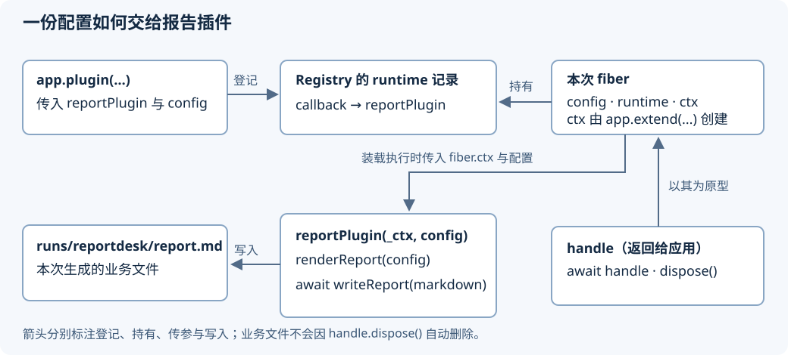

<!-- Generated from LearningTask.ipynb by scripts/render-lessons.py. -->

[运行此课 Notebook](LearningTask.ipynb) · [课程目录](../../README.md)

**Cordis 2004 · ReportDesk 的第一个报告插件**

[课程目录](../../README.md) · [环境与运行](../../SETUP.md)

# 本课导览

把文本报告函数接成插件，观察配置怎样进入业务回调并改变输出。

本课先给具体代码和预期行为，再沿本课固定版本的源码解释原因。读到所选路径即可，不要求通读整个内核。

本课延续前课的 ReportDesk，所有文件与依赖独立保存在当前目录。先在本课目录安装依赖，再按 00 → 01 执行 Notebook，或使用 `npm run demo` 运行完成参考。

建议按 2–3 小时安排首次阅读、运行与回看；可分多次完成。

# 源码与阅读导航

所有相对路径以本课目录为基准。只沿正文选段阅读，不要求通读整份文件。

| 资料 | 指定阅读范围与用途 | 停止点 |
|---|---|---|
| S1 · [应用入口](examples/01-reportdesk/main.ts) | 配置对象、`new Context()`、`app.plugin()` 和等待；认识输入与装配 | `finally` 结束 |
| S2 · [报告插件](app/report-plugin.ts) | `reportPlugin` 两个参数和生成、写入报告三行；认识业务职责 | 函数结束 |
| S3 · [插件登记](materials/cordis/src/registry.ts) | `resolve` 144–149 行、`plugin` 193–212 行；找到保存的函数与本次运行对象 | 返回 `wrapped` |
| S4 · [回调执行](materials/cordis/src/fiber.ts) | 构造参数 122–127、上下文 135、执行回调 146–163 行；正文给出触发桥接 | `runtime.callback(this.ctx, config)` |

S1、S2 为本课示例（2026-10-12）；S3、S4 固定于 Cordis `c261dd2c13d6`（2026-10-10，包版本 `4.0.0-rc.10`），访问日期均为 2026-10-12。初始来源与哈希见 [source-index.json](materials/source-index.json)。正文摘录加了中文注释，省略处明确说明；本地文件保留完整上游实现，允许添加自己的注释和打印。

教学运行只有 **01 · ReportDesk** 这一个案例：`examples/01-reportdesk/start.ts` 是建设起点，`main.ts` 是完成参考；`00` 是 Notebook 初始化，不是另一个练习。运行路径与资料入口保持相同，不依赖其他课程或宿主应用。

# 沿场景理解源码

先在本课目录执行 `npm ci` 和 `npm run check`。Notebook 使用 JavaScript（jslab），按 00 → 01 运行；终端使用 `npm run demo`，两者加载同一份本课源码。各阶段的观察说明紧邻代码。

运行生成的报告、状态快照和声明位于本课 `runs/`。重跑会替换同一用途的结果；需要比较时先另行保存。只修改本课文件即可，不依赖其他课程的安装目录。VS Code 请单独打开本课目录，再选择对应调试配置。

```javascript
// 00 · 初始化：定位本课运行器；可重复执行。
var path = require("node:path");
var fs = require("node:fs");
var taskName = "2004.Cordis-ReportDesk-First-Plugin";
var localRunner = path.basename(process.cwd()) === taskName
    ? path.resolve("shared/notebook.cjs")
    : null;
var repoRunner = path.resolve("2004.Cordis-ReportDesk-First-Plugin/shared/notebook.cjs");
var runnerPath = localRunner && fs.existsSync(localRunner) ? localRunner : repoRunner;
if (!fs.existsSync(runnerPath)) {
    throw new Error("请从仓库根目录或本课目录启动 JavaScript 内核。");
}
var reportdesk = require(runnerPath);
console.log("00：本课 ReportDesk 运行器已就绪，后续调用相同的 TypeScript 文件。");
```

## M1 · 运行并建设第一份报告

约 45 分钟。从一个已经能生成报告的小脚本开始，把它接入 Cordis。文本读取、格式化和文件写入已准备好；本段只修改装配入口。

### M1.1 输入、输出和建设起点

输入为 [fixtures/product.txt](fixtures/product.txt)；也可从编辑器文件树打开。若 HTML 预览中的文本链接被浏览器拦截，直接看下方完整输入即可：

> 这款便携台灯适合夜间阅读，支持三档亮度调节。
> 它采用可充电设计，适合放在书桌或床头。

`sampleConfig(false)` 读取这份文本，返回配置 `{ title, text, includeExcerpt: false }`。`renderReport(config)` 把它变成 Markdown 字符串；`writeReport(markdown)` 写入报告。它们都在 [shared/report.ts](shared/report.ts)，本课按这三个接口使用即可。

先打开 [建设起点 start.ts](examples/01-reportdesk/start.ts)。其中三行主体是“取得配置 → 生成字符串 → 等待文件写完”。运行下方单元，先确认这个业务结果是什么。

```javascript
// 01 · ReportDesk：运行建设起点；改完 start.ts 后仍运行这一格。
reportdesk.run("start");
```

预期报告标题为“便携台灯 · 内容报告”，正文显示 **41** 个 Unicode 码点：空格、换行不计，标点计入；这不是分词统计。此时没有“首段摘录”小节。控制台展示报告正文，也可打开 [实际报告](runs/reportdesk/report.md)。

起点里已经有业务功能。接下来改变的是谁负责调用它：把一次生成报告的操作交给 Cordis 登记与执行。

### M1.2 先认识要交给 Cordis 的函数

[app/report-plugin.ts](app/report-plugin.ts) 的业务主体如下（省略导入和日志）：

```typescript
export async function reportPlugin(_ctx: Context, config: ReportConfig): Promise<void> {
    const markdown = renderReport(config); // 用本次配置生成报告文本
    await writeReport(markdown);            // 写完文件，函数才完成
}
```

这个函数就是本课的插件。Cordis 会传入两个参数：`_ctx` 是给本次插件使用的上下文，`config` 是装配入口提供的配置。本例业务只需配置，因此用 `_ctx` 这个名字表示参数已接收、目前未使用。`ReportConfig` 是 TypeScript 对配置形状的声明，字段就是上一节的标题、文本与摘录选项。

函数返回 `Promise<void>`：异步工作完成，但不把报告字符串作为返回值。报告保存在文件中。插件的返回值由框架处理，所以此处保留 `await writeReport(...)`，让 Cordis 能等待写入结束。

### M1.3 把起点接到插件入口

在 `start.ts` 中保留 `const config = await sampleConfig(false)`，按以下三步改装配。该文件只属于本课，完成参考始终保留在 [main.ts](examples/01-reportdesk/main.ts)。

1. 将原来的导入改为下面三行（保留文件顶部的 `01` 注释）。

```typescript
import { Context } from "cordis";
import { reportPlugin } from "../../app/report-plugin.ts";
import { sampleConfig } from "../../shared/report.ts";
```

2. 用下面的装配片段替换直接调用 `renderReport`、`writeReport` 的两行。
3. 重跑上一格 `reportdesk.run("start")`，或在本课终端执行 `npm run demo:start`。

```typescript
const app = new Context();
const handle = app.plugin(reportPlugin, config);
try {
    await handle;
} finally {
    await handle.dispose();
}
```

`app` 是根 Context；`app.plugin` 接收函数本身，不要写成 `reportPlugin(...)` 提前调用。第二个参数提供本次配置。返回的 `handle` 是操作本次插件的句柄，支持等待和卸载：`await handle` 等待本次装载中的异步函数完成，`handle.dispose()` 结束本次插件的注册与运行。它不会自动删除业务写出的报告文件。

改装后报告内容应与起点相同，同时能看见“reportPlugin 收到 config.includeExcerpt = false”。业务功能仍由报告函数完成；Cordis 多负责了插件的登记、参数传递以及本次运行的等待与收束。现在只有一个插件，先把这个装配边界做清楚。

如果卡在入口编辑，可对照完成参考继续阅读；下面提供同一参考的直接运行入口，不要求两个入口重复完成一遍。

```javascript
// 01 · ReportDesk：完成参考，用于对照建设结果。
reportdesk.run("plugin", { includeExcerpt: false });
```

参考的输出顺序为：创建 `app` → 取得 `handle` → 插件收到 `false` → 打印报告 → `await handle` 完成 → 卸载。取得句柄早于报告写完；等待之后才可以依赖文件已生成。`main.ts` 的日志和参数适配只帮助观察，核心装配就是上面的几行。

## M2 · 给报告加上首段摘录

约 30 分钟。读报告的人有时只需长度，有时还需要迅速确认这份报告对应哪段内容；因此让报告按配置展示原文第一段。业务 helper 已支持这个选项，本段把它接入插件配置，不增加第二个插件。

### M2.1 用一个实际选项改变报告

`renderReport(config)` 中负责摘录的片段如下（其余格式化省略）：

```typescript
if (config.includeExcerpt) {
    lines.push("", "## 首段摘录", "", firstParagraph);
}
```

`firstParagraph` 是输入文本按空行分段后的第一段；`lines` 是待输出的报告各行。Cordis 负责把配置交给插件，是否展示摘录由业务代码决定。

Notebook 中直接将下方配置设为 `true`；如果沿用自己改好的 `start.ts`，把 `sampleConfig(false)` 改成 `sampleConfig(true)` 再运行即可。选一种入口操作，不必重复。

```javascript
// 01 · ReportDesk：需要让报告包含原文第一段。
reportdesk.run("plugin", { includeExcerpt: true });
```

这次 `config.includeExcerpt` 输出为 `true`，报告仍统计 41 个码点，下面新增“首段摘录”和“这款便携台灯适合夜间阅读，支持三档亮度调节。”。标题、输入和统计逻辑均未改变。

这里每次重跑都会创建新的 `app` 并登记一次插件。配置值决定这一次报告的内容；本例没有在一个已经运行的插件上修改配置。Notebook 参数由辅助代码合入输入配置，再交给相同的 `main.ts`；终端 `npm run demo:excerpt` 也运行这份入口。

停在这里即可：一份输入，一个报告插件，一个有实际用途的选项。其余时间可用于把参数与输出对照清楚，或记录疑问。

## M3 · 找到这一次插件的登记与执行

约 45 分钟。现在带着已经运行的 `app.plugin(reportPlugin, config)` 进入源码。只回答这次调用中“函数存在哪里、配置由谁保留、最终在哪里调用”。本段先给关键实现，再把对象关系归纳成图。

### M3.1 登记函数，创建本次运行对象

`app.plugin` 转发到 `RegistryService.plugin`。Registry 是应用中登记插件的服务；本次服务方法通过它的 `this.ctx` 取得发起调用的 `app` 上下文。这里先使用这个入口约定，不展开方法转发本身。

以下摘自 `registry.ts` 144–149、193–212 行，固定版本 `c261dd2c13d6`；省略校验、名称处理与其他插件形态，保留本例的数据流：

```typescript
const callback = this.resolve(plugin); // plugin 是传入的 reportPlugin
// resolve 对函数直接返回函数本身，所以 callback === reportPlugin。
let runtime = this._internal.get(callback);
if (!runtime) {
    // runtime 是这个插件函数的登记记录；fibers 保存它的各次运行。
    runtime = { name, callback, fibers: new DisposableList(), Config: plugin.Config };
    this._internal.set(callback, runtime); // Map 的 key 是函数，value 是记录
}
const fiber = new Fiber(this.ctx, config, Inject.resolve(plugin.inject), runtime, getOuterStack);
const wrapped = Object.create(fiber);
wrapped.then = (onFulfilled, onRejected) => {
    return fiber.await().then(onFulfilled, onRejected);
};
return wrapped; // 返回给应用，变量名就是 handle
```

本次是新应用里的首次登记，`runtime` 尚不存在，因此创建记录并保存 `reportPlugin`。其中 `name` 来自函数名称；`DisposableList` 在这里是保存运行对象并支持移除的列表；本例没给插件设置 `Config` 配置校验器。

随后创建 `fiber`，它代表**这一次**装载。构造参数依次是调用上下文、业务配置、依赖声明、插件登记记录和错误定位辅助。报告插件没有声明依赖，第三项解析为空对象；沿本例只追踪 `config` 与 `runtime` 即可。

最后的 `wrapped` 以 `fiber` 为原型，额外提供 `then`。因此 `handle` 不是业务报告，也不是原生 Promise；它是可被 `await` 等待的句柄，等待动作转交 `fiber.await()`，其余操作可从 `fiber` 找到。读到这里停止，不展开 Registry 的其他方法。

### M3.2 配置如何走进业务函数

先看 `fiber.ts` 构造器 122–135 行的两个位置，固定版本 `c261dd2c13d6`（省略其他构造参数和语句）：

```typescript
// 构造参数前加 public：接收参数，同时保存成对象字段。
constructor(public parent: Context, public config: any, /* 其他参数 */) {
    // ...本例进入有 runtime 的插件分支
    this.ctx = this.context = parent.extend({ fiber: this });
    // ...
}
```

入口配置保存为 `fiber.config`。`parent` 是上一节传入的 `app`；`extend({ fiber: this })` 创建本次插件的上下文视图，让回调里的上下文关联到这次运行。`ctx`、`context` 两个字段指向同一个视图。

接着看同一构造器的 146–163 行，Cordis 将稍后要做的工作保存在 `this._runner` 中；其中 `execute` 是执行函数。以下省略其余字段和类插件分支，保留本例路径：

```typescript
this._runner = {
    // ...其余字段
    execute: function (this: Fiber) {
        const config = this._resolve(this.config);
        // ...reportPlugin 是 async 函数，本例走普通函数分支
        return runtime.callback(this.ctx, config);
    },
    // ...
};
```

`_resolve` 是配置处理入口。本例没有校验器和额外配置处理，值原样交给回调；依据为本文件 `resolveConfig` 34–46 行及 `events.ts` 的默认配置处理。此处使用这个行为即可。

`runtime.callback` 就是上一节存入的 `reportPlugin`：第一实参 `this.ctx` 对应业务函数的 `_ctx`，第二实参 `config` 对应业务配置。`execute` 中的 `this` 是本次 `fiber`，由下面的调用处明确传入。业务函数使用显式参数，不依赖它自己的 `this`。

为了连接“保存函数”和“调用函数”，只看下面三个触发位置。表格是正常路径的选段索引，省略分支不连成一份假想函数，也不需要沿每个方法继续向下读。

| 位置 | 本例的关键语句 | 它连接什么 |
|---|---|---|
| 构造器，171–175 行 | `parent.fiber.effect(() => { … this._refresh() … })` | `effect` 登记时立即执行传入函数；本次运行加入记录，随后请求更新装载条件 |
| `_reload`，423–427 行 | `await Promise.resolve()` 后，条件未变化时 `await this._execute(this._runner)` | 首次条件满足后安排装载；经过一次异步调度再交给执行器。安排逻辑可定位 389–417 行，当前按此行为使用 |
| `_execute`，243 行 | `const effect = runner.execute.call(this)` | 真正调用保存的 `execute`，把本次 `fiber` 作为 `this`，由它调用报告插件 |

于是 `app.plugin` 先返回句柄，业务回调随后才运行。报告插件返回的 Promise 交回框架等待；它会等到文件写完。`await handle` 的实现可定位 470–475 行：等待当前装载结束，有错误则抛出；本课只依赖这一接口行为。源码深读到 **回调收到上下文和配置** 为止，不把完整异步调度与清理流程加进本段。

### M3.3 把已经见过的对象连起来

下图只归纳前两节已经出现的实体。实线表示登记、持有或传参，文字标注关系；不是把所有箭头都当作同步调用栈。



回看 M2：入口配置里 `includeExcerpt: true`，由本次 `fiber` 保存，再作为第二个实参交给 `reportPlugin`，最终影响 `renderReport` 的输出分支。框架处理插件的组织与运行，报告内容仍由业务函数决定。

### M3.4 用断点看见配置交接

断点只用于看见上面的参数交接。已经沿代码理解清楚时可直接在自由笔记停下，不要求另交调试证据。

1. VS Code 打开本课目录或仓库根目录；在“运行和调试”选择 **Cordis 2004 · 01 · ReportDesk**。该配置运行 `main.ts` 并打开摘录选项。
2. 打开本课 `materials/cordis/src/fiber.ts`，在 **159 行** `return runtime.callback(this.ctx, config)` 设置断点，启动调试（F5）。
3. 停住后查看局部变量 `config.includeExcerpt`，应为 `true`；`runtime.callback` 应为 `reportPlugin`。此时 `this` 是本次 `Fiber`，`this.ctx` 是传给插件的上下文。
4. 在这一行执行“单步调试／Step Into”（F11），进入本课 `app/report-plugin.ts`，看第二参数 `config`；继续运行后，终端会显示带首段摘录的报告和等待、卸载日志。

若断点空心未命中，先核对打开的是 **2004 的** `fiber.ts` 及所选配置，再执行 npm ci 后重试。每次重跑加载当前本课源码；不用修改旧课或安装全局 Cordis。这里止于看到配置进入业务函数，不要求继续跟踪所有调度内部。

# 本课收束

插件是交给框架调用的入口。配置通过 Runtime/Fiber 的装载路径进入回调，业务在回调里生成并保存报告。取得句柄不等于异步业务已完成；本例通过 await 等待，再释放插件。
