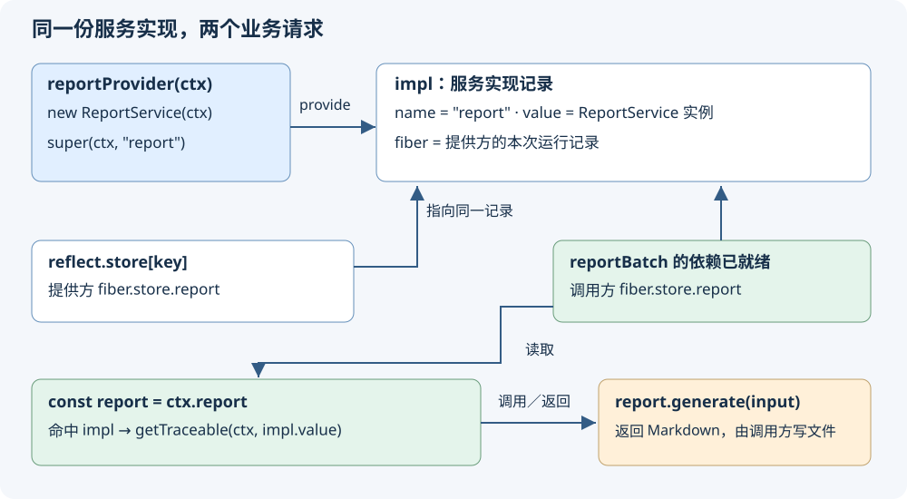

<!-- Generated from LearningTask.ipynb by scripts/render-lessons.py. -->

[运行此课 Notebook](LearningTask.ipynb) · [课程目录](../../README.md)

**Cordis 2005 · 可复用的报告服务**

[课程目录](../../README.md) · [环境与运行](../../SETUP.md)

# 本课导览

把报告能力登记为服务，让声明依赖的调用方连续处理两份输入。

本课先给具体代码和预期行为，再沿本课固定版本的源码解释原因。读到所选路径即可，不要求通读整个内核。

本课延续前课的 ReportDesk，所有文件与依赖独立保存在当前目录。先在本课目录安装依赖，再按 00 → 01 执行 Notebook，或使用 `npm run demo` 运行完成参考。

建议按 2–3 小时安排首次阅读、运行与回看；可分多次完成。

# 源码与阅读导航

资料均已放在本课；Cordis 固定为 **4.0.0-rc.10 / c261dd2c13d6**，与 2004 选用同一上游基线，但有独立的文件、依赖与运行目录。

| 阅读位置 | 类型、入口与停止点 | 用途 |
|---|---|---|
| M1–M2 | 教学应用：[report-service.ts](app/report-service.ts)、[report-batch.ts](app/report-batch.ts)、[main.ts](examples/01-reportdesk/main.ts)；只读本课展示的创建、声明和调用 | 看懂如何把现有业务能力接到框架上 |
| M3.1 | 上游 [service.ts](materials/cordis/src/service.ts)，constructor 18–34 行；普通对象路径到 provide 返回 | 找到实际登记动作 |
| M3.2 | 上游 [reflect.ts](materials/cordis/src/reflect.ts)，provide 177–195 行的写入片段 | 认识登记后保存的记录 |
| M3.3 | 同文件 handler.get，重点 84–86 行的命中分支；正文恢复入口及参数，到返回可用服务即停 | 将 `ctx.report` 接到已有记录 |

正文摘录固定于上述提交，添加教学注释、调整缩进，并明确省略。文件中允许直接加打印或注释；来源清单记录初始版本，不会自动恢复或覆盖你的修改。类型声明生成、输入准备和文件写入已由课程提供。

源码摘录在 Markdown 中阅读；下面的 Code cell 才是运行入口。

原始来源与哈希见 [source-index.json](materials/source-index.json)。源码摘录用于阅读，Code cell 用于运行。

# 沿场景理解源码

先在本课目录执行 `npm ci` 和 `npm run check`。Notebook 使用 JavaScript（jslab），按 00 → 01 运行；终端使用 `npm run demo`，两者加载同一份本课源码。各阶段的观察说明紧邻代码。

运行生成的报告、状态快照和声明位于本课 `runs/`。重跑会替换同一用途的结果；需要比较时先另行保存。只修改本课文件即可，不依赖其他课程的安装目录。VS Code 请单独打开本课目录，再选择对应调试配置。

## M1 · 恢复报告场景，封装能力

**40 分钟。** 先看这次要处理什么，再认识服务本身。上课的报告规则沿用：统计不含空白、包含标点的 Unicode 码点数，可加入首段摘录。

### M1.1 两份输入与建设起点

台灯文本沿用上一课，水杯文本是第二次调用的数据：

**台灯（`lamp`）**：

```text
这款便携台灯适合夜间阅读，支持三档亮度调节。

它采用可充电设计，适合放在书桌或床头。
```

**水杯（`bottle`）**：

```text
这款旅行水杯容量为500毫升。

杯盖支持单手开启，便于通勤携带。
```

预期分别为 **41** 和 **31** 个码点。这里统计字符，数字 `500` 按三个码点计入，不是在统计中文词数。

实际文件为 [lamp.txt](fixtures/lamp.txt) 与 [bottle.txt](fixtures/bottle.txt)。下面先用原来的业务函数处理两份输入，确认业务结果；M2 将保留结果，改变调用能力的方式。

先执行一次 `00`。可从仓库根或本课目录启动内核；辅助入口会让子进程以本课为 cwd。它每次启动新的 Node 进程，你改动的本课 TypeScript 源码会在重跑时生效。

```javascript
// 00 · 初始化 ReportDesk 本课入口。先执行本单元，再运行 01。
var path = require("node:path");
var fs = require("node:fs");
var taskName = "2005.Cordis-ReportDesk-Reusable-Service";
var taskRoot = path.basename(process.cwd()) === taskName ? process.cwd() : path.resolve(taskName);
var runnerPath = path.join(taskRoot, "shared/notebook.cjs");
if (!fs.existsSync(runnerPath)) {
    throw new Error("请从仓库根目录或本课目录启动 JavaScript 内核。");
}
delete require.cache[require.resolve(runnerPath)];
var reportdesk = require(runnerPath);
console.log("00 · 本课运行入口已加载；01 将使用本课目录作为 cwd。");
```

准备好后执行建设起点。对应 [start.ts](examples/01-reportdesk/start.ts)：`jobs` 是两份报告输入，循环对每份调用 `renderReport(job.input)`，再按 `job.id` 写到不同文件。这里没有需要重学的业务算法。

```javascript
// 01 · ReportDesk 建设起点：直接调用已有报告函数。
reportdesk.run("start");
```

观察 `job.id` 与输出文件的一一对应：`lamp → lamp.md`、`bottle → bottle.md`。两份报告有各自的标题、码点数和首段摘录。这里两次调用共享的是同一个业务函数；接下来把它放进可供插件使用的服务。

### M1.2 把报告能力放进 ReportService

业务函数在 [shared/report.ts](shared/report.ts)。本课将它封装为 `generate(input)` 方法：`input` 仍有 `title`、`text`、`includeExcerpt`，返回值仍是 Markdown 字符串。调用者负责选择输入和保存结果，服务负责生成内容。

下面摘自 [app/report-service.ts](app/report-service.ts)，供阅读；完整可运行版本由 M2 的 Code cell 装配。

```typescript
// 01 · 报告服务；省略导入与类型声明，保留构造和业务方法。
export class ReportService extends Service {
    constructor(ctx: Context) {
        super(ctx, "report"); // 用提供方的 ctx，把当前服务登记为 report。
    }

    generate(input: ReportInput): string {
        return renderReport(input); // 复用上课的业务规则，返回报告正文。
    }
}

export function reportProvider(ctx: Context): void {
    const service = new ReportService(ctx); // 提供方运行一次，创建这份服务。
    console.log(`reportProvider：已创建并登记 service.name = ${service.name}`);
}
```

`ReportService` 是业务服务类；`Service` 是 Cordis 提供的基类。`super(ctx, "report")` 执行基类构造器，同时完成登记。`reportProvider` 仍是上一课熟悉的函数插件：框架调用它时传入本次插件的 `ctx`。它创建服务并返回；此时还没有处理任何产品文本。

文件顶部还有这段类型声明：

```typescript
// 仅补充 TypeScript 对 Context 的认识。
declare module "cordis" {
    interface Context {
        report: ReportService;
    }
}
```

它让编辑器知道 `ctx.report.generate(...)` 的方法和参数类型，编译后不会创建对象。运行时登记来自刚才的 `new ReportService(ctx)` / `super(...)`。服务名 `"report"` 与声明的属性名 `report` 对应，但二者承担的工作不同。

## M2 · 装配提供方与调用方

**45 分钟。** 现在让另一个插件使用服务。这里只保留一个调用方，它处理两份输入；这样可以观察能力重复使用，又不需要增加新的业务角色。

### M2.1 调用方先声明需要 report

[app/report-batch.ts](app/report-batch.ts) 导出一个插件对象。与上一课直接传函数不同，这种对象将插件主体放在 `apply` 方法里，还能在 `inject` 列出需要的服务名。

```typescript
// 01 · 摘自 report-batch.ts；省略导入与打印。
export const reportBatch = {
    name: "report-batch",            // 插件自身的名称。
    inject: ["report"],              // 它需要名为 report 的服务。
    async apply(ctx: Context, config: { jobs: ReportJob[] }): Promise<void> {
        const report = ctx.report;   // 取得本次运行可用的报告能力。
        for (const job of config.jobs) {
            const markdown = report.generate(job.input);
            await writeReport(job.id, markdown);
        }
    },
};
```

这里 `config.jobs` 来自主入口传入的两份输入。`reportBatch` 不直接导入 `ReportService` 或 `renderReport`，它依赖的是 Context 上的 `report` 能力。提供方负责装配实现，调用方负责提出业务请求，二者通过服务名连接。

`inject: ["report"]` 是运行时依赖声明。它让框架在该依赖可用时运行插件，并让插件能够通过自己的 `ctx` 读取服务。只写 TypeScript 声明不会建立这种运行关系。反过来，`inject` 本身也不会创建 ReportService；提供方必须真的登记它。

本例采用明确顺序：先装载并等待提供方完成，再装载调用方。进入 `apply` 时，`report` 已可用。我们先使用这条接口行为；本段的停止点就是一次成功的读取和两次调用。

### M2.2 把起点改为服务装配

打开可编辑的 [start.ts](examples/01-reportdesk/start.ts)。现有 `jobsFromArgs()`、`prepareReports()` 保留，它们准备输入和输出目录。按下面三个动作接上框架：

1. 从 `cordis` 导入 `Context`，从本课 `app/report-service.ts`、`app/report-batch.ts` 导入 `reportProvider`、`reportBatch`。
2. 删除直接调用 `renderReport` 的循环，在 `prepareReports()` 之后创建 `app`，先装载提供方并等待，再把 `{ jobs }` 传给调用方。
3. 沿用上一课的 `finally` 清理方式，先卸载调用方，再卸载提供方。清理用于结束这次案例，报告文件会留下。

下面是 [main.ts](examples/01-reportdesk/main.ts) 中对应的装配摘录；完整导入和清理已在该文件中提供。可以边改起点边对照参考，也可以直接运行参考理解关系。

```typescript
// 01 · 装配的主路径摘录；省略输入准备和 finally 清理。
const app = new Context();
const provider = app.plugin(reportProvider);
await provider; // 本例提供方同步创建服务；这里等待其本次装载完成。
const batch = app.plugin(reportBatch, { jobs });
await batch;    // 本例调用方处理两份输入，并等待文件写完。
```

`provider` 与 `batch` 是两次插件装载各自的操作句柄，不是报告服务。真正提供 `generate` 的对象由 `new ReportService(ctx)` 创建，经 `ctx.report` 交给调用方。

修改起点后，用前面的 `reportdesk.run("start")` 重跑它。下面单元运行完成参考，方便你核对；两种入口会更新同一个 `runs/reportdesk/`，所以不会积累额外副本。

```javascript
// 01 · ReportDesk 完成参考：一个报告服务连续处理两份输入。
reportdesk.run("service", { includeExcerpt: true });
```

输出先出现一次 `reportProvider：已创建并登记 service.name = report`，再出现调用方取得 `report.name = report`。后面的 `report.generate(job.input)` 分别对应 lamp 与 bottle；结果仍为 41 和 31 个码点。

这说明本次流程创建一次报告服务，然后用它的方法完成两个业务请求。框架不会因为调用 `generate` 就重新装载一次插件。本例没有依赖对象的 `===` 比较来推断复用；M3 将直接看服务实现记录。

若日志没有进入调用方，先核对 `super(ctx, "report")`、`inject: ["report"]` 与 `ctx.report` 的名称一致，并确认提供方先完成。本课参考不会故意撤掉服务，也不要求额外制造故障。

### M2.3 在 VS Code 中运行与定位

打开仓库根目录或本课目录都有对应调试配置：[本课 launch.json](.vscode/launch.json)。配置名称为 `Cordis 2005 · 01 · 报告服务`，程序是本课 `main.ts`，cwd 是本课目录，Node 通过 `--import tsx` 直接加载本课 TypeScript。

适合观察的两处是 [report-service.ts](app/report-service.ts) 的 `super(ctx, "report")` 与 [report-batch.ts](app/report-batch.ts) 的 `const report = ctx.report`：前一处提供服务，后一处取用服务。M3 的相邻源码提供了继续定位的停止点，不需要单步走完所有初始化。

在 VS Code 左侧打开 **Run and Debug**，顶部配置下拉框选择 `Cordis 2005 · 01 · 报告服务`。在 `report-service.ts` 的 `super(ctx, "report")` 行按 **F9** 设置断点，点击 **Start Debugging (F5)**；暂停后点 **Step Into (F11)**，可进入本课 `materials/cordis/src/service.ts`。调试器可能先停在字段初始化，再进入构造器语句；这是同一个对象的构造过程。点击 **Continue (F5)** 完成两份报告，调试结束后可按 F9 移除刚才的断点。

上述配置选择、F5 启动、断点命中和 F11 进入本课源码已在当前 VS Code 图形界面实测；终端也显示 41/31 个码点与两份输出文件。普通运行可在本课终端使用 `npm run demo`，Notebook 执行与页面检查另行记录，不与 GUI 调试混写。

## M3 · 沿服务名追到实现

**40 分钟。** 回到刚运行的两处代码：`super(ctx, "report")` 为什么让服务可用？调用方的 `ctx.report` 又从哪里找到它？本段用同一个服务记录连接两者。

### M3.1 Service 构造器把自己交给登记入口

调用从 `reportProvider(ctx)` 中的 `new ReportService(ctx)` 开始。子类构造器调用 `super(ctx, "report")`，于是进入 [service.ts:18–34](materials/cordis/src/service.ts)。这里 `ctx` 是提供方插件上下文，`name` 是字符串 `"report"`，`this` 是正在构造的 ReportService 对象。

```typescript
// 固定源码的非连续摘录；本例沿普通服务对象路径，省略其他形式的构造及元数据设置。
constructor(protected ctx: Context, name: string) {
    let self = this;
    self.ctx = ctx;
    self.name = name;
    self.ctx.reflect.provide(name, self, this[symbols.check]);
    return self;
}
```

`ctx.reflect` 是框架提供的服务登记与读取入口。本次调用把 `"report"` 与实际对象 `self` 一起交给 `provide`。第三个参数是可选的可用性检查，本例没有定义，所以为 `undefined`。我们看到的关键动作是登记一个**已经创建的对象**，不是把类名存起来等待每次调用时再构造。

本例 `self` 就是 ReportService 实例；构造完成后回到 `reportProvider`，随后提供方装载完成。到这一步，尚未调用 `generate`。停止于第 34 行，不要求通读整份 Service 文件。

### M3.2 provide 保存什么

进入 [reflect.ts 的 provide](materials/cordis/src/reflect.ts)（177–195 行）。本次调用中 `this.ctx` 是提供方的 `ctx`，`name = "report"`，`value` 是上一段的 `self`。

`effect` 是本次插件的资源登记入口：它立即执行这里的回调，并接管回调返回的清理函数。我们先看它里面的写入；原文件后面的通知和清理仍然存在，但不影响本段要认识的数据形态。

```typescript
// provide 的非连续摘录；保留 effect 回调的调用位置与写入。
provide(name: string, value?: any, check?: () => boolean) {
    return this.ctx.fiber.effect(() => {
        // 省略已有名字检查。
        this.props[name] = { type: 'service' };
        this.ctx.root[symbols.isolate][name] ??= Symbol(name);
        const key = this.ctx[symbols.isolate][name];
        const impl: Impl = { name, value, fiber: this.ctx.fiber, check };
        this.store[key] = impl;
        this.ctx.fiber.store![name] = impl;
        // 后面通知依赖方并返回清理函数；此处省略，不能用摘录替换原实现。
    }, `ctx.provide(${JSON.stringify(name)})`);
}
```

回调是箭头函数，所以里面的 `this` 沿用这次 `provide` 的接收者；`name`、`value` 来自刚才的调用参数。`effect` 的第二个参数是登记用途的文字标签，不是服务名的另一个来源。

`symbols.isolate` 在这里标识 Context 上的一张名字表；公开的 `Context.isolate` 与它是同一个 Symbol（[context.ts:24](materials/cordis/src/context.ts) 的静态字段）。本例没有改变默认名字范围，因此 `"report"` 对应根上下文保存的那个 Symbol。它是实现表的键，`Symbol("report")` 的显示名称不是新的服务对象。

| 位置 | 本例保存的值 | 职责 |
|---|---|---|
| `props.report` | `{ type: "service" }` | 标明 report 是服务属性 |
| `ctx[Context.isolate].report` | 本次创建的 Symbol 键 | 从字符串名称连接到实现表 |
| `reflect.store[key]` | `impl` | 保存这份服务的实现记录 |
| `impl.value` | ReportService 实例 | 实际提供 generate 的对象 |
| `impl.fiber` | 提供方本次运行的 Fiber | 记录这份服务由谁提供 |
| 提供方的 `ctx.fiber.store.report` | 同一个 `impl` | 记录该运行已经提供的服务 |

`store!` 的感叹号是 TypeScript 的非空断言，运行时仍是这张表。`Impl` 是记录的类型，`impl` 才是这一次创建的对象。`props.report` 和 `impl.value` 也不同：前者只有属性种类，后者才有业务方法。读到两张 store 写入即停。

### M3.3 调用方的 ctx.report 怎样命中记录

先恢复读取现场：`reportBatch.apply(ctx, { jobs })` 已经开始执行，紧接着运行 `const report = ctx.report`。这里的 `ctx` 属于调用方，不是提供方。`inject: ["report"]` 使框架在依赖准备好后，为调用方保存本次可用的服务记录；进入 `apply` 时，调用方的 `ctx.fiber.store.report` 指向 report 的那份 `impl`。本段从这个已经满足的前提继续跟读取，不展开准备过程。

属性读取会进入 Context 的代理入口。它最初在 [context.ts](materials/cordis/src/context.ts) 构造器第 39 行登记：

```typescript
const self = new Proxy<this>(this, ReflectService.handler);
```

因此 `ctx.report` 的读取会交给 `ReflectService.handler.get`。本例的属性名参数 `prop` 为 `"report"`，读取接收者是调用方 `ctx`；代码定位到它的 Fiber 后，在 [reflect.ts:84–86](materials/cordis/src/reflect.ts) 命中：

```typescript
// 摘自 handler.get 的查找循环内部；本例 fiber 是调用方的 ctx.fiber，第一次即命中。
const impl = fiber.store?.[prop];
if (impl) return getTraceable(ctx, impl.value);
```

它先取得同一份实现记录，再把其中的业务对象交给 `getTraceable(ctx, ...)`。这个函数返回与当前访问上下文关联的服务访问对象；通过它调用 `generate`，最终仍执行已登记 ReportService 的方法。它不是这里新建第二个 ReportService，也不能据此假设取得的访问对象与原对象一定 `===`。

本课 `generate` 只用传入的 `input`，返回 `renderReport(input)`；调用方拿到字符串后写文件。理解到“取出哪份实现，调用哪个业务方法，返回什么”即可停止，当前访问对象内部如何绑定上下文不作为本课阅读任务。

| 时刻 | 谁持有记录 | `impl.value` 是否换了一份报告服务 |
|---|---|---|
| 提供方登记完成 | `reflect.store[key]` 与提供方的 `fiber.store.report` | 否，指向刚创建的实例 |
| 调用方依赖就绪、进入 apply | 调用方的 `fiber.store.report` 也持有该实现记录 | 否 |
| 先调用 lamp、再调用 bottle | 局部变量 `report` 提供同一能力的访问入口 | 否；变化的是方法参数与报告字符串 |

这也解释了为何主入口只装载一次提供方，而可以完成两次业务调用。

### M3.4 把两条路径放回同一张图

前面已经见过图中各个实体。箭头分别表示“写入／引用记录”和“调用／返回业务结果”，不是执行时间相等的表示。



对照自己的阅读位置即可：`reportProvider` 创建对象，`provide` 写入实现记录，调用方依赖就绪后通过 `ctx.report` 取用，`generate(input)` 为两份输入返回各自的 Markdown。本图只归纳本例已经解释的登记与读取。

# 本课收束

提供方在插件中创建 ReportService；Service 构造器登记实现；调用方先声明 report 依赖，再通过 ctx.report 使用服务。类型声明扩充和运行时服务登记分别解决编译与执行的问题。
