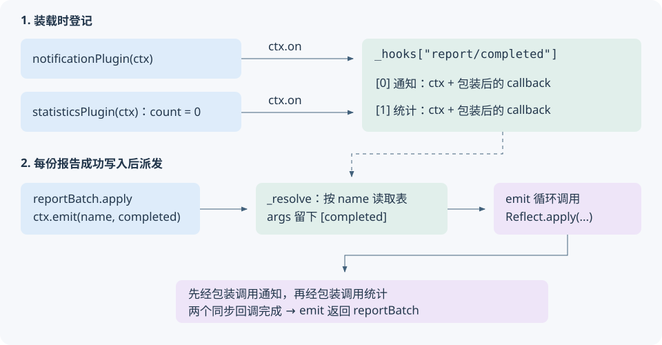

<!-- Generated from LearningTask.ipynb by scripts/render-lessons.py. -->

[运行此课 Notebook](LearningTask.ipynb) · [课程目录](../../README.md)

**Cordis 2006 · 事件、通知与统计**

[课程目录](../../README.md) · [环境与运行](../../SETUP.md)

# 本课导览

报告写入后发出完成事件，由通知与统计两个插件分别响应。

本课先给具体代码和预期行为，再沿本课固定版本的源码解释原因。读到所选路径即可，不要求通读整个内核。

本课延续前课的 ReportDesk，所有文件与依赖独立保存在当前目录。先在本课目录安装依赖，再按 00 → 01 执行 Notebook，或使用 `npm run demo` 运行完成参考。

建议按 2–3 小时安排首次阅读、运行与回看；可分多次完成。

# 源码与阅读导航

本课使用独立可编辑的 **Cordis 4.0.0-rc.10 / c261dd2c13d6**，上游提交日期为 2026-10-10 UTC，资料访问日期为 2026-10-13。应用从 2005 已确认的服务版演进；内核按来源哈希核对后物理复制，不继承前课调试修改。

| 位置 | 材料类型、阅读入口与停止点 | 用途 |
|---|---|---|
| M1 | 本地应用：[report-batch.ts](app/report-batch.ts) 的 `apply`、[事件声明](app/report-events.ts)；到 `emit` 返回 | 明确生产者、完成信息和发出时机 |
| M2 | 本地应用：[通知插件](app/notification-plugin.ts)、[统计插件](app/statistics-plugin.ts)、[main.ts](examples/01-reportdesk/main.ts)；到两个观察者响应 | 带着补齐可编辑起点 |
| M3.1–M3.2 | 固定源码：[events.ts](materials/cordis/src/events.ts) 的 `Hook` / `_hooks`（40–46 行）、`on` / `register`（138–145、158–171 行） | 解释登记动作与记录形态 |
| M3.3 | 同文件 `_resolve`（76–85 行）与 `emit`（100–103 行）；到两个回调返回 | 解释名称查找、参数去向和同步调用 |

相关的根装配、方法转发与监听包装只在 M3 给出短连接，完整内部实现不作为本课必读。上游[事件测试](materials/cordis/events.spec.ts)的 `ctx.on()` / `ctx.emit()` 为作者核对材料；正文精选两次派发断言供回看，不要求通读测试。

来源链接与初始哈希见 [source-index.json](materials/source-index.json)，版本与研究范围见[资料说明](materials/README.md)。源码摘录标明省略或改写，统一为 4 空格缩进；执行单元调用下面的独立文件。

# 沿场景理解源码

先在本课目录执行 `npm ci` 和 `npm run check`。Notebook 使用 JavaScript（jslab），按 00 → 01 运行；终端使用 `npm run demo`，两者加载同一份本课源码。各阶段的观察说明紧邻代码。

运行生成的报告、状态快照和声明位于本课 `runs/`。重跑会替换同一用途的结果；需要比较时先另行保存。只修改本课文件即可，不依赖其他课程的安装目录。VS Code 请单独打开本课目录，再选择对应调试配置。

## M1 · 从报告完成引出事件

**30 分钟。** 先把“完成”定义清楚，再看生产者和观察者需要共享什么信息。

### M1.1 恢复两份输入与服务调用

仍使用台灯和水杯两份产品文本。文件读取、报告规则、文件写入已准备好；正文长度不含空白、计入标点，分别是 41 和 31 个 Unicode 码点。输入包含 `title`、`text`、`includeExcerpt`，报告 ID 分别为 `lamp`、`bottle`。

上一课的 [ReportService](app/report-service.ts) 仍由 `reportProvider` 创建并登记为 `report`；下面先摘录这个已建立的接口，不重读登记内部：

```ts
// app/report-service.ts，省略导入、类型扩充和提供方日志。
export class ReportService extends Service {
    constructor(ctx: Context) {
        super(ctx, "report");
    }
    generate(input: ReportInput): string {
        return renderReport(input); // 仍返回 Markdown 字符串
    }
}
```

`reportBatch` 是使用这项能力的对象插件，声明 `inject: ["report"]`；装载后框架调用其 `apply(ctx, { jobs })`。`jobs` 由入口读取本课两份输入生成，`ctx` 是框架交给这个插件的 Context。这里先记住输入来源，下一小节直接看这次调用体。

先执行一次 00 初始化。所有后续运行单元复用 `reportdesk`；重启内核后重新执行本单元即可。

```javascript
// 00 · ReportDesk：载入本课运行入口；Notebook 从仓库根或本课目录均可初始化。
var path = require("node:path");
var fs = require("node:fs");
var taskName = "2006.Cordis-ReportDesk-Events-and-Observers";
var taskRoot = path.basename(process.cwd()) === taskName ? process.cwd() : path.join(process.cwd(), taskName);
if (!fs.existsSync(path.join(taskRoot, "shared/notebook.cjs"))) {
    throw new Error("请从仓库根或本课目录启动 Notebook。");
}
var helperPath = require.resolve(path.join(taskRoot, "shared/notebook.cjs"));
delete require.cache[helperPath];
var reportdesk = require(helperPath);
console.log("运行 cwd：" + taskRoot + "；00 初始化完成，后续执行本课 01 案例。");
```

### M1.2 生产者：报告写入之后发出完成事件

如果让 `reportBatch` 直接导入通知函数和计数函数，每增加一种完成后行为，就需要修改调用方。这里改为：调用方公布“这份报告完成了”，由已经装载的插件决定如何响应。

下面摘自 [report-batch.ts](app/report-batch.ts)，省略日志。`ReportCompleted` 的完整定义在下一段；此处先看它的两个实际值。

```ts
export const reportBatch = {
    name: "report-batch",
    inject: ["report"],
    async apply(ctx: Context, config: { jobs: ReportJob[] }): Promise<void> {
        const report = ctx.report;
        for (const job of config.jobs) {
            const markdown = report.generate(job.input);
            await writeReport(job.id, markdown);
            const completed: ReportCompleted = { id: job.id, title: job.input.title };
            ctx.emit("report/completed", completed);
        }
    },
};
```

本课规定 `report/completed` 表示**本次报告已经生成且成功写入本地文件**。所以它在 `await writeReport(...)` 之后；写入抛错就不会执行该次 `emit`。文件写入仍是已准备的业务辅助函数，`ReportService.generate` 本身只生成字符串。

第一次发出的参数为 `{ id: "lamp", title: "便携台灯 · 内容报告" }`；第二次为水杯信息。事件名是约定的字符串，参数 `completed` 是本次创建的普通对象。报告正文不需要传给只负责提示和计数的观察者。

[report-events.ts](app/report-events.ts) 约定参数形状：

```ts
export interface ReportCompleted {
    id: string;
    title: string;
}

declare module "cordis" {
    interface Events {
        "report/completed"(report: ReportCompleted): void;
    }
}
```

与上一课扩充 `Context.report` 一样，这里只是让 TypeScript 检查事件名及参数类型，**没有登记运行时监听**。`emit` 发出事件，下一段的 `on` 才负责登记谁来响应。

### M1.3 先运行尚未补监听的起点

[起点 start.ts](examples/01-reportdesk/start.ts) 已装配报告服务、两个尚未填写监听的函数插件和批处理调用方。你将修改的 [observers.ts](examples/01-reportdesk/observers.ts) 中，两处函数体只有注释；先原样运行一次，恢复当前应用行为。

```javascript
// 01 · ReportDesk：建设起点，先确认报告生成与事件发出的位置。
reportdesk.run("start");
```

观察两份报告之后的 `ctx.emit：name = report/completed` 与 `ctx.emit 已返回`。此时没有“通知”和“统计”输出，因为两个起点插件尚未登记回调。没有监听者也能完成报告；事件不会保存下来等将来的监听者读取。

如果你已经补过起点，出现通知和统计属于正常结果，无须清空自己的代码。

## M2 · 接上通知与统计插件

**40 分钟。** 本段把需求落实为两个独立的函数插件。它们接收同一个完成信息，分别执行自己的行为。

### M2.1 通知插件：登记回调，等待完成事件

在 [observers.ts](examples/01-reportdesk/observers.ts) 的 `notificationPlugin` 函数体中补上下面的 `ctx.on(...)`。导入已准备；对照文件为 [notification-plugin.ts](app/notification-plugin.ts)。这是待编辑文件的源码摘录，运行用后面的 Code cell。

```ts
export function notificationPlugin(ctx: Context): void {
    ctx.on("report/completed", (report: ReportCompleted) => {
        console.log(`通知：report.id = ${report.id}，report.title = ${report.title}（已生成并写入）`);
    });
}
```

插件函数被装载时执行 `on`，把箭头函数登记为监听回调；这一步不会打印通知。之后 `emit("report/completed", completed)` 触发它，回调的参数 `report` 来自那次发出的 `completed`，与报告服务变量恰好同名，但这里代表完成信息，类型是 `ReportCompleted`。

`ctx` 来自通知插件自己的装载调用；回调本身不读取 `this`。`on` 返回一个移除监听的函数，本例不手动使用它，监听随插件由框架管理。

### M2.2 统计插件：让两次事件共用一个计数变量

继续在起点的 `statisticsPlugin` 中声明 `count` 并登记回调。完整参考位于 [statistics-plugin.ts](app/statistics-plugin.ts)。

```ts
export function statisticsPlugin(ctx: Context): void {
    let count = 0;
    ctx.on("report/completed", (report: ReportCompleted) => {
        count += 1;
        console.log(`统计：count = ${count}（本次装载以来的完成事件数），report.id = ${report.id}`);
    });
}
```

`count` 在插件装载时创建一次，回调通过闭包访问它，所以本次运行内两次完成事件得到 1、2。不要把 `let count = 0` 放进回调；那样每次触发都会重新初始化。

这个数统计的是该次插件装载后收到的完成事件次数；本课每份报告只发一次，所以与完成报告数一致。它不表示报告去重数或磁盘历史总量。每次 Notebook 调用启动新进程，因此下次运行又从 0 开始。

通知与统计都只依赖完成事件的参数，不需要 `inject: ["report"]`，也不用互相导入。报告调用方仍只导入事件类型和文件写入辅助函数。

### M2.3 装配顺序、运行与结果

起点和参考使用相同装配顺序，只是导入的观察插件分别来自起点文件和完整参考文件。下面是 [main.ts](examples/01-reportdesk/main.ts) 的非连续摘录，省略输入准备与 finally 清理；`jobs` 来自 M1 的两份输入，`app` 是本次应用的根 Context。

```ts
const app = new Context();
const provider = app.plugin(reportProvider);
const notification = app.plugin(notificationPlugin);
const statistics = app.plugin(statisticsPlugin);

await provider;
await notification;
await statistics;
const batch = app.plugin(reportBatch, { jobs });
await batch;
```

三个 `app.plugin(...)` 开始装载，依次 `await` 确认它们已经就绪，再开始批处理。通知与统计的监听先存在，报告发出完成事件时才有人响应；装载期间仅登记回调，并不提前处理报告。完整入口的 `finally` 负责结束时清理，运行一次即退出。

补完两个函数后，用下面的起点入口观察自己的实现。没有必要同时改报告规则或额外增加第三种插件。

```javascript
// 01 · ReportDesk：运行已编辑的两个观察插件。
reportdesk.run("start");
```

单份报告的关键顺序应为：报告正文 → 发出完成事件 → 通知 → 统计 → `ctx.emit 已返回`。台灯的 `count` 是 1，水杯是 2。本课两个回调都是同步代码，因此它们运行结束后 `emit` 才返回。

如果报告生成了却没有通知，先看起点是否写在 `examples/01-reportdesk/observers.ts`，再检查监听和发出的字符串是否同为 `report/completed`。两次都显示 1 时检查 `count` 的定义位置。无需重新安装依赖。

需要对照或暂时跳过编辑时，运行下面的完整参考。它导入 `app/` 中的两个插件，不会覆盖你在起点中的修改。

```javascript
// 01 · ReportDesk：完整参考；参数会显示在执行命令中。
reportdesk.run("events", { includeExcerpt: true });
```

完整参考中两份报告仍为 41/31 个码点，并各有一次通知，统计从 1 增至 2。`includeExcerpt` 控制报告是否有首段摘录，与事件登记无关。

**VS Code 阅读入口。** 在仓库根打开“运行和调试”，选择 `Cordis 2006 · 01 · 事件、通知与统计`；打开本课 [report-batch.ts](app/report-batch.ts)，在 `ctx.emit("report/completed", completed)` 行设置断点，启动调试。停下时查看 `completed`，随后进入事件派发。若单步先落在方法包装处，可直接在本课 `events.ts` 的 `emit` 循环处设置断点，继续到该处，再进入监听回调。若以本课目录为工作区，同名配置使用同一入口。起点另有 `Cordis 2006 · 01 · 建设起点` 配置。界面验证范围在交付审查记录中单独说明。

**本轮界面核验边界（2026-10-13）：** 已在 VS Code 选择本课配置、给 report-batch.ts:17 添加断点并启动；随后原生界面连接返回 `cgWindowNotFound`，重新绑定同样失败，因此本轮未确认停断点、变量查看和单步。CLI 与独立 jslab 运行已通过，不能替代图形调试验收。

## M3 · 从监听表走到回调执行

**55 分钟。** 现在应用中的两个箭头回调、事件名、参数和输出均已出现。回到内核只回答：它们登记在哪里，`emit` 又如何找到并执行它们。

### M3.1 先确定当前对象和共享的数据

本次应用由 `new Context()` 开始。下面是 [context.ts](materials/cordis/src/context.ts) 构造器第 41–46 行的非连续摘录；`self` 是构造器为这个 Context 创建的代理对象。

```ts
this.reflect = new ReflectService(self);
this.events = new EventsService(self);
```

[reflect.ts](materials/cordis/src/reflect.ts) 第 149 行把 EventsService 的方法开放到 Context 上，相关摘录为：

```ts
// 只摘录本课使用的方法名，其他条目省略。
this.mixin('events', ['on', /* 省略 */ 'emit', /* 省略 */]);
```

这里的 `mixin` 建立从 Context 到已有组件的转发入口：`ctx.on(...)` 经已建立的方法转发进入 `EventsService.on(...)`，`ctx.emit(...)` 进入 `EventsService.emit(...)`。各插件有各自的 `ctx`，这次应用仍共用根 Context 创建的事件服务及其监听表；不会因为装了两个观察插件就生成两张独立表。方法转发会保留调用 Context，供登记时记录监听归属。

[events.ts](materials/cordis/src/events.ts) 第 40–46 行定义记录形态；摘录保留本课需要的字段，省略选项类型：

```ts
export interface Hook extends EventOptions {
    ctx: Context;
    callback: (...args: any[]) => any;
}

// EventsService 的实例字段
_hooks: Record<keyof any, Hook[]> = Object.create(null);
```

`Hook` 是“一条监听登记”的类型；运行时 `_hooks` 是按事件名保存监听数组的表。`_hooks["report/completed"]` 对应本课的两个观察者，数组中每项包含登记者 `ctx` 与可调用的 `callback`。`Object.create(null)` 创建没有原型的字典对象。先记住这些实体，再看谁写入和读取。

### M3.2 on：把可调用的监听放进数组

恢复第一处调用：`notificationPlugin(ctx)` 中执行 `ctx.on("report/completed", 箭头回调)`。所以进入 `on` 时，`name` 是事件名，`listener` 是刚才的箭头函数，没有传第三个参数。

下面是 [events.ts](materials/cordis/src/events.ts) 的 `on`（158–171 行），增加注释并省略不接管本例的内部事件处理：

```ts
on(name: string | symbol, listener: (...args: any) => any, options?: boolean | EventOptions) {
    if (typeof options !== 'object') {
        options = { prepend: options }; // 本例 prepend 为 undefined
    }
    this.ctx.fiber.assertActive();
    listener = this.ctx.reflect.bind(listener); // 得到可调用的包装
    // 省略内部事件专门处理；本例的 report/completed 继续走 register。
    const label = `ctx.on(${typeof name === 'string' ? JSON.stringify(name) : name.toString()})`;
    return this.register(label, name, listener, options);
}
```

`assertActive` 检查登记时插件仍可使用；`bind` 为监听加上携带上下文的调用包装，并未执行监听。被省略的分支允许框架内部事件使用专门的登记方式，本例直接进入 `register`。`label` 是本次登记的说明文字。

继续读 `register`（138–145 行）：

```ts
private register(label: string, name: string | symbol, callback: any, options: EventOptions): () => void {
    const method = options.prepend ? 'unshift' : 'push';
    return this.ctx.fiber.effect(() => {
        const hooks = this._hooks[name] ??= [];
        hooks[method]({ ctx: this.ctx, callback, ...options });
        return () => this.unregister(name, callback);
    }, label);
}
```

`effect` 在这里的必要行为与上一课一致：现在执行外层回调，把返回的清理函数纳入插件管理。外层是箭头函数，`this` 沿用这次 `register` 的接收对象；它访问 `_hooks`，并用 `this.ctx` 记录本次调用的插件上下文，不能把它误读成 Fiber 自己的 `_hooks`。

没有设置 `prepend`，所以 `method` 为 `push`，每次登记追加一项。`??=` 在该事件第一次出现时创建数组；统计插件随后向同一个数组追加第二项。按本课装配顺序可推导出：

| `_hooks["report/completed"]` 的位置 | `ctx` 指向谁 | `callback` 负责什么 |
|---|---|---|
| 0 | 通知插件的 Context | 包装后的通知回调 |
| 1 | 统计插件的 Context | 包装后的计数回调，闭包保留 `count` |

表格是对源码与本例的推导，不是预填的运行输出。注意实际保存的是包装后的回调，不能直接说它和传入的箭头函数是同一个对象。`on` 此时完成登记并返回清理入口；到数组写入这里就足以继续理解派发。

### M3.3 emit：取出事件名，把余下参数交给监听

现在恢复台灯报告写入之后的调用：

```ts
// app/report-batch.ts，此时 completed 已在循环内创建。
ctx.emit("report/completed", completed);
```

[events.ts](materials/cordis/src/events.ts) 的 `emit`（100–103 行）只有一个调用循环：

```ts
emit(...args: any[]) {
    const [thisArg, callbacks] = this._resolve('emit', args);
    for (const callback of callbacks) Reflect.apply(callback, thisArg, args);
}
```

进入时 `args` 是 `["report/completed", completed]`。`_resolve` 接收的是这个数组，下面摘录第 76–85 行，省略本例没有监听的 `internal/dispatch` 通知分支：

```ts
private _resolve(type: string, args: any[]) {
    const thisArg = typeof args[0] === 'object' || typeof args[0] === 'function'
        ? args.shift() : null;
    const name: string | symbol = args.shift();
    // 省略 internal/dispatch：本例没有注册该内部事件。
    const filter = thisArg?.[Context.filter];
    return [thisArg, (this._hooks[name] || [])
        .filter(hook => hook.global || !filter || filter.call(thisArg, hook.ctx))
        .map(hook => hook.callback)] as const;
}
```

第一项是字符串，因此本次 `thisArg = null`，第一行不移除参数。下一行 `shift()` 取走事件名后，**原来的 args 变为 `[completed]`**。`filter` 不存在，已登记的两项都保留，再由 `map` 取出它们的 `callback`。如果事件没有登记，`|| []` 得到空数组，循环执行零次，这解释了 M1 的起点。

| 时刻 | `args` | 本次得到的结果 |
|---|---|---|
| 进入 emit | `["report/completed", completed]` | 待解析 |
| `_resolve` 取出 name 后 | `[completed]` | `name = "report/completed"`、`thisArg = null` |
| 读取监听表并返回 | 仍为 `[completed]` | 两个包装后的回调 |
| 回到 emit 的循环 | 仍为 `[completed]` | 依次调用通知、统计 |

`Reflect.apply(callback, thisArg, args)` 的三个参数分别是要调用的函数、显式 this 参数、实参数组；这里把 `completed` 作为第一个实参传给包装后的监听。监听包装在 [reflect.ts](materials/cordis/src/reflect.ts) 的 `bind`（273–281 行）中继续调用原函数，关键路径为：

```ts
// bind 返回的 Proxy 的 apply 入口，省略构造调用分支。
apply: (target, thisArg, args) => {
    return Reflect.apply(target, this.trace(thisArg), args.map(arg => this.trace(arg)));
}
```

这里 `target` 就是原始箭头回调；`trace` 的接口职责是为可追踪对象带上调用上下文。本例传入普通的完成信息对象与 `null`，没有额外绑定变化，原回调收到这份完成信息。箭头回调不使用调用方提供的 this；通知读取参数，统计还读取定义时捕获的 `count`。

回调返回值被这个 `for` 循环忽略，`emit` 自身返回 `undefined`。本课回调同步且正常返回，所以通知和计数完成后才打印 `ctx.emit 已返回`。如果换成 async 回调，`emit` 不会等待它的 Promise；本课保持这两个短小同步动作。若同步监听抛错，异常会传出并中断本次循环，不能把 `emit` 理解为故障隔离队列。

读到两个回调被调用完就停止。无须继续沿其它派发方法展开；本课观察到的通知与计数，已由这张监听表和这个调用循环解释。

### M3.4 把两条路径放回同一个应用

下图归纳刚才已读过的登记和触发动作。登记先发生；处理两份输入时复用这些监听。



上游 `events.spec.ts` 的 `ctx.on()` 测试也在登记后连续发出两次事件，断言回调次数分别为 1、2。下面是该测试的非连续阅读摘录，`event` 是测试预先定义的事件名，`mock.fn()` 是记录调用次数的测试替身：

```ts
const callback = mock.fn();
const dispose = root.on(event, callback);
root.emit(event);
expect(callback.mock.calls).to.have.length(1);
root.emit(event);
expect(callback.mock.calls).to.have.length(2);
```

它与本课正常调用路径一致。该测试文件用于阅读和作者核对，本课不要求搭建或执行上游测试工程；下面直接保留你的疑问和观察即可。

# 本课收束

on 保存监听器；emit 解析事件名与参数，再调用匹配的监听。同步通知和统计在本例 emit 返回前完成；emit 不等待异步监听器，不能据此假定异步工作也已完成。
