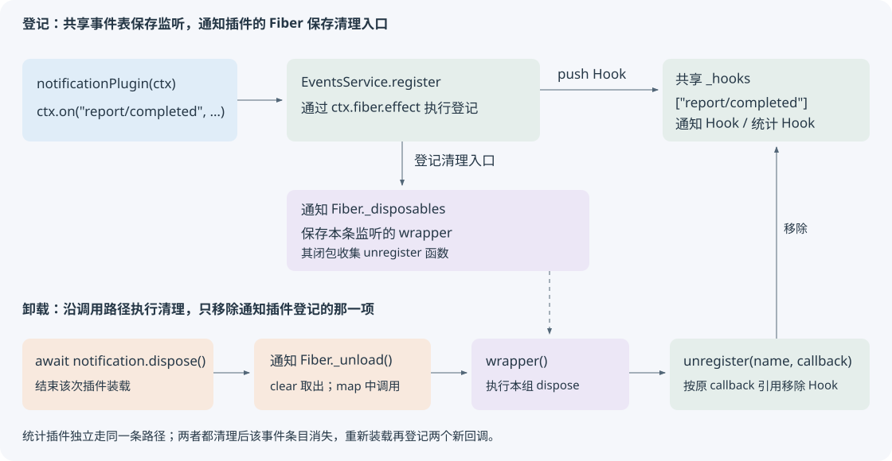
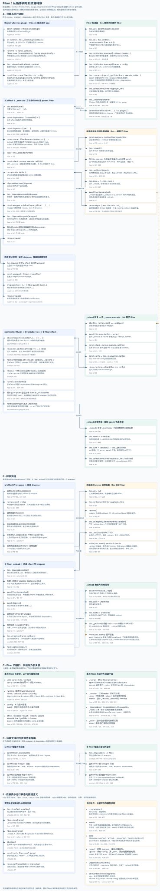

<!-- Generated from LearningTask.ipynb by scripts/render-lessons.py. -->

[运行此课 Notebook](LearningTask.ipynb) · [课程目录](../../README.md)

**Cordis 2007 · 观察插件卸载与重装**

[课程目录](../../README.md) · [环境与运行](../../SETUP.md)

# 本课导览

在三批报告之间卸载、重新装载观察者，跟踪监听器的登记与释放。

本课先给具体代码和预期行为，再沿本课固定版本的源码解释原因。读到所选路径即可，不要求通读整个内核。

本课延续前课的 ReportDesk，所有文件与依赖独立保存在当前目录。先在本课目录安装依赖，再按 00 → 01 执行 Notebook，或使用 `npm run demo` 运行完成参考。

建议按 2–3 小时安排首次阅读、运行与回看；可分多次完成。

# 源码与阅读导航

固定版本为 **Cordis 4.0.0-rc.10 / c261dd2c13d6**，提交日期 2026-10-10 UTC，访问日期 2026-10-13。每个链接都指向本课独立文件；可直接添加注释、打印或修改，不影响前课。

| 位置 | 类型、入口与停止点 | 用途 |
|---|---|---|
| M1–M2 | 教学应用：[start.ts](examples/01-reportdesk/start.ts)、[main.ts](examples/01-reportdesk/main.ts)、[batch.ts](shared/batch.ts)；读到三批完成 | 明确装配、开关与业务调用的关系 |
| M3.1、M3.5 | 固定源码：[events.ts](materials/cordis/src/events.ts)，`register` 138–145、`unregister` 147–156 行；到监听移出表 | 看清被登记的对象与实际清理动作 |
| M3.2–M3.3 | 固定源码：[fiber.ts](materials/cordis/src/fiber.ts)，构造器 135 行交代 ctx.fiber 归属；`effect` 278–344 与 `_execute` 233–245 只读正文摘出的同步返回函数路径 | 理解清理函数如何保存并包装 |
| M3.4 | 同文件构造器 `dispose` 171–199、`_unload` 447–467；只读当前已就绪插件的卸载连接；[registry.ts](materials/cordis/src/registry.ts) 207–214 仅恢复句柄来源 | 连接公开卸载与已登记清理入口 |
| M3.3–M3.4 | 固定源码：[utils.ts](materials/cordis/src/utils.ts)，`DisposableList` 4–34；读正文中的 push/clear 行为 | 区分移除记录与调用清理函数 |

正文均为精选阅读材料，省略或教学改写会就地说明。源码摘录不要求执行；下面 Code cell 才是运行入口。[事件测试](materials/cordis/events.spec.ts)中的 `ctx.on()` 和 `removes empty event buckets after disposal` 供作者核对；只在末尾选读相关断言，不搭建上游完整测试工程。

初始哈希、完整来源见 [source-index.json](materials/source-index.json)；版本适配及调研范围见[资料说明](materials/README.md)。

# 沿场景理解源码

先在本课目录执行 `npm ci` 和 `npm run check`。Notebook 使用 JavaScript（jslab），按 00 → 01 运行；终端使用 `npm run demo`，两者加载同一份本课源码。各阶段的观察说明紧邻代码。

运行生成的报告、状态快照和声明位于本课 `runs/`。重跑会替换同一用途的结果；需要比较时先另行保存。只修改本课文件即可，不依赖其他课程的安装目录。VS Code 请单独打开本课目录，再选择对应调试配置。

## M1 · 保持应用运行，恢复观察插件

**25 分钟。** 先认清已有服务、事件、观察者和本次控制它们的入口。

### M1.1 先恢复已经工作的三个角色

`reportProvider` 创建并登记 `report` 服务，`ReportService.generate(input)` 返回报告 Markdown；报告规则和文件写入已经准备好。[report-batch.ts](app/report-batch.ts) 是一次性处理一批输入的对象插件，声明 `inject: ["report"]`。框架装载它时调用下面的 `apply`（省略导入与日志）：

```ts
async apply(ctx: Context, config: { jobs: ReportJob[] }): Promise<void> {
    const report = ctx.report;
    for (const job of config.jobs) {
        const markdown = report.generate(job.input);
        await writeReport(job.id, markdown);
        const completed = { id: job.id, title: job.input.title };
        ctx.emit("report/completed", completed);
    }
}
```

`jobs` 含台灯、水杯两份输入。`input` 中的 `title`、`text`、`includeExcerpt` 决定报告内容；报告长度仍为 41、31 个 Unicode 码点，不含空白、计入标点。`completed` 是本份报告成功写入后的信息，形状由 [ReportCompleted](app/report-events.ts) 约定。

两个观察插件保留 2006 的行为，摘自 [notification-plugin.ts](app/notification-plugin.ts) 与 [statistics-plugin.ts](app/statistics-plugin.ts)，省略导入：

```ts
export function notificationPlugin(ctx: Context): void {
    ctx.on("report/completed", (report: ReportCompleted) => {
        console.log(`通知：report.id = ${report.id}，report.title = ${report.title}（已生成并写入）`);
    });
}

export function statisticsPlugin(ctx: Context): void {
    let count = 0;
    ctx.on("report/completed", (report: ReportCompleted) => {
        count += 1;
        console.log(`统计：count = ${count}（本次装载以来的完成事件数），report.id = ${report.id}`);
    });
}
```

每次装载分别得到自己的 `ctx`；`on` 登记箭头回调，之后 `emit` 才调用它。统计闭包在这次装载中保存 `count`。回调都同步执行，通知只打印本地信息。报告调用方只知道完成事件，不导入观察插件。

### M1.2 让同一个应用先后处理三批报告

[start.ts](examples/01-reportdesk/start.ts) 中先准备输入，再创建根 Context `app`。下面是入口的非连续摘录，省略导入、日志与末尾清理：

```ts
const jobs = await jobsFromArgs();
await prepareReports();
const app = new Context();
const provider = app.plugin(reportProvider);
let notification = app.plugin(notificationPlugin);
let statistics = app.plugin(statisticsPlugin);

await provider;
await notification;
await statistics;
await runBatch(app, jobs, "before");
// 这里将补上关闭操作。
await runBatch(app, jobs, "during");
// 这里将补上重新启用操作。
await runBatch(app, jobs, "after");
```

`provider`、`notification`、`statistics` 是各次 `plugin()` 返回的装载句柄，可以等待就绪，也可以调用其 `dispose()`。前两课末尾已用过清理；本课把观察插件的卸载移到应用运行中间。两个变量用 `let`，是因为后面要保存新装载的句柄。

已准备的 [runBatch](shared/batch.ts) 沿用上一课的批处理方式，每次安装一个 `reportBatch` 处理一整批两份报告，完成后清理该批次句柄。下面是其主体，省略日志：

```ts
const batchJobs = jobs.map((job) => ({ ...job, id: `${phase}-${job.id}` }));
const batch = app.plugin(reportBatch, { jobs: batchJobs });
try {
    await batch;
} finally {
    await batch.dispose();
}
```

`jobsFromArgs()` 读取本课两份文本并应用 `includeExcerpt` 选项；`prepareReports()` 只在整个案例开始时重建本课报告目录，不会在批次间删除前一批。

`phase` 来自入口的 `before` / `during` / `after` 字符串，只给文件名和输出加上批次标签；它不改变报告规则。这里不是重建整个应用：报告服务和观察插件与批处理插件都由 `app` 直接装载，**结束一批不等于卸载另外三个插件**。每份报告不会单独装插件。

先执行 00。后续运行单元复用 `reportdesk`；重新启动内核后再次执行即可。

```javascript
// 00 · ReportDesk：初始化本课 Notebook 入口。
var path = require("node:path");
var fs = require("node:fs");
var taskName = "2007.Cordis-ReportDesk-Observer-Lifecycle";
var taskRoot = path.basename(process.cwd()) === taskName ? process.cwd() : path.join(process.cwd(), taskName);
if (!fs.existsSync(path.join(taskRoot, "shared/notebook.cjs"))) {
    throw new Error("请从仓库根或本课目录启动 Notebook。");
}
var helperPath = require.resolve(path.join(taskRoot, "shared/notebook.cjs"));
delete require.cache[helperPath];
var reportdesk = require(helperPath);
console.log("运行 cwd：" + taskRoot + "；00 初始化完成。");
```

### M1.3 运行尚未添加开关的起点

起点中的两个 TODO 尚未实现，因此当前三批都会通知、计数。`during` 只是待加入卸载的位置标记，不能根据这个名字认定观察者已经关闭。先运行一次，建立比较基线。

```javascript
// 01 · ReportDesk：观察三批都开启的起点。
reportdesk.run("start");
```

观察 `phase` 的三个分隔区：每批都有两次通知，统计值连续为 **1、2 → 3、4 → 5、6**。报告服务只创建一次，六份报告都正常写入。如果已修改过起点，则以当前代码为准，无须删除自己的实现。

## M2 · 关闭并重新启用观察者

**35 分钟。** 在现有入口的两处加入生命周期操作；业务生产者和两个监听回调都保持已有实现。

### M2.1 等第一批结束，再卸载两个插件

在 [start.ts](examples/01-reportdesk/start.ts) 的 **TODO 1**，也就是 `before` 返回后、`during` 开始前，加入：

```ts
await notification.dispose();
await statistics.dispose();
```

调用者持有的是各次插件装载的句柄。`dispose()` 结束那次装载并清理它登记的资源；这里就是监听。等待两个清理完成，再发起下一批报告，才能把“停用期间”的边界说清楚。

保留 `provider`，报告服务继续可用。此时也没有修改事件名、增加开关判断或手动删除监听数组。下一批仍会生成、写入并发出 `report/completed`，只是这两个观察者已经离开。

`await notification` 等待装载就绪，`await notification.dispose()` 等待该次卸载完成；两句执行的操作不同。这里观察的是完成卸载之后的新事件，上一批已经结束。

### M2.2 装载新的观察插件，再开始第三批

继续在 **TODO 2** 加入：

```ts
notification = app.plugin(notificationPlugin);
statistics = app.plugin(statisticsPlugin);
await notification;
await statistics;
```

重新调用 `plugin` 创建新的装载，保存新句柄；不是把已释放的旧句柄复活。插件函数再次运行，重新登记箭头回调，统计函数也重新执行 `let count = 0`。等待它们就绪后，才发起 `after` 批次。

源码中的 `finally` 始终保留，它在程序结束或发生错误时清理变量当前指向的观察插件以及报告服务。只补这两处，不需要重写批处理或自行实现事件开关。

用同一个起点入口运行自己的修改：

```javascript
// 01 · ReportDesk：观察补齐卸载与重装后的三批响应。
reportdesk.run("start");
```

三批的预期结果如下。每一行的“每份”都指该批次的台灯或水杯报告。

| 批次 | 报告文件 | 每份的通知次数 | 该批统计输出 |
|---|---|---|---|
| before | 两份正常写入 | 1 | 1、2 |
| during | 两份正常写入 | 0 | 无输出 |
| after | 两份正常写入 | 1 | 1、2 |

`after` 的计数从 1 开始，因为新装载创建了新闭包；停用期间的两个事件不会补发。应用没有保存事件历史，也没有把计数持久化。

如果 `during` 仍打印通知，核对卸载是否位于该批次之前，并等待完成；如果 `after` 没有响应，检查是否重新装载且等待就绪。若出现重复响应，检查是否在未卸载旧插件时又装了新的同类插件。先看入口，不需要重新安装依赖。

需要直接对照时，运行 [main.ts](examples/01-reportdesk/main.ts) 的完整参考；它不会改写你的起点：

```javascript
// 01 · ReportDesk：完整参考，命令会同时打印传入参数。
reportdesk.run("lifecycle", { includeExcerpt: true });
```

### M2.3 从应用断点进入本课源码

VS Code 在仓库根打开“运行和调试”，选择 **Cordis 2007 · 01 · 观察插件卸载与重装**；本课目录单独打开时有同名配置。配置的 cwd、入口与 Notebook 一致。

打开 [main.ts](examples/01-reportdesk/main.ts)，在第一次 `await notification.dispose()` 处设断点并启动。此时 `before` 已完成，`during` 尚未开始。继续跟入可以看到该句柄的清理入口；如果单步先进入辅助包装，可在本课 [events.ts](materials/cordis/src/events.ts) 的 `unregister` 第一行另设断点，继续运行到真正移除监听的位置。

在 `unregister` 中查看 `name` 与 `callback`，并比较 `_hooks[name]` 删除前后。先读 M3 再回到这个断点也可以；无需额外提交截图或解释。

## M3 · 监听为什么会随插件消失

**65 分钟。** 沿通知插件这一条监听，先看谁持有清理入口，再看卸载时谁调用它。统计插件采用相同路径。

### M3.1 共享监听表，分别管理归属

恢复已经见过的调用：入口执行 `app.plugin(notificationPlugin)`，框架创建本次装载的 Fiber，把其 Context 传给 `notificationPlugin(ctx)`，插件调用 `ctx.on("report/completed", 箭头回调)`。Fiber 是这次装载的运行记录，保存自己的资源清理入口。

先看本课 [fiber.ts](materials/cordis/src/fiber.ts) 第 135 行如何建立这个归属，下面是构造器中的一行摘录：

```ts
this.ctx = this.context = parent.extend({ fiber: this });
```

`parent` 是装载通知插件的 `app`，`this` 是新建的通知 Fiber；`ctx` 与 `context` 是同一派生 Context 的两个属性名。传给插件的 ctx 因而带着自己的 fiber。沿用上一课的事件方法转发，调用 `ctx.on` 时事件服务保留这个调用方 Context；此处只用这一接口行为，停止在 `ctx.fiber` 的归属，不展开方法代理。

上一课的 `on` 先包装回调，再调用 `register` 并返回其结果。这里摘自 [events.ts](materials/cordis/src/events.ts) 第 138–145 行，4 空格重排，添加注释：

```ts
private register(label: string, name: string | symbol, callback: any, options: EventOptions): () => void {
    const method = options.prepend ? 'unshift' : 'push';
    return this.ctx.fiber.effect(() => {
        const hooks = this._hooks[name] ??= [];
        hooks[method]({ ctx: this.ctx, callback, ...options });
        return () => this.unregister(name, callback);
    }, label);
}
```

此处 `name` 为 `report/completed`，`callback` 是包装后的通知监听。`this.ctx` 保留这次调用的通知插件 Context；`this.ctx.fiber` 因而是**通知插件自己的 Fiber**。外层箭头函数在 effect 执行时向共享表加入记录，并返回内层箭头函数。内层函数捕获本次 `name`、`callback` 和 register 的 `this`，将来才执行 `unregister`。

| 对象或容器 | 本例中的内容 | 用途 |
|---|---|---|
| `app.events._hooks["report/completed"]` | 通知和统计的两条 Hook，各保存 ctx、callback | 按事件名找到所有监听 |
| 通知插件 Fiber 的 `_disposables` | 该插件资源的清理入口 | 卸载通知插件时执行 |
| 统计插件 Fiber 的 `_disposables` | 另一组独立的清理入口 | 卸载统计插件时执行 |

共享监听表与资源归属是两件事。Hook 中的 ctx 可供事件筛选使用；本例自动清理的直接依据是 `this.ctx.fiber.effect(...)`，不是卸载时遍历共享表、按 Hook.ctx 查找。

### M3.2 effect 先执行登记，再收集返回函数

进入 [fiber.ts](materials/cordis/src/fiber.ts) 的 `effect` 时，参数 `execute` 就是上一节传入的外层箭头函数，方法中的 `this` 是通知插件 Fiber。该调用创建局部数组 `disposables` 和运行记录 `runner`，再执行 `_execute(runner)`。以下是第 282–316 行的非连续摘录，省略释放函数的定义、标签元数据及错误捕获；释放部分下一节马上连接：

```ts
const disposables: Disposable[] = [];
const runner: EffectRunner<boolean> = {
    execute,
    epoch: true,
    collect: (dispose) => {
        disposables.push(dispose);
        this._disposables.delete(dispose);
        // 省略仅记录嵌套 effect 信息的 meta.children 分支。
    },
    getOuterStack: buildOuterStack(),
};
let task: void | Promise<void>;
task = this._execute(runner);
```

`runner` 把“执行哪个回调”和“怎样保存返回的清理函数”放在一起。`epoch` 在这次 effect 中是一个布尔标记，表示该入口是否仍有效；`getOuterStack` 只为错误定位保存调用位置。局部 `disposables` 属于本次 effect，与整个 Fiber 的 `_disposables` 不是同一个列表。

`_execute` 在本例经过下面几行（233–245 行，省略错误包装与其他返回类型分支）：

```ts
const effect: Effect = runner.execute.call(this);
if (typeof effect === 'function') {
    return runner.collect(effect);
}
```

第一行执行登记，因此共享表现在增加一条 Hook；返回值 `effect` 是 `() => this.unregister(name, callback)`，所以第二步把它交给 collect，放进局部 `disposables`。collect 中的 delete 会把已登记过的同一清理函数移出 Fiber 列表以免重复管理；本例返回的是新建的 unregister 闭包，尚未在该列表中，因此 delete 没有额外变化。

这里的 `.call(this)` 传入 Fiber，但 **execute 是在 register 中定义的箭头函数，其 this 仍来自 register 的词法环境**。因此 `this._hooks`、`this.unregister` 仍访问事件服务；不会因 `.call` 改为 Fiber。`runner.collect` 也是箭头函数，定义在 effect 内，所以它的 this 是 Fiber。这是两个定义位置，不能仅看调用点推断。

本例 collect 没有返回值，`task` 为 undefined。到这里，登记已发生，真正移除监听的函数只是被保存，尚未执行。

### M3.3 把一组清理动作挂到 Fiber 上

先认识 Fiber 列表所用的 [DisposableList](materials/cordis/src/utils.ts)。它的 `push(value)` 存下一个值，返回一个**从列表移除该记录**的函数（第 13–17 行）：

```ts
push(value: T) {
    const sn = ++this.sn;
    this.map.set(sn, value);
    this.weak.set(value, sn);
    return () => this.map.delete(sn);
}
```

`map` 保存登记序号与值，`weak` 支持按值查到序号。这里保存的值会是一个清理函数，但 **push 返回的移除函数本身并不会调用那个值**。

回到 `Fiber.effect`：它还定义了一个局部 `dispose`，执行局部数组中收集到的清理函数（第 284–298 行）：

```ts
const dispose = () => {
    let task!: void | Promise<void>;
    for (const dispose of disposables.splice(0).reverse()) {
        if (task) {
            task = task.then(dispose);
        } else {
            const result = dispose();
            if (isObject(result) && 'then' in result) {
                task = result as any;
            }
        }
    }
    return task;
};
```

`splice(0)` 取出并清空这一组，`reverse()` 让后加入的先执行。本例都是同步清理，沿 else 中的 `dispose()` 往下即可；源码也能串接返回 Promise 的清理动作。循环变量与外层函数恰好都叫 dispose：循环变量表示被收集的每一个函数。

effect 最后生成 `wrapper`、登记它并返回（326–343 行，下面省略 defineProperty 的标签附加与 wrapper.then，只保留本例直接调用 wrapper 的主体）：

```ts
const wrapper = () => {
    if (!runner.epoch) return;
    runner.epoch = false;
    return task ? task.then(dispose) : dispose();
};
disposables.push(this._disposables.push(wrapper));
return wrapper;
```

本例 `task` 为 undefined，wrapper 会直接调用刚才的局部 dispose。中间那一行由内向外读：先把 wrapper 挂到通知 Fiber 的 `_disposables`，再把“移除 wrapper 记录的函数”放进局部数组。因此本次 effect 的局部数组最后包含：

1. `() => this.unregister(name, callback)`：真正移除事件监听；
2. `this._disposables.push(wrapper)` 返回的函数：移除 Fiber 中这条清理入口记录。

调用 wrapper 时先移除自身记录，再执行 unregister；`runner.epoch = false` 使重复调用不再执行整组清理。`register → on` 返回的也是这个 wrapper，所以手动调用 on 的返回值与插件统一清理，会汇入同一条移除路径。本课应用选择统一卸载插件，无须另外保存每个 on 的返回值。

### M3.4 notification.dispose 怎样走到这些入口

先连接入口句柄与实际 Fiber。[registry.ts](materials/cordis/src/registry.ts) 的 `plugin` 第 207–214 行保留了下面的创建与返回关系。以下为阅读摘录：构造参数和 `then` 等待入口有省略，不是运行示例；`this.ctx` 就是本次调用 plugin 的 `app`：

```ts
const fiber = new Fiber(this.ctx, /* 其余配置与插件登记参数省略 */);
const wrapped = Object.create(fiber) as Fiber & PromiseLike<Fiber>;
// 省略 wrapped.then 的定义。
return wrapped;
```

这次返回的 wrapped 就是入口的 `notification`。它通过原型取得 fiber 上的 dispose；这个属性保存的是 effect 返回的闭包，闭包最终清理创建时捕获的 Fiber，不因 `notification.dispose()` 的调用形式改变目标。下面摘自 [fiber.ts](materials/cordis/src/fiber.ts) 第 171–199 行，省略运行记录登记、日志与 Registry 移除：

```ts
this.dispose = parent.fiber.effect(() => {
    // 省略登记并启动当前插件的代码。
    return async () => {
        this.uid = null;
        // 省略内部通知和 Registry 记录清理。
        this._setEpoch(INACTIVE);
        while (this.inertia) {
            await this.inertia;
        }
    };
}, 'ctx.plugin()');
```

这一次外层 effect 登记在 **parent.fiber**，因为装载本身也由父上下文管理。箭头函数中的 `this` 来自当前 Fiber 的构造器，所以清理的是通知插件，不是根 app。句柄上的 dispose 与 M3.3 的单条监听 wrapper 是不同层级的入口：前者结束整个装载，后者移除一项资源。

本例已等待插件就绪，上一批也已完成。`uid = null` 标记这次装载已被释放；`_setEpoch(INACTIVE)` 将运行目标设为停用；第 402–418 行中，它先更新 `this._runner.epoch`，本例随后走 else 分支的 `this.inertia = this._unload()`。`inertia` 保存这段装载／卸载工作的 Promise，外层循环等待它结束。这里只连接这一次稳定状态下的卸载，不展开状态切换的其他分支。

`_unload` 的核心是取出当前 Fiber 全部清理入口并调用。下面保留第 447–458 行的循环结构，省略错误上下文包装、日志和末尾状态更新：

```ts
private async _unload() {
    await Promise.all(this._disposables.clear().map(async (dispose) => {
        // 原码在错误包装内先 await Promise.resolve()，再调用：
        await dispose();
    }));
    // 省略 store 清空与完成状态更新。
}
```

`clear()` 在 [utils.ts](materials/cordis/src/utils.ts) 第 26–30 行取出列表值、清空登记并反转列表。**clear 只取出函数，map 里的 dispose() 才执行函数**。通知 Fiber 中的监听 wrapper 由此被调用，再回到 M3.3 的局部清理过程。

`_unload` 使用 Promise.all 等待各资源清理，不能据列表反转推断所有异步资源会严格逐个完成。本例每个观察插件仅有一条同步监听清理；两个插件由应用入口显式依次 await 卸载。

### M3.5 unregister 移除哪一项，重装又增加什么

最后调用到 [events.ts](materials/cordis/src/events.ts) 的 unregister（147–156 行）：

```ts
private unregister(name: string | symbol, callback: any) {
    const hooks = this._hooks[name];
    if (!hooks) return;
    const index = hooks.findIndex(hook => hook.callback === callback);
    if (index >= 0) {
        hooks.splice(index, 1);
        if (!hooks.length) delete this._hooks[name];
        return true;
    }
}
```

`name`、`callback` 来自登记时返回的闭包。按 callback 引用找到当时那一项，移除它；数组空了才删除事件名对应的整个条目。两个观察者共享事件名，卸载通知只删通知这一项，统计仍在；再卸载统计时，该事件条目消失。

下面按本例代码推导状态，不是预填的运行记录：

| 位置 | `_hooks["report/completed"]` | 观察结果 |
|---|---|---|
| 两个观察插件就绪 | 通知、统计两项 | before 每份各响应一次 |
| notification 卸载完成 | 只剩统计 | 本例此处尚未发起新一批 |
| statistics 也卸载完成 | 该事件条目不存在 | during 无通知、无计数 |
| 再次装载两者并等待就绪 | 两个新回调 | after 每份各响应一次，新 count 为 1、2 |

`emit` 仍按事件名读取表，不存在时使用空数组，因此 during 不会执行这两个回调。重装再次运行插件函数并登记新回调；旧回调已移除，故没有叠加。新统计闭包与旧闭包不同，不会自动继承计数。

上游 [events.spec.ts](materials/cordis/events.spec.ts) 的 `ctx.on()` 用例在两次派发后调用 on 的返回清理函数，再派发并断言调用数仍为 2；`removes empty event buckets after disposal` 则检查移除最后一个监听后不再保留事件条目。它们支持这里的移除语义；本课实际应用运行另行验证，不宣称执行过完整上游测试。

### M3.6 把清理路径放回应用

下图只归纳前面已出现的对象与调用，实线表示调用或登记，虚线表示保存引用。监听共享一张表，释放入口分别由所属 Fiber 管理。



读到旧监听移除、新监听按重装创建就结束本课。应用入口通过卸载句柄表达关闭，Cordis 把监听和所属插件的生命期连接起来；报告生成与写入继续使用原有服务。

## M4 · Fiber 全景图

[打开原尺寸全景图](materials/fiber-overview.svg) · 源码：[fiber.ts](materials/cordis/src/fiber.ts)



# 本课收束

共享事件表保存监听项，所属 Fiber 保存其撤销动作。dispose 沿资源归属移除旧监听；重新装载创建新的闭包与计数，下一次完成事件只触发新的一组监听器。
