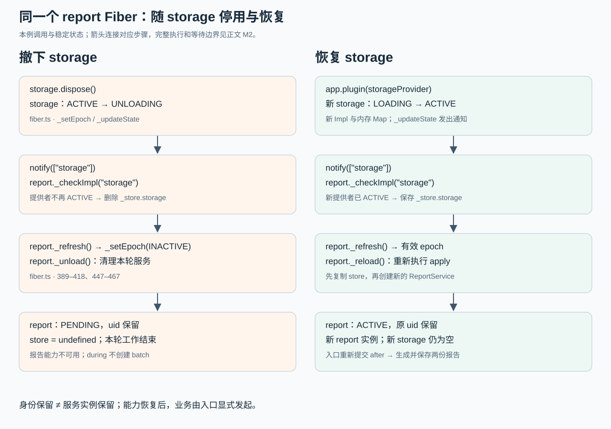

<!-- Generated from LearningTask.ipynb by scripts/render-lessons.py. -->

[运行此课 Notebook](LearningTask.ipynb) · [课程目录](../../README.md)

**Cordis 2008 · 存储依赖的停用与恢复**

[课程目录](../../README.md) · [环境与运行](../../SETUP.md)

# 本课导览

保持同一个 report 插件句柄，观察 storage 撤下与恢复怎样改变本轮服务。

本课先给具体代码和预期行为，再沿本课固定版本的源码解释原因。读到所选路径即可，不要求通读整个内核。

本课延续前课的 ReportDesk，所有文件与依赖独立保存在当前目录。先在本课目录安装依赖，再按 00 → 01 执行 Notebook，或使用 `npm run demo` 运行完成参考。

建议按 2–3 小时安排首次阅读、运行与回看；可分多次完成。

# 源码与阅读导航

固定 **Cordis 4.0.0-rc.10 / c261dd2c13d65b1994adb1cdc10d7dba61542523**，上游提交日期 2026-10-10 UTC，本课访问日期 2026-10-17。链接指向本课独立、可编辑的文件；正文摘录均来自这一提交。

| 资料 | 类型、指定范围与停止点 | 用途 |
|---|---|---|
| S1：[main.ts](examples/01-reportdesk/main.ts)、[storage-service.ts](app/storage-service.ts)、[report-service.ts](app/report-service.ts) | 本地教学应用，M1 的服务与入口；读到 after 完成 | 先建立真实依赖关系与预期行为 |
| S2：[reflect.ts](materials/cordis/src/reflect.ts) | 固定源码；`provide` 186–203、`_getImpl` 156–161、`notify` 207–220，仅跟同一根 Context 的 storage | 找到服务记录、可用性条件及通知接收者 |
| S3：[fiber.ts](materials/cordis/src/fiber.ts) | 固定源码；正文摘录的 `_updateState` 359–372、`_checkImpl` 375–386、`_refresh` 389–399；`_setEpoch` 402–418 与 420–475 的正常装卸载、等待路径 | 解释同一个 report Fiber 如何停用和恢复 |
| 辅助：[service.ts](materials/cordis/src/service.ts) 18–34、[registry.ts](materials/cordis/src/registry.ts) 207–212 | 只回顾 `super` 登记和句柄等待的接线；正文给必要片段 | 不要求重新通读服务与插件注册 |
| S4：[fiber.spec.ts](materials/cordis/fiber.spec.ts) | 选读测试：`inertia lock 3` 42–63 的末尾断言，读到 `PENDING` 即停 | 核对依赖失去后的状态；没有额外测试作业 |

正文先给调用与对象，再解释实现；非连续摘录和省略就地标明。测试源码用于阅读，未把上游完整测试工程复制到本课。初始来源哈希和研究范围见 [source-index.json](materials/source-index.json) 与 [资料说明](materials/README.md)。

# 沿场景理解源码

先在本课目录执行 `npm ci` 和 `npm run check`。Notebook 使用 JavaScript（jslab），按 00 → 01 运行；终端使用 `npm run demo`，两者加载同一份本课源码。各阶段的观察说明紧邻代码。

运行生成的报告、状态快照和声明位于本课 `runs/`。重跑会替换同一用途的结果；需要比较时先另行保存。只修改本课文件即可，不依赖其他课程的安装目录。VS Code 请单独打开本课目录，再选择对应调试配置。

## M1 · 存储撤下后，报告能力如何变化

**50 分钟。** 先读两个服务怎样连接，再沿一个入口观察停用与恢复。

### M1.1 复用服务模式，增加内存保存

已有的 `report` 服务由 `Service` 构造器登记，批处理插件调用它生成 Markdown。现在增加同样形式的 `storage` 服务，职责是按报告 id 保存正文。下面摘自 [storage-service.ts](app/storage-service.ts)，省略导入、类型扩充和日志：

```ts
export class StorageService extends Service {
    private records = new Map<string, string>();

    constructor(ctx: Context) {
        super(ctx, "storage");
    }

    save(id: string, markdown: string): void {
        this.records.set(id, markdown);
    }

    ids(): string[] {
        return [...this.records.keys()];
    }
}

export function storageProvider(ctx: Context): void {
    new StorageService(ctx);
}
```

`ctx` 是 storage 插件本次装载的 Context；`super(ctx, "storage")` 将服务登记到它所属的 Fiber。`records` 属于这个服务实例，`ids()` 只供观察当前保存了哪些报告。重装插件会创建新实例、新 Map，旧数据不会自动迁移。

文件中的 `declare module "cordis"` 让 TypeScript 知道 `ctx.storage` 的类型；**运行登记仍由 `super` 执行**，类型声明不会创建存储。Service 构造器的末尾调用 `self.ctx.reflect.provide(name, self, this[symbols.check])`，就是前课已认识的服务登记入口。

### M1.2 让 report 明确依赖 storage

[report-service.ts](app/report-service.ts) 的核心如下。`ReportService` 继续生成相同正文，新参数 `id` 用于保存；省略导入、类型扩充以及仅用于观察实例新旧的编号字段与日志：

```ts
export class ReportService extends Service {
    constructor(ctx: Context) {
        super(ctx, "report");
    }

    generate(id: string, input: ReportInput): string {
        const markdown = renderReport(input);
        this.ctx.storage.save(id, markdown);
        return markdown;
    }
}

export const reportProvider = {
    name: "report-provider",
    inject: ["storage"],
    apply(ctx: Context): void {
        const service = new ReportService(ctx);
    },
};
```

`inject` 是插件对象的依赖声明。Cordis 找到可用的 storage 后，才执行这个插件的 `apply`，其 ctx 可访问已声明的服务。`Service` 构造器保存传入的 ctx；本例从服务方法中用 `this.ctx.storage` 访问该插件声明的依赖。这里沿用前课的服务访问行为，先确认声明与实际保存调用的对应；调用时的上下文转发另按既定路线解释，不能据此把所有调用时的 ctx 都理解成同一原始对象。

一次业务调用来自 [report-batch.ts](app/report-batch.ts)。它依旧声明 `inject: ["report"]`，每批处理台灯、水杯两项；下面是循环中的阅读摘录：

```ts
const markdown = report.generate(job.id, job.input);
await writeReport(job.id, markdown);
const completed = { id: job.id, title: job.input.title };
ctx.emit("report/completed", completed);
```

`report` 来自批处理插件的 `ctx.report`；`job` 含 id 和 input，input 仍有标题、正文与是否带摘录。生成时先通过 storage 保存到内存，`writeReport` 另导出一份文件方便阅读，然后发出完成事件。内存服务与快照文件的职责分开，不能把磁盘快照当成重装后的内存数据。

通知、统计仍沿用上课实现：监听同一个完成事件，分别打印和累加。它们不依赖 storage，本课一直保持装载。

### M1.3 只撤下 storage，保留 report 的句柄

下面是 [main.ts](examples/01-reportdesk/main.ts) 的非连续摘录，省略导入、日志、观察辅助调用及 finally 清理。`jobsFromArgs()` 准备台灯、水杯输入；`prepareReports()` 仅清理本次快照目录。新建的 `app` 是同一次运行的根 Context：

```ts
const jobs = await jobsFromArgs();
await prepareReports();
const app = new Context();
let storage = app.plugin(storageProvider);
const report = app.plugin(reportProvider);
const notification = app.plugin(notificationPlugin);
const statistics = app.plugin(statisticsPlugin);

await storage;
await report;
await notification;
await statistics;
await runBatch(app, jobs, "before");

await storage.dispose();
await report;
await runBatch(app, jobs, "during");

storage = app.plugin(storageProvider);
await storage;
await report;
await runBatch(app, jobs, "after");
```

这里 storage 的句柄被替换，report 用 `const` 保留同一次装载。入口没有在中间调用 `report.dispose()`，也没有重新 `app.plugin(reportProvider)`。它的停用和恢复由依赖变化触发。

[runBatch](shared/batch.ts) 在创建批处理插件前多了一项入口检查，下面是相邻语句的摘录：

```ts
if (!app.get("report")) {
    console.log("本批未提交：report 当前不可用；不创建批处理插件，也不排队重放。");
    return;
}
const batchJobs = jobs.map((job) => ({ ...job, id: `${phase}-${job.id}` }));
const batch = app.plugin(reportBatch, { jobs: batchJobs });
```

`app.get("report")` 默认只返回当前可用的服务；没有则为 undefined。这个检查是应用入口的选择，不是 Cordis 自动保存请求的队列。已有的 `try/finally` 会等待并释放每个已提交的 batch，因此 before 完成后，不会留下等待自动重跑的旧批处理插件。

完整入口中的 `observe()` 只打印 uid、state、实例编号和存储 id；`saveObservations()` 只保存观察记录，它们不触发生命周期。下面按 00 → 01 执行一次。M1.4 会对照输出中的状态名：ACTIVE 表示本例已运行就绪，PENDING 表示因缺少 storage 而等待依赖；这两个观察点都在当前装卸载工作结束之后。

```javascript
// 00 · ReportDesk：初始化本课 Notebook 入口。
var path = require("node:path");
var fs = require("node:fs");
var taskName = "2008.Cordis-ReportDesk-Storage-Dependency";
var taskRoot = path.basename(process.cwd()) === taskName ? process.cwd() : path.join(process.cwd(), taskName);
if (!fs.existsSync(path.join(taskRoot, "shared/notebook.cjs"))) {
    throw new Error("请从仓库根或本课目录启动 Notebook。");
}
var helperPath = require.resolve(path.join(taskRoot, "shared/notebook.cjs"));
delete require.cache[helperPath];
var reportdesk = require(helperPath);
console.log("00 初始化完成；后续入口的 cwd 为本课目录。");
```

```javascript
// 01 · ReportDesk：观察存储撤下与恢复时同一个报告插件的变化。
reportdesk.run();
```

### M1.4 对照身份、实例和业务结果

以下是按代码推导的预期，不是你的运行记录。每个阶段的输出均在相应等待完成后打印：

| 观察点 | report.uid | report.state | 报告服务 instanceId | storage.ids() |
|---|---|---|---|---|
| before 两份报告完成 | 同一个非空编号 | ACTIVE | 1 | before-lamp、before-bottle |
| during，存储已撤下 | 编号保持不变 | PENDING | 不可用 | null（服务不可用） |
| restored，新存储就绪 | 编号保持不变 | ACTIVE | 2 | []（新存储为空） |
| after 两份报告完成 | 编号保持不变 | ACTIVE | 2 | after-lamp、after-bottle |

`uid` 是 Cordis 给本次插件装载的身份，实际数字由装配顺序决定；`instanceId` 是本课加在 ReportService 上的进程内创建序号。**同一个 Fiber 可以清理旧服务并再次执行 apply，产生新服务实例**，两种编号分别说明不同对象。

`during` 会打印“本批未提交”，没有生成报告，也没有完成事件。恢复只让 report 能力重新可用，入口随后显式调用 `runBatch(..., "after")`；它不会补跑 during。通知和统计始终装载，所以统计为 before 的 1、2，after 的 3、4。

`runs/reportdesk/` 应有 before 和 after 的四份 Markdown；新 storage 不包含 before 的 id，磁盘快照仍可阅读。若 during 仍有报告，检查存储卸载位置；若恢复后没有 report，先检查 `inject` 的服务名与等待位置。

### M1.5 从入口断点进入实际源码

VS Code 单独打开本课目录，在“运行和调试”，选择 **Cordis 2008 · 01 · 存储依赖的停用与恢复**。在 [main.ts](examples/01-reportdesk/main.ts) 的 `await storage.dispose()` 设断点，启动调试；这里 before 已完成，report 仍是原句柄。

阅读 M2 后，可以在本课 [fiber.ts](materials/cordis/src/fiber.ts) 的 `_checkImpl(name)` 第一行另设断点，再继续运行。当 `name === "storage"` 且 `this.runtime.name === "report-provider"` 时，当前 this 就是本例 report Fiber；观察 `_store.storage` 与后续 `_refresh()`。若先停在其他插件，按这两个值识别目标，不把所有内部调用都列为必读。

配置的 cwd 与 Notebook 相同，执行本课文件，sourceMaps 已启用。调试只帮助对应对象和语句，不要求提交截图或另写报告。

## M2 · 从依赖变化跟到同一 Fiber 的停用与恢复

**90 分钟。** 只追 M1 的正常撤下和恢复：服务记录归谁、谁通知 report、report 如何选择运行目标，再接回已学的清理过程。

### M2.1 服务记录保存了提供者

从 M1 的 `storageProvider(ctx)` 调用 `new StorageService(ctx)` 开始。`super(ctx, "storage")` 最终调用 `ctx.reflect.provide("storage", self, ...)`；因此这里的 `this.ctx` 是 storage 插件的 Context。

[reflect.ts](materials/cordis/src/reflect.ts) 第 186–193 行摘录如下，省略重复登记报错，添加解释性注释、统一缩进：

```ts
this.ctx.root[symbols.isolate][name] ??= Symbol(name);
const key = this.ctx[symbols.isolate][name];
const impl: Impl = { name, value, fiber: this.ctx.fiber, check };
this.store[key] = impl;
this.ctx.fiber.store![name] = impl;
```

本次 `name = "storage"`，`value` 是 StorageService 实例，`fiber` 是 storage 提供者的 Fiber，`check` 未定义。`Impl` 是这样一条服务实现记录，不是服务实例本身。`key` 是根 Context 为服务名保存的 Symbol 键；本课所有插件来自同一个根 Context，因此同名 storage 找到同一个键。

注意这里两处 store 的接收者不同：`this.store` 是共享 ReflectService 按 Symbol 键保存的服务记录表；`this.ctx.fiber.store` 是 storage Fiber 本轮运行持有的表，按字符串名称访问。先认清服务记录携带 `impl.fiber`，下一节可用它判断提供者是否处于可用状态。

### M2.2 谁发出通知，谁接收 storage 的变化

入口 `await storage.dispose()` 使 storage Fiber 开始卸载：目标改为停用，状态由 ACTIVE 变成 UNLOADING。**即使共享表中的记录尚未删除，提供者已不再 ACTIVE，依赖者也要重新检查。**

在 [fiber.ts](materials/cordis/src/fiber.ts) 的 `_updateState` 中，359–372 行先保存 oldState、更新 state；以下保留通知部分，省略状态赋值与内部状态事件：

```ts
if (oldState !== FiberState.ACTIVE && this.state !== FiberState.ACTIVE) return;
for (const key of Reflect.ownKeys(this.ctx.reflect.store)) {
    const impl = this.ctx.reflect.store[key as symbol];
    if (impl.fiber !== this) continue;
    this.ctx.reflect.notify([impl.name]);
}
```

当前 this 是 storage Fiber。它从共享表找到自己提供的记录，调用 `notify(["storage"])`。条件表示只有跨越 ACTIVE 边界才沿这里通知；提供者开始卸载和重新变为 ACTIVE 都会触发。

`notify` 在 [reflect.ts](materials/cordis/src/reflect.ts) 第 207–220 行遍历已登记插件的装载记录。以下摘录主体，省略返回数组的收集与方法末尾的其他内部通知：

```ts
for (const runtime of this.ctx.registry.values()) {
    for (const fiber of runtime.fibers) {
        let hasUpdate = false;
        for (const name of names) {
            if (!(name in fiber.inject)) continue;
            if (!filter(fiber.ctx, name)) continue;
            hasUpdate = true;
            fiber._checkImpl(name);
        }
        if (!hasUpdate) continue;
        fiber._refresh();
    }
}
```

`names` 是刚传入的 `["storage"]`；`runtime` 是插件登记记录，`runtime.fibers` 保存该插件的各次装载。report 在 `inject` 中声明了 storage，所以进入 `_checkImpl("storage")`，然后 `_refresh()`。默认 filter 比较两边服务名对应的键，本课同一根 Context 的 storage 满足该条件。

这里是直接调用依赖检查，不需要 report 自己注册业务事件监听。M1 的通知、统计插件没声明 storage，循环会跳过它们，因此它们不会跟着停用。

### M2.3 从可用实现得到本次运行目标

现在调用的是 **report Fiber** 的 `_checkImpl("storage")`，它先向 ReflectService 查找可用的 storage。下面是 [reflect.ts](materials/cordis/src/reflect.ts) 156–161 行的完整方法：

```ts
_getImpl(name: string, strict = true) {
    const key = this.ctx[symbols.isolate][name];
    const impl = key && this.store[key];
    if (!impl) return;
    if (strict && impl.fiber.state !== FiberState.ACTIVE) return;
    return impl;
}
```

storage 已进入 UNLOADING，所以即使 impl 还在共享表，严格查找也返回 undefined。接着 [fiber.ts](materials/cordis/src/fiber.ts) 375–386 行的 `_checkImpl` 更新 report 的 `_store`；以下为本例路径，省略自定义 check 及错误处理分支，本例没有定义 check：

```ts
const impl = this.ctx.reflect._getImpl(name, true);
if (!impl) return delete this._store[name];
this._store[name] = impl;
```

`_store.storage` 保存的是 **report 当前可选用的依赖实现记录**。不可用时删除这一项；它不同于共享服务表，也不同于本轮运行正在使用的 `store.storage`。

随后 `_refresh()`（389–399 行）把所有声明依赖归纳为一个目标标记：

```ts
_refresh() {
    let epoch = `${this._revision}`;
    for (const name of Object.keys(this.inject)) {
        const impl = this._store[name];
        if (!impl) {
            epoch = INACTIVE;
            break;
        }
        epoch += ':' + impl.fiber.uid;
    }
    this._setEpoch(epoch);
}
```

本例只有 storage 依赖：原目标类似 `"0:<旧 storage 的 uid>"`，缺失后变为 `INACTIVE`，源码中的值是 `"__INACTIVE__"`。`epoch` 表示希望运行在哪一组依赖上，**不是公开 state，也不是 report.uid**；`_revision` 本课保持 0。恢复时新的 storage 有新 uid，因此目标又变为一串有效标记。

### M2.4 停用运行资源，保留插件身份

`_refresh` 把目标传给 report 的 `_setEpoch`。下面摘自 [fiber.ts](materials/cordis/src/fiber.ts) 402–418 行，省略失败状态的保护分支；本例正常执行，转换前没有尚未结束的装卸载工作：

```ts
const oldEpoch = this._runner.epoch;
if (epoch === oldEpoch) return;
this._runner.epoch = epoch;
if (this.inertia) return;
this._updateState(() => {
    if (epoch !== INACTIVE && oldEpoch === INACTIVE) {
        this.inertia = this._reload();
        return FiberState.LOADING;
    } else {
        this.inertia = this._unload();
        return FiberState.UNLOADING;
    }
});
```

从有效目标变成 INACTIVE 时走 `_unload()`，`inertia` 保存当前装卸载工作的 Promise。已经在运行的资源需要清理，状态暂时成为 UNLOADING。

`_unload`（447–467 行）沿上课已读的路径取出 `this._disposables` 并执行清理函数。本轮 report 服务通过 provide 登记的清理入口也在其中，因此其服务记录被撤下。provide 返回的清理函数摘自 [reflect.ts](materials/cordis/src/reflect.ts) 197–203 行：

```ts
return async () => {
    delete this.store[key];
    const fibers = this.notify([name]);
    await Promise.allSettled(fibers.map(fiber => fiber.await()));
    delete this.ctx.fiber.store![name];
};
```

这段清理由 report 自己的 provide 触发时，name 是 report；storage 提供者自己的清理也采用同一形式。删除共享记录会再次通知相应依赖者。与 M2.2 的“提供者离开 ACTIVE”通知可以先后出现；不是只有删除记录才会引发停用。后续检查若得到相同目标，`epoch === oldEpoch` 就直接返回，不会重复安排同一转换。

report 的 `_unload` 在清理完成后执行 `this.store = undefined`；若目标仍为 INACTIVE，就清空 inertia，再计算稳定状态。`_getState()`（352–356 行）依次检查：

```ts
if (this.uid === null) return FiberState.DISPOSED;
if (this._error) return FiberState.FAILED;
if (this._runner.epoch !== INACTIVE) return FiberState.ACTIVE;
return FiberState.PENDING;
```

入口没有调用 report.dispose，report 的 uid 仍在，也没有执行错误，所以稳定在 **PENDING**。本轮服务与资源已清理，但 report Fiber 仍在插件登记记录中，能接收之后的依赖通知。对照上课主动 dispose 会设置 `uid = null` 并移除装载记录，二者不同。

### M2.5 恢复 storage 后，谁重新执行 apply

M1 再次执行 `app.plugin(storageProvider)`，创建新的 storage Fiber 和 StorageService。provide 登记新 impl 时提供者还在 LOADING；它正常装载完成、进入 ACTIVE 后，M2.2 的 `_updateState` 再次调用 `notify(["storage"])`。

这次 `_getImpl("storage", true)` 找到 ACTIVE 提供者，report 的 `_store.storage` 得到新 impl，`_refresh()` 得到有效目标。旧目标是 INACTIVE，所以 `_setEpoch` 走 `_reload()`。

下面摘自 [fiber.ts](materials/cordis/src/fiber.ts) 的 `_reload` 421–427、437–440 行，省略错误处理和目标再次变化时的分支：

```ts
this.store = { ...this._store };
const oldEpoch = this._runner.epoch;
await Promise.resolve();
if (this._runner.epoch === oldEpoch) {
    await this._execute(this._runner);
}
// 本例目标保持不变，收尾时：
this._updateState(() => {
    if (this._runner.epoch === oldEpoch) {
        this.inertia = undefined;
    }
});
```

`store` 是 **本轮运行采用的依赖记录快照**，从 `_store` 浅复制，保存的仍是同一个 impl 引用。这样卸载期间旧运行和当前可选依赖能分开管理；本课只跟稳定撤下、清理完成、再恢复的顺序。

`await Promise.resolve()` 把后续执行安排到微任务，先让外层完成 inertia 和状态设置；恢复时再确认目标未变化。`this._runner` 是 report 构造时创建的 runner；它的 execute 调用 `runtime.callback(this.ctx, config)`，本例 callback 就是 reportProvider 的 apply。这里执行的是**同一个 report Fiber 的插件回调**，不是再次执行 `app.plugin(reportProvider)`。

apply 再次 `new ReportService(ctx)`，创建并登记实例 2；正常完成后 report 变为 ACTIVE。新 storage 的 Map 仍为空，因为恢复插件只重建能力，尚未调用 generate。入口显式发起 after 批次后才有两条新记录。

### M2.6 await report 等待的是当前工作

M1 在撤下存储后也执行了 `await report`，随后仍能观察到 PENDING。这不矛盾：句柄的 then 由 [registry.ts](materials/cordis/src/registry.ts) 207–211 行连接到当前 Fiber 的 await 方法：

```ts
const fiber = new Fiber(this.ctx, config, Inject.resolve(plugin.inject), runtime, getOuterStack);
const wrapped = Object.create(fiber) as Fiber & PromiseLike<Fiber>;
wrapped.then = (onFulfilled, onRejected) => {
    return fiber.await().then(onFulfilled, onRejected);
};
```

`wrapped` 是本例入口保存的 report 句柄，闭包中的 fiber 是它对应的装载记录。这里仅恢复等待接线，构造及依赖解析沿用前课。

[fiber.ts](materials/cordis/src/fiber.ts) 470–475 行直接说明等待范围：

```ts
async await() {
    while (this.inertia) {
        await this.inertia;
    }
    if (this._error) throw this._error;
    return this;
}
```

它等待当前已安排的生命周期工作，没有错误就返回；**不会等未来某次 storage 才出现**。因此 during 的等待在清理结束后返回 PENDING。恢复时先 `await storage`，让新提供者进入 ACTIVE 并发出通知，再 `await report` 等待此次重建；入口检查确认当前 report 可用，才创建 after 的 batch。

这也解释了为什么不把一次性报告任务长时间挂成待依赖插件：插件回调随依赖恢复会重新执行，应用是否重放业务工作应由其具体实现决定。本课 during 在创建 batch 前直接返回，before 的 batch 也早已 dispose，所以不会自动补跑或重复已完成的报告。

### M2.7 将两次变化放回同一个应用

图中每一步均对应前文的同名方法；箭头表示本例的调用或等待完成后的状态变化。report 的 uid 从头到尾保留，服务实例在清理后新建。



用三个位置收束数据关系：共享的 `ctx.reflect.store[key]` 保存当前服务登记记录；report 的 `_store.storage` 保存当前检查可选的依赖；report 的 `store.storage` 保存本轮运行采用的依赖。停用时清理运行资源并最终清空 store，恢复时重新复制依赖并执行 apply。

选读 [fiber.spec.ts](materials/cordis/fiber.spec.ts) 的 `inertia lock 3`：测试先等待消费者变为 ACTIVE，撤下 Foo 服务提供者并完成清理，最后断言消费者为 PENDING。它使用测试时钟控制异步过程；只看这一状态断言即可，不要求搭建测试环境。该结果不表示执行失败也能靠依赖恢复自动重试，本课示例没有失败分支。

读到本例恢复 ACTIVE、after 正常生成与保存即结束。保留疑问或观察即可，不另提交答案。

# 本课收束

依赖变化触发可用实现检查，改变本轮运行目标。storage 暂缺时 report 的运行资源被清理，Fiber 身份仍可保留；恢复会重建服务。本例由入口重新提交报告，不会自动重放未提交的业务任务。
