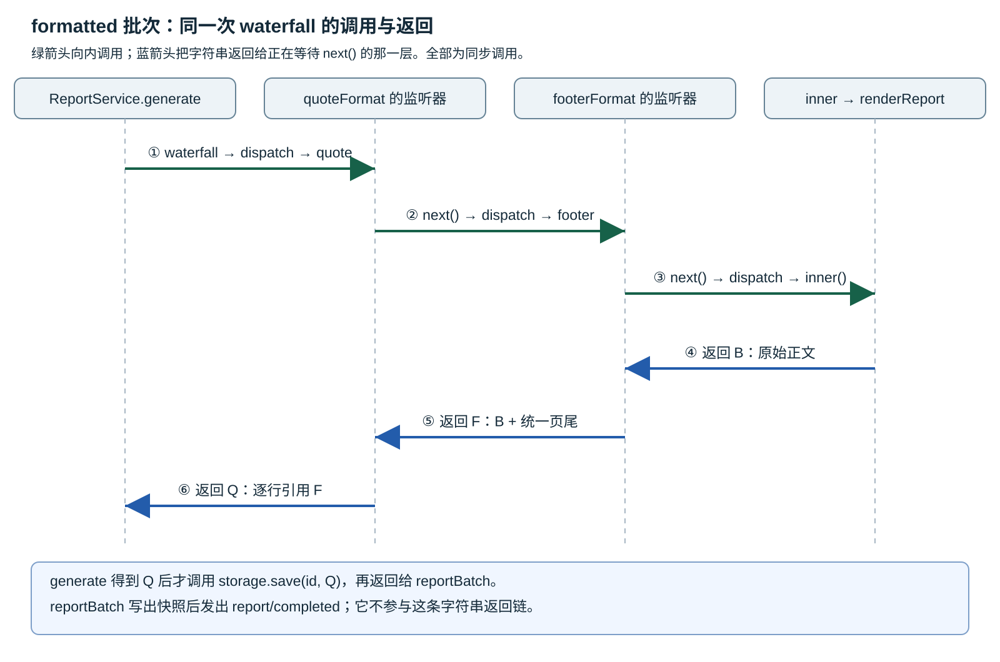

<!-- Generated from LearningTask.ipynb by scripts/render-lessons.py. -->

[运行此课 Notebook](LearningTask.ipynb) · [课程目录](../../README.md)

**Cordis 2009 · 可插拔的格式处理**

[课程目录](../../README.md) · [环境与运行](../../SETUP.md)

# 本课导览

用 quote、footer 两个插件包装生成结果，沿 next 进入，再带着字符串返回。

本课先给具体代码和预期行为，再沿本课固定版本的源码解释原因。读到所选路径即可，不要求通读整个内核。

本课延续前课的 ReportDesk，所有文件与依赖独立保存在当前目录。先在本课目录安装依赖，再按 00 → 01 执行 Notebook，或使用 `npm run demo` 运行完成参考。

建议按 2–3 小时安排首次阅读、运行与回看；可分多次完成。

# 源码与阅读导航

固定 **Cordis 4.0.0-rc.10 / c261dd2c13d65b1994adb1cdc10d7dba61542523**；提交日期 2026-10-10 UTC，访问日期 2026-10-19。下面的本地文件就是本课运行和调试使用的源码。

| 资料 | 读取范围与停止点 | 用途 |
|---|---|---|
| [main.ts](examples/01-reportdesk/main.ts)、[report-service.ts](app/report-service.ts)、[format-plugins.ts](app/format-plugins.ts) | M1 的三处接入，读到 without-footer 批次完成 | 明确输入、格式回调、保存与完成通知的位置 |
| [events.ts](materials/cordis/src/events.ts) | M2 摘录：on 158–170、register 138–144、_resolve 76–85、waterfall 121–136、unregister 147–155 | 从注册读到本次返回，再连接已学清理 |
| [reflect.ts](materials/cordis/src/reflect.ts) | 只核对 149 行的方法混入声明 | 确认 ctx.on / ctx.waterfall 进入哪个服务 |
| [events.spec.ts](materials/cordis/events.spec.ts)（选读） | 190–200 行，止于两个监听器与第一次结果断言 | 佐证返回值计算，不要求安装或运行测试框架 |

正文摘录注明省略与注释，展示代码统一为每级 4 个空格，原始上游文件保持原缩进；精确来源及初始哈希在 [source-index.json](materials/source-index.json)，研究输入见 [资料说明](materials/README.md)。源码可以加注释和打印；哈希描述初始版本，不会自动覆盖你的修改。

# 沿场景理解源码

先在本课目录执行 `npm ci` 和 `npm run check`。Notebook 使用 JavaScript（jslab），按 00 → 01 运行；终端使用 `npm run demo`，两者加载同一份本课源码。各阶段的观察说明紧邻代码。

运行生成的报告、状态快照和声明位于本课 `runs/`。重跑会替换同一用途的结果；需要比较时先另行保存。只修改本课文件即可，不依赖其他课程的安装目录。VS Code 请单独打开本课目录，再选择对应调试配置。

## M1 · 把格式接入报告生成

**50 分钟。** 从现成的应用增量读起，再执行唯一案例。起点是上一课的 `renderReport(input) → storage.save(id, markdown)`；本课在这两步之间完成格式包装。

### M1.1 给生成结果留一个格式入口

`reportProvider` 创建 `ReportService`，声明 `inject: ["storage"]`；`storageProvider` 创建内存 Map 服务。`reportBatch` 逐份调用 `ctx.report.generate(id, input)`。本课继续使用这三个角色；`input` 是含 `title`、`text`、`includeExcerpt` 的对象，id 用于保存结果。台灯和水杯输入由 [shared/report.ts](shared/report.ts) 的 `sampleJobs()` 从 fixtures 读入。

新增事件的类型声明在 [report-events.ts](app/report-events.ts)。这里 `next` 的类型是“无参数、返回字符串的函数”，声明本身不会注册任何运行回调：

```ts
"report/format"(input: ReportInput, next: () => string): string;
```

在 [report-service.ts](app/report-service.ts) 23–29 行，将生成动作放进最后一个函数参数。下面为完整 generate 方法；日志用于辨认终点执行：

```ts
    generate(id: string, input: ReportInput): string {
        const markdown = this.ctx.waterfall("report/format", input, () => {
            console.log("inner：调用 renderReport(input)，生成原始正文");
            return renderReport(input);
        });
        this.ctx.storage.save(id, markdown);
        return markdown;
    }
```

这次 `waterfall` 调用传入事件名、同一个 input 对象、终点函数。它调用已注册的格式回调；回调中的 `next()` 继续进入后面的回调，最后执行终点。每层拿到 `next()` 返回的字符串，可以加工后返回。**最终结果回到 generate 的 markdown，再被 storage 保存。** 没有格式回调时，直接调用终点，得到原始正文。

`next` 由框架为每层回调创建；最后一个 `() => renderReport(input)` 则由这里的业务代码创建。终点闭包已经捕获 input，因此框架执行它时不必再传参数。

### M1.2 两个格式插件各包装一层

[format-plugins.ts](app/format-plugins.ts) 的两个函数是插件入口；`app.plugin(...)` 执行入口时，`ctx` 是各插件自己的 Context。每个入口调用 `ctx.on("report/format", listener)` 登记一个监听器。以下摘录完整函数体，只有导入被省略：

```ts
export function quoteFormat(ctx: Context): void {
    ctx.on("report/format", (input, next) => {
        console.log(`quoteFormat：进入 ${input.title}，调用 next()`);
        const markdown = next();
        console.log("quoteFormat：next() 已返回，为每行添加引用前缀");
        return markdown.trimEnd().split("\n").map((line) => `> ${line}`).join("\n") + "\n";
    });
}

export function footerFormat(ctx: Context): void {
    ctx.on("report/format", (input, next) => {
        console.log(`footerFormat：进入 ${input.title}，调用 next()`);
        const markdown = next();
        console.log("footerFormat：next() 已返回，添加统一页尾");
        return markdown + "\n---\n由 ReportDesk 生成。\n";
    });
}
```

`quoteFormat` 要把整份报告作为 Markdown 引用交付，因此给每一行添加 `> `。`footerFormat` 添加统一页尾。这里的箭头监听器不读取 `this`，业务输入来自显式参数 `input`。

> **先进入的是 `quoteFormat` 的事件处理器；先完成格式加工的是 `footerFormat`。** 两个处理器都把加工放在 `next()` 之后，因此“进入处理器的顺序”与“加工返回值的顺序”相反。

入口先装 quote，再装 footer，监听器也按这个顺序进入。quote 执行到 `const markdown = next()` 时，会同步调用下一层 footer；**此时 quote 已经开始执行，但还没有给任何一行加上引用前缀**。footer 的 `next()` 再调用终点 `inner`，生成原始正文。

下面按调用的嵌套层次缩进，展示一次报告生成的日志顺序，省略报告标题：

```text
quoteFormat：进入，调用 next()
    footerFormat：进入，调用 next()
        inner：生成原始正文
    footerFormat：next() 已返回，添加统一页尾
quoteFormat：next() 已返回，为每行添加引用前缀
```

终点返回后，footer 先拿到原始正文，加上页尾并 `return`；这个返回值成为 quote 的 `next()` 的结果，赋给 quote 自己的 `markdown`。quote 随后才继续向下执行，把**正文和页尾一起**加上 `> ` 后返回。因此进入顺序是 **quote → footer → inner**，返回时的加工顺序是 **footer 加页尾 → quote 加引用**。这是同步函数调用逐层返回的结果；看到 footer 先添加页尾，不表示它的事件处理器先被调用。

`.split()` / `.map()` / `.join()` 只是逐行加前缀，不改变 Cordis 的调用规则。每个回调的 `return` 都是结果链的一段，不能只计算字符串却忘记返回。

### M1.3 在同一应用中观察装载和卸载

下面摘自 [main.ts](examples/01-reportdesk/main.ts)，省略导入、观察日志和 finally 清理；完整文件已准备，不需要另建应用。`jobs` 是两份输入，`runBatch` 为每份 id 加上批次前缀，并在批次结束后释放一次性的 reportBatch 插件。

```ts
const app = new Context();
const storage = app.plugin(storageProvider);
const report = app.plugin(reportProvider);
const notification = app.plugin(notificationPlugin);
const statistics = app.plugin(statisticsPlugin);
await storage;
await report;
await notification;
await statistics;
await runBatch(app, jobs, "plain");

const quote = app.plugin(quoteFormat);
await quote;
const footer = app.plugin(footerFormat);
await footer;
await runBatch(app, jobs, "formatted");

await footer.dispose();
await runBatch(app, jobs, "without-footer");
```

`quote`、`footer` 是插件装载句柄，不是返回的 Markdown。装载和 await 完成后，监听器已经登记；每次 report.generate 才会调用它们。本课的存储和报告服务始终保留，只有页尾监听在第三批之前被移除。

接下来执行 00 和 01，重点看 formatted 的日志顺序以及最后一批的页尾变化。

```javascript
// 00 · ReportDesk：初始化本课 Notebook 入口。
var path = require("node:path");
var fs = require("node:fs");
var taskName = "2009.Cordis-ReportDesk-Format-Plugins";
var taskRoot = path.basename(process.cwd()) === taskName ? process.cwd() : path.join(process.cwd(), taskName);
if (!fs.existsSync(path.join(taskRoot, "package.json"))) throw new Error("请从仓库根或本课目录打开 Notebook。");
var reportdesk = require(path.join(taskRoot, "shared/notebook.cjs"));
console.log("本课目录：", taskRoot);
```

```javascript
// 01 · ReportDesk：观察两层格式的调用、返回以及卸载页尾后的结果。
reportdesk.run();
```

### M1.4 对照报告正文与完成通知

下面是按代码推导的预期，用于读你的实际输出，不是预填的学习记录。

| 批次 | 格式回调进入顺序 | 报告最终外观 | report 状态 / 实例 |
|---|---|---|---|
| plain | 无，直接进入 inner | 原始正文 | ACTIVE / instanceId=1 |
| formatted | quote → footer → inner | 每行有 `> `，页尾也在引用内 | ACTIVE / instanceId=1 |
| without-footer | quote → inner | 每行仍有 `> `，统一页尾消失 | ACTIVE / instanceId=1 |

formatted 每份报告的关键日志为：quote 进入 → footer 进入 → inner 生成 → footer 返回并添加页尾 → quote 返回并添加前缀 → storage.save → 快照写出 → report/completed 通知与统计。三批共六份报告，统计从 1 连续到 6。

磁盘快照位于 `runs/reportdesk/plain-lamp.md`、`formatted-lamp.md`、`without-footer-lamp.md` 及对应 bottle 文件；内存 storage 累积六个 id。`observations.json` 保存服务状态和实例编号，帮助确认卸载格式插件没有重建报告服务。

`report/format` 的返回字符串参与生成结果；`report/completed` 是保存和快照写出之后的通知。完成事件仍由 [report-batch.ts](app/report-batch.ts) 发出，通知和统计监听器没有返回正文的职责。

## M2 · 沿 next 进入，再带着结果返回

**75 分钟。** 以 formatted 批次第一份台灯报告为现场，只读本次同步调用。先看监听器从哪里来，再跟到最终字符串返回。

### M2.1 注册后，监听器保存在哪里

`ctx.on` 和 `ctx.waterfall` 都是 EventsService 的方法入口；[reflect.ts](materials/cordis/src/reflect.ts) 149 行把这些方法混入 Context：

```ts
this.mixin('events', ['on', 'once', 'parallel', 'emit', 'serial', 'bail', 'waterfall'])
```

本例的格式插件最终进入 [events.ts](materials/cordis/src/events.ts) 的 on。以下为 158–170 行，完整保留方法：

```ts
on(name: string | symbol, listener: (...args: any) => any, options?: boolean | EventOptions) {
    if (typeof options !== 'object') {
        options = { prepend: options }
    }

    // handle special events
    this.ctx.fiber.assertActive()
    listener = this.ctx.reflect.bind(listener)
    const result = this.bail(this.ctx, 'internal/listener', name, listener, options)
    if (result) return result

    const label = `ctx.on(${typeof name === 'string' ? JSON.stringify(name) : name.toString()})`
    return this.register(label, name, listener, options)
}
```

本例没有额外的 internal/listener 拦截处理 report/format，最后进入 register。`reflect.bind` 返回包装原始 listener 的 Proxy，因此表中的 callback 与原始 listener 并非同一个函数对象。调用 callback 时，这个包装层再调用原始 listener；本例普通 input 与 next 不被替换，两个箭头也不读取 this，所以显式参数和字符串返回路径保持不变。对应 [reflect.ts](materials/cordis/src/reflect.ts) 269–282 行；本课到这层接口行为为止。

register 的实现（138–144 行）把监听器与所属 ctx 存到共享表，并把 unregister 登记为该插件 Fiber 的清理动作：

```ts
private register(label: string, name: string | symbol, callback: any, options: EventOptions): () => void {
    const method = options.prepend ? 'unshift' : 'push'
    return this.ctx.fiber.effect(() => {
        const hooks = this._hooks[name] ??= []
        hooks[method]({ ctx: this.ctx, callback, ...options })
        return () => this.unregister(name, callback)
    }, label)
}
```

没有设置 prepend 时使用 push。quote 先装、footer 后装，所以 `_hooks["report/format"]` 的顺序为：

| 保存项 | ctx 指向谁 | callback 对应谁 |
|---|---|---|
| 第 1 项 | quote 插件 Context | quoteFormat 注册的监听器 |
| 第 2 项 | footer 插件 Context | footerFormat 注册的监听器 |

这张表跨多次业务调用保存；回调此时只是登记，尚未执行格式转换。

### M2.2 从调用参数得到本轮 callbacks 和 inner

再次看调用点：`this.ctx.waterfall("report/format", input, terminal)`，这里用 terminal 指代 M1.1 中最后那个闭包，实际代码没有另外声明这个变量。进入 EventsService.waterfall 时，剩余参数数组最初是 `["report/format", input, terminal]`。

第一步调用 `_resolve('waterfall', args)`。下面为 [events.ts](materials/cordis/src/events.ts) 76–85 行：

```ts
private _resolve(type: string, args: any[]) {
    const thisArg = typeof args[0] === 'object' || typeof args[0] === 'function' ? args.shift() : null
    const name: string | symbol = args.shift()
    if ((typeof name !== 'string' || !name.startsWith('internal/')) && this._hooks['internal/dispatch']?.length) {
        this.emit('internal/dispatch', type, name, args, thisArg)
    }
    const filter = thisArg?.[Context.filter]
    return [thisArg, (this._hooks[name] || [])
        .filter(hook => hook.global || !filter || filter.call(thisArg, hook.ctx)).map(hook => hook.callback)] as const
}
```

本例第一个参数是事件名字符串，所以 thisArg 为 null，然后 args.shift() 取走事件名。这里未显式提供事件 thisArg，因此不会设置 filter；map 从已登记记录中取出 callback，创建本次派发使用的新数组。

回到 waterfall 后，`const inner = args.pop()` 取走终点函数。此时具体数据为：

| 变量 | formatted 本次的值 |
|---|---|
| `thisArg` | null；后面传给 Reflect.apply，两个箭头监听器不使用它 |
| `args` | `[input]`；每层得到同一个 input 对象引用 |
| `callbacks` | `[quote 监听器, footer 监听器]`，本次新建数组 |
| `inner` | generate 中捕获 input 的终点闭包 |

后面的 shift 只消耗本次 callbacks，不删除共享 `_hooks` 中的登记。下一份报告再次调用 waterfall 时，会重新取得一份 callbacks。

### M2.3 dispatch 为每层创建一个 next

[events.ts](materials/cordis/src/events.ts) 121–136 行是完整 waterfall 方法。下面只增加了中文行尾注释，逻辑保持原样：

```ts
waterfall(...args: any[]) {
    const [thisArg, callbacks] = this._resolve('waterfall', args)
    const inner = args.pop() // 最后的业务闭包，返回原始正文
    const dispatch = () => {
        const callback = callbacks.shift() // 取出本轮尚未调用的下一项
        if (!callback) return inner() // 已无监听器，进入终点
        let called = false // 属于当前这层 callback
        const next = () => {
            if (called) throw new Error('next() called multiple times')
            called = true
            return dispatch() // 同步进入下一层，把它的结果返回
        }
        return Reflect.apply(callback, thisArg, [...args, next])
    }
    return dispatch() // 启动最外层，并返回它的结果
}
```

Reflect.apply 的第三个参数是本次回调的实参列表，因此每个格式监听器收到 `(input, next)`。dispatch 与 callbacks 由同一次 waterfall 共享；但每次取到 callback，都会创建一个新的 called 和 next 闭包。quote 的 next 与 footer 的 next 是两个不同函数，分别记住本层是否已经继续执行过。

本例调用关系是：外层 dispatch 取 quote；quote 的 next 再调用 dispatch 取 footer；footer 的 next 再调用 dispatch，发现列表已空，执行 inner。inner 返回字符串后，普通函数调用栈逐层返回。**next() 在本课中是同步调用，不是等待以后才发生的通知，也不返回 Promise。**

called 只防止同一个 next 被调用两次，不强制监听器调用 next。若某个回调直接 return，则后面的回调和终点不会在本次调用中执行；本课两个格式回调都正常调用一次 next，按这条路径跟读即可。

### M2.4 用一份具体字符串串起返回链

把本次终点返回的原始 Markdown 暂记为 **B**；footer 返回的“B 加统一页尾”为 **F**；quote 把 F 的每行加 `> ` 后返回的字符串为 **Q**。这三个字母只是图中的值简称，源码里各函数都用自己的局部变量 markdown。



[单独打开大图](materials/format-flow.svg)，原始尺寸 1600 × 1060。绿色箭头是向内调用，蓝色箭头是字符串返回；每条箭头对应 M2.3 的 return 或 callback 内的 next / return。

| 暂停位置 | callbacks 的剩余内容 | 这层下一步得到什么 |
|---|---|---|
| quote 即将执行 next | `[footer 监听器]` | 等内层完成后得到 F |
| footer 即将执行 next | `[]` | inner 返回 B |
| footer 的 next 已返回 | `[]` | 本层返回 F |
| quote 的 next 已返回 | `[]` | 本层返回 Q |
| generate 的 waterfall 已返回 | 本次调用结束 | markdown=Q，随后保存 |

两个插件的输入参数始终是 input；框架没有把上一回调的返回值自动塞进下一回调的第一个参数。加工结果沿 next 的返回方向交给外层，最终回到 generate。先注册的 quote 因此是外层，最后完成包装。

### M2.5 用断点看到回调数组与局部返回值

本课与仓库根的 [launch.json](.vscode/launch.json) 都提供 **Cordis 2009 · 01 · 可插拔的格式处理**。在 VS Code 的“运行和调试”选择该配置；先在 [main.ts](examples/01-reportdesk/main.ts) 的 formatted 批次调用处设断点（第 34 行）。启动后停在这里，再启用下列断点，便于跳过 plain 批次。

| 断点 | 看什么 |
|---|---|
| [report-service.ts](app/report-service.ts) 24 行 | this.ctx、id、input；进入本次 waterfall |
| [events.ts](materials/cordis/src/events.ts) 124 行 | _resolve 和 pop 已完成；args 只有 input、callbacks 有两项、inner 是终点 |
| events.ts 126 行 | 每次 shift 后的 callback 与剩余 callbacks |
| [format-plugins.ts](app/format-plugins.ts) 8 / 17 行 | quote / footer 各自的 next；单步进入可看到不同调用栈层 |
| format-plugins.ts 18 / 9 行 | 两次 next 已返回后，局部 markdown 分别是 B / F |
| report-service.ts 28 行 | waterfall 完成，markdown 是 Q；保存发生在包装之后 |

F10 跨过当前调用，F11 进入调用，Shift+F11 返回调用者。装载配置使用本课 tsx 与源码；若进入工具加载器，可直接使用上表文件断点，继续执行到它，优先观察变量与调用栈。无需改核心源码或逐个遍历代理实现。

断点只是帮助看清本次调用；已有理解时可只阅读摘录与图，不要求提交截图或调试记录。

本次作者验证已执行本配置的程序、cwd 和 runtimeArgs，并用 Node 调试协议停在本课实际源码，核对 callbacks 与 B/F/Q 返回值。VS Code 窗口连接超时，图形界面的配置选择、行号断点映射与单步尚未重新验收；此边界不影响终端和 Notebook 的已验证入口。

### M2.6 卸载页尾，改变的是下一次派发的列表

入口在 formatted 批次全部结束后执行 `await footer.dispose()`。M2.1 中 register 通过该插件 Fiber 的 effect 登记了 unregister，卸载会执行这个清理函数。[events.ts](materials/cordis/src/events.ts) 147–155 行：

```ts
private unregister(name: string | symbol, callback: any) {
    const hooks = this._hooks[name]
    if (!hooks) return
    const index = hooks.findIndex(hook => hook.callback === callback)
    if (index >= 0) {
        hooks.splice(index, 1)
        if (!hooks.length) delete this._hooks[name]
        return true
    }
}
```

本次移除的是 footer 对应的 callback，quote 仍留在 `_hooks["report/format"]` 中。下一批调用 `_resolve` 时得到 `[quote 监听器]`：quote 的 next 直接进入 inner，所以报告仍带引用前缀，但页尾消失。

reportProvider 的 inject 仍只有 storage；格式插件是可选监听器，不是 report 的必要服务依赖。因此本例没有触发 2008 的 PENDING / 重建过程，report 服务实例仍为 1。plain 阶段还说明：没有任何格式监听器时，waterfall 也能直接执行 inner。

这里是在一批同步格式处理完成之后才卸载，不涉及正在进行的异步回调取消。本次结束于“移除监听后，下一次调用读到新列表”，无需扩展到其他生命周期路径。

### M2.7 回到本课的一条业务路径

报告生成调用 waterfall；waterfall 从本次 callbacks 依次进入 quote、footer 和 inner；返回时 footer 加页尾、quote 加引用，最终字符串由 report 保存。reportBatch 写出快照后再发完成事件，通知与统计继续观察结果。

注册顺序决定嵌套的外内层；next 负责进入下一层并把其返回值带回；各层 return 把自己的加工结果交回上一层。卸载格式插件清掉的是登记的监听器，后续生成按剩余列表继续。

选读 [events.spec.ts](materials/cordis/events.spec.ts) 190–200 行时，可看到同样规则：两个回调都计算 `value + next()`，value 都是 1，终点返回 2，最终为 `1 + (1 + 2) = 4`。只读到第一次断言即可；这是上游测试源码，不是本课新增作业或已运行测试的声明。

# 本课收束

waterfall 为每层回调提供 next。调用顺序沿注册顺序进入，返回值沿调用栈向外传回；外层可以加工结果。卸载 footer 改变后续派发的监听列表，quote 与 report 服务仍可继续使用。
