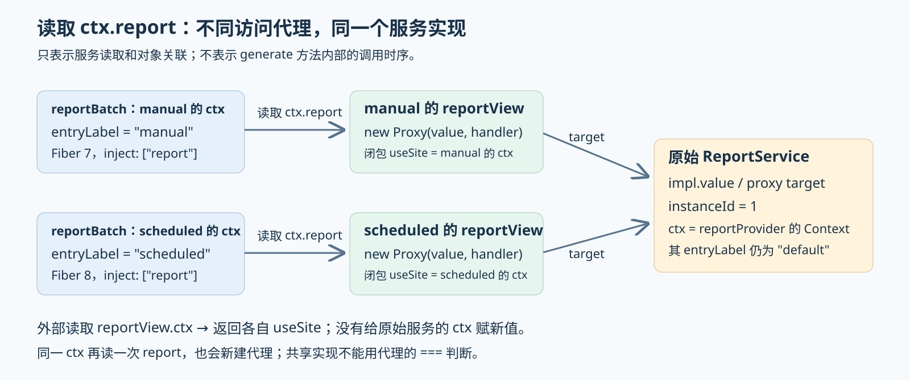

<!-- Generated from LearningTask.ipynb by scripts/render-lessons.py. -->

[运行此课 Notebook](LearningTask.ipynb) · [课程目录](../../README.md)

**Cordis 2011 · 同一服务的两个调用视图**

[课程目录](../../README.md) · [环境与运行](../../SETUP.md)

# 本课导览

manual、scheduled 共用报告实现，读取不同代理视图并保留来源标签。

本课先给具体代码和预期行为，再沿本课固定版本的源码解释原因。读到所选路径即可，不要求通读整个内核。

本课延续前课的 ReportDesk，所有文件与依赖独立保存在当前目录。先在本课目录安装依赖，再按 00 → 01 执行 Notebook，或使用 `npm run demo` 运行完成参考。

建议按 2–3 小时安排首次阅读、运行与回看；可分多次完成。

# 源码与阅读导航

固定 **Cordis 4.0.0-rc.10 / c261dd2c13d65b1994adb1cdc10d7dba61542523**，上游提交日期 2026-10-10 UTC，访问日期 2026-10-22。使用本课独立可编辑的源码、依赖与锁文件；初始哈希及固定链接见 [source-index.json](materials/source-index.json)。

| 资料与类型 | 指定范围与停止点 | 用途 |
|---|---|---|
| 本课应用：[main.ts](examples/01-reportdesk/main.ts)、[report-batch.ts](app/report-batch.ts)、[report-service.ts](app/report-service.ts) | M1 的相邻摘录；读到两批报告完成 | 找到两个调用方、标签与服务使用位置 |
| 官方源码：[service.ts](materials/cordis/src/service.ts) | M2.1 的普通 Service 构造选段；到 provide | 确定原始服务和 tracker 的来源 |
| 官方源码：[reflect.ts](materials/cordis/src/reflect.ts) | 63–99 行，按 M2.2 只走 report 已就绪的分支，到 87 行返回 | 从调用 Context 找到实现值 |
| 官方源码：[utils.ts](materials/cordis/src/utils.ts) | M2.3–M2.4 精选 getTraceable / createTraceable；到代理返回和普通数据字段读取 | 解释视图身份与 ctx 关联 |
| 官方测试（选读）：[service.spec.ts](materials/cordis/service.spec.ts) | 36–73 行 traceable effect (with inject)，到 value=3 断言 | 对照服务与消费方各自的依赖声明 |

测试文件为阅读材料，未安装完整上游测试工程。选题依据与资料核验范围在 [资料说明](materials/README.md)。正文中的源码围栏是阅读摘录，实际运行使用下方独立 Code cell。

# 沿场景理解源码

先在本课目录执行 `npm ci` 和 `npm run check`。Notebook 使用 JavaScript（jslab），按 00 → 01 运行；终端使用 `npm run demo`，两者加载同一份本课源码。各阶段的观察说明紧邻代码。

运行生成的报告、状态快照和声明位于本课 `runs/`。重跑会替换同一用途的结果；需要比较时先另行保存。只修改本课文件即可，不依赖其他课程的安装目录。VS Code 请单独打开本课目录，再选择对应调试配置。

## M1 · 两个入口共用报告服务

40 分钟。先读入口和两处业务调用，再运行一次。已有配置、格式、存储与通知保持，新增内容只是入口标签和服务视图的观察。

### M1.1 标签放在调用 Context 上

以下摘自 [main.ts](examples/01-reportdesk/main.ts)，省略导入、格式/观察插件和 finally 清理。`jobs` 来自 fixtures 中的台灯、水杯文本。`app` 是根 Context；storageProvider 提供内存存储，reportProvider 声明 `inject: ["storage"]`，并且只装载一次。

```ts
const jobs = await sampleJobs();
const app = new Context();
app.entryLabel = "default";
const storage = app.plugin(storageProvider);
const report = app.plugin(reportProvider, { excerptLength: 8 });
await storage;
await report;

const manualCtx = app.extend({ entryLabel: "manual" });
const scheduledCtx = app.extend({ entryLabel: "scheduled" });
```

`extend` 创建派生 Context，复制参数对象的属性描述符到新对象；没有重新创建根服务。两个入口各有自己的 entryLabel，公共起点 app 仍为 default。字段的 TypeScript 声明在 [call-context.ts](app/call-context.ts)，运行值来自上面的赋值和 extend，不由类型声明生成。

沿用同一个 reportBatch 插件，分别从两个入口装载；每份 id 加前缀，避免覆盖存储中的报告。两批顺序执行，manual 批次完成后才创建 scheduled 批次：

```ts
manual = manualCtx.plugin(reportBatch, {
    jobs: jobs.map((job) => ({ ...job, id: `manual-${job.id}` })),
});
await manual;
scheduled = scheduledCtx.plugin(reportBatch, {
    jobs: jobs.map((job) => ({ ...job, id: `scheduled-${job.id}` })),
});
await scheduled;
```

plugin 为每次装载创建自己的 Fiber 与 Context。manual 的 apply 参数 ctx 派生自 manualCtx；scheduled 的则派生自 scheduledCtx。因此读取 `ctx.entryLabel` 分别得到 manual 和 scheduled。report 变量仍是提供服务的插件句柄；下面的 reportView 才是调用插件读到的服务。

### M1.2 调用代码保持同一份

[report-batch.ts](app/report-batch.ts) 的相关选段如下，省略观察辅助、文件导出和完成事件。两个插件装载都声明依赖 report；每轮 apply 读一次服务并保存为 reportView：

```ts
export const reportBatch = {
    name: "report-batch",
    inject: ["report"],
    async apply(ctx: Context, config: { jobs: ReportJob[] }): Promise<void> {
        const reportView = ctx.report;
        for (const job of config.jobs) {
            const markdown = reportView.generate(job.id, job.input);
            // 后续将 markdown 导出为文件并发出 report/completed。
        }
    },
};
```

服务的生成路径见 [report-service.ts](app/report-service.ts)。下面是 generate 的核心代码，省略一条观察日志。入口标签从本次调用所使用的 Context 读取，摘录长度仍来自共享服务的 config；格式和存储操作沿用已有流程。

```ts
const entryLabel = this.ctx.entryLabel;
const markdown = this.ctx.waterfall("report/format", input, () => {
    return `来源入口：${entryLabel}\n\n` + renderReport(input, this.config.excerptLength);
});
this.ctx.storage.save(id, markdown);
return markdown;
```

这里先使用服务的调用行为：manual 和 scheduled 应生成不同来源标签，report 自己声明的 storage 仍可使用。M2 的源码推导只解释 `const reportView = ctx.report` 和外部读取视图属性；方法执行时 this 如何处理，是另一个调用环节，不能仅凭“view.ctx 指向调用方”推断其完整过程。

### M1.3 运行并观察身份

完整实现已准备。01 除生成报告，还在业务循环外调用 [observe-view.ts](shared/observe-view.ts)：比较两次 ctx.report 的引用、它们指向的原始服务，以及外部读取 reportView.ctx 的结果。这些是只读观察辅助，不参与报告生成。

先执行 00；若定位失败，确认从本课目录打开 Notebook。

```javascript
// 00 · ReportDesk：初始化本课 Notebook 入口。
var path = require("node:path");
var fs = require("node:fs");
var taskName = "2011.Cordis-ReportDesk-Service-Views";
var taskRoot = path.basename(process.cwd()) === taskName ? process.cwd() : path.join(process.cwd(), taskName);
if (!fs.existsSync(path.join(taskRoot, "package.json"))) throw new Error("请从仓库根或本课目录打开 Notebook。");
var reportdesk = require(path.join(taskRoot, "shared/notebook.cjs"));
console.log("本课目录：", taskRoot);
```

00 成功后执行 01。先看两组视图观察，再看四次 generate 日志；报告正文应分别带上 manual 或 scheduled。

```javascript
// 01 · ReportDesk：两个调用入口、一个服务实现。
reportdesk.run();
```

### M1.4 把观察项翻译成对象关系

以下为固定示例的预期，用于对照本次运行输出：

| 输出字段 | manual / scheduled 的预期 | 含义 |
|---|---|---|
| callerUid | 7 / 8 | 两次 reportBatch 装载各有自己的 Fiber |
| callerInject | 都只有 report | 调用方声明其直接使用的服务 |
| sameViewOnRepeatedRead | 都为 false | 同一个 ctx 连续读取两次 report，得到不同的代理 |
| sameOriginalOnRepeatedRead | 都为 true | 这两个代理背后指向同一服务对象 |
| sameOriginalAcrossCallers | 第二组为 true | scheduled 的原始服务与 manual 的原始服务相同 |
| viewContextIsCaller | 都为 true | 外部读取视图的 ctx，得到本轮 reportBatch 的 ctx |
| originalContextIsCaller / originalContextLabel | false / default | 原始服务保存的 Context 没有被替换成调用方 |
| reportInstanceId | 都为 1 | 只创建了一次 ReportService |

两个入口共用 storage 实例 1，累计保存 manual-lamp、manual-bottle、scheduled-lamp、scheduled-bottle 四份报告，完成统计为 1–4。具体 uid 由本例装载顺序决定；比较的是对象是否共享，不是记住数字。

“原始服务”由固定版本的内部 `Symbol.for("cordis.original")` 观察：代理读取这个键会返回目标对象，M2.4 给出实现。辅助代码用 Reflect.get 读取受 TypeScript protected 限制的 ctx，仅用于观察，不把内部 Symbol 或绕过类型访问作为业务接口。第一组的跨调用方比较是与自身对照，真正有区分意义的是第二组。

## M2 · 从 ctx.report 读到服务视图

70 分钟。固定现场为 manual 的 reportBatch.apply 执行 `const reportView = ctx.report`。此时 report 依赖已就绪，服务实例 1 已登记；scheduled 随后经过同一路径，但传入另一份调用 Context。

### M2.1 原始服务和 tracker 从哪里来

reportProvider.apply 只执行一次 `new ReportService(ctx, config)`。它的构造器通过 `super(ctx, "report")` 进入 Service；这里 ctx 属于 reportProvider，不是 reportBatch 的调用 Context。以下选自 [service.ts](materials/cordis/src/service.ts) 18–34 行，省略可调用服务分支及 name 的兜底赋值，保留本例普通 Service 的行为：

```ts
let self = this;
const tracker: Tracker = {
    associate: name,
    property: 'ctx',
};
self.ctx = ctx;
self.name = name;
defineProperty(self, symbols.tracker, tracker);
self.ctx.reflect.provide(name, self, this[symbols.check]);
return self;
```

`self` 是新建的原始 ReportService。本例 name 为 report，tracker 保存 `{ associate: "report", property: "ctx" }`：property 告诉后面的代理“哪个属性代表这个对象的 Context”；associate 用于关联服务成员名，本例无需进入该分支。tracker 不是新的服务，也不保存业务配置。

provide 将服务保存为登记项 `impl = { name, value: self, fiber: 提供服务的 Fiber, check }`。依赖准备阶段把同一登记项交给声明 report 的调用 Fiber。本次 apply 已能运行，`ctx.fiber.store.report` 已存在，其中 `value` 正是原始 ReportService。两个调用 Fiber 的 store 是各自的记录表，但 report 项引用的是同一实现登记。此处复用已读的依赖准备行为，直接进入消费方如何读取它。

### M2.2 ctx.report 先取得 impl.value

根 Context 在构造时执行 `new Proxy(this, ReflectService.handler)`（[context.ts](materials/cordis/src/context.ts) 39 行）。调用插件的 ctx 通过派生链连接到这层代理；ctx 自己与原型上没有普通的 report 字段，所以读取进入 handler 的服务分支。get 的第三个参数在源码命名为 ctx，含义是本次属性读取的 receiver，也就是 reportBatch.apply 的参数 ctx；target 是代理包裹的根对象。

下面从 [reflect.ts](materials/cordis/src/reflect.ts) 63–99 行精选本次会经过的语句，将 while 的首次迭代展开，省略普通属性、访问器、异常处理和查找失败时的父链分支；省略处不用于推导本例结果：

```ts
get: (target, prop, ctx: Context) => {
    // 本例 prop === "report"，走服务分支。
    const error = new Error(`cannot get property "${prop}" without inject`);
    const defSite = (ctx[symbols.shadow] as Context | undefined) ?? ctx;
    return ctx.events.waterfall('internal/get', ctx, prop, error, () => {
        let fiber = defSite.fiber;
        const impl = fiber.store?.[prop];
        if (impl) return getTraceable(ctx, impl.value);
        // 完整源码还会处理未声明、未就绪及父链查找。
    });
}
```

`error` 是 handler 前面创建、供失败路径使用的 Error；本例不会抛出。`symbols.shadow` 是内部保存定义上下文的键，本次直接访问的 ctx 没有这个值，因此 defSite 就是 ctx。internal/get 是围绕服务读取的内部处理链；本例没有自定义处理，走终点箭头函数。

首次查找便命中 `fiber.store.report`，于是调用 `getTraceable(ctx, impl.value)`：第一个参数是 manual 的调用 Context，第二个参数是共享的原始服务。handler 返回什么，`const reportView = ctx.report` 就得到什么；这里并没有把原始服务直接原样交出。

### M2.3 getTraceable 用 tracker 决定是否包装

这个函数同时服务于多种值；本例 value 是 M2.1 已登记的 ReportService 对象。阅读时只跟这一个输入。

[utils.ts](materials/cordis/src/utils.ts)，110–118 行（阅读摘录，仅将缩进统一为 4 空格）：

```ts
export function getTraceable<T>(ctx: Context, value: T): T {
    if (!isObject(value)) return value
    if (Object.hasOwn(value, symbols.shadow)) {
        return Object.getPrototypeOf(value)
    }
    const tracker = value[symbols.tracker]
    if (!tracker) return value
    return createTraceable(ctx, value, tracker)
}
```

本例 isObject(value) 为真；原始服务没有自己的 symbols.shadow 属性，因此不走提前返回原型的分支。随后找到 Service 构造器写入的 tracker，调用 `createTraceable(ctx, value, tracker)`。

这个函数也解释了一个边界：并非任何值都会变成代理。非对象直接返回，没有 tracker 的对象也直接返回。本课的 ReportService 会被包装，是因为它通过 Service 构造过程明确带有 tracker。

### M2.4 新 Proxy 关联调用 Context，共享目标不变

下面摘自 [utils.ts](materials/cordis/src/utils.ts) 161–171 与 215–216 行，保留视图创建和本课需要的两个 get 分支；其余 handler 成员省略。这是阅读选段，不能作为完整实现单独运行。

```ts
function createTraceable(ctx: Context, value: any, tracker: Tracker) {
    const defSite = (ctx[symbols.shadow] as Context | undefined) ?? ctx;
    const useSite = ctx[symbols.shadow] ? Object.getPrototypeOf(ctx) as Context : ctx;
    const proxy = new Proxy(value, {
        get: (target, prop, receiver) => {
            if (prop === symbols.original) return target;
            // 省略 caller 元数据分支。
            if (prop === tracker.property) return useSite;
            // 其余属性读取规则见完整文件。
        },
        // 省略其他 handler 成员。
    });
    return proxy;
}
```

本次普通调用 Context 没有 symbols.shadow，所以 defSite、useSite 都等于传入 ctx；useSite 表示本次服务被使用的位置。`new Proxy(value, ...)` 的 target 是共享原始服务；闭包保存的 useSite 则分别是 manual 或 scheduled 的调用 Context。

tracker.property 是字符串 ctx，因此**从外部读取 `reportView.ctx` 时，get 返回 useSite**，没有把 target.ctx 改写。读取内部 original 键时返回 target，所以辅助观察能够比较两个视图背后的实现身份。

每次 `ctx.report` 再次进入 getTraceable 都执行一个 new Proxy；这条路径没有缓存代理，所以同一 ctx 的两次读取也不保证引用相等。`reportView.instanceId` 则沿 utils.ts 177–192 行普通数据属性分支：getPropertyDescriptor 从 target 开始沿原型链查找属性描述符，取出 desc.value，数值不带 tracker、也不是函数，最后直接返回 1。原始对象的 config 同样保留，没有因视图创建而复制一份服务。

外部读取视图 ctx 的结果不能直接等同于 generate 方法内部 this.ctx 的完整实现。读取方法还会经过专门的函数处理；本课使用 M1 已观察到的业务行为，源码只收束到服务视图与普通数据字段。

### M2.5 用一张图收束身份关系

下图归纳前面已经给出的代码；它表示属性读取与代理关联，不表示 generate 的内部调用时序。



| 问题 | 本例答案 | 对应语句 |
|---|---|---|
| 谁选择服务实现？ | 调用 Fiber 的 report 依赖登记项 | `fiber.store[prop].value` |
| 谁关联本次调用方？ | 新代理闭包保存 useSite | `createTraceable(ctx, value, tracker)` |
| 哪个对象每次读取会新建？ | 服务访问代理 | `new Proxy(value, ...)` |
| 哪个对象被两个入口共享？ | 原始 ReportService，实例 1 | 两次传入相同 impl.value |
| 原始服务 ctx 是否被入口覆盖？ | 没有；其标签仍为 default | 分支直接 return useSite，没有赋值给 target.ctx |

由此可以区分“共享实现”和“拿到同一个代理”。业务调用保持 `ctx.report.generate(...)` 或先保存视图再调用；不要用代理的严格相等来判断服务是否重新创建，也不要为了改标签直接改共享服务的 ctx。

### M2.6 按需用断点核对本次读取

仓库根与本课的 launch.json 均提供 **Cordis 2011 · 01 · 共享服务与调用视图**，入口为 [main.ts](examples/01-reportdesk/main.ts)，cwd 为本课，使用 `--import tsx`。

可先停在 [report-batch.ts](app/report-batch.ts) 的 `const reportView = ctx.report`，查看 ctx.entryLabel；再停在本课 [reflect.ts](materials/cordis/src/reflect.ts) 87 行或 [utils.ts](materials/cordis/src/utils.ts) 164 行，只观察 prop 为 report、value.instanceId 为 1 的调用。第二批 ctx.entryLabel 改为 scheduled，目标服务仍为实例 1。到视图返回即可停止。

源码修改后重启运行会加载本课文件。

# 本课收束

不同调用方可以取得不同的服务代理，同时共享同一个底层实现。判断是否共享要比较原始服务；仅比较 ctx.report 的代理身份不足以得出实例是否相同。
