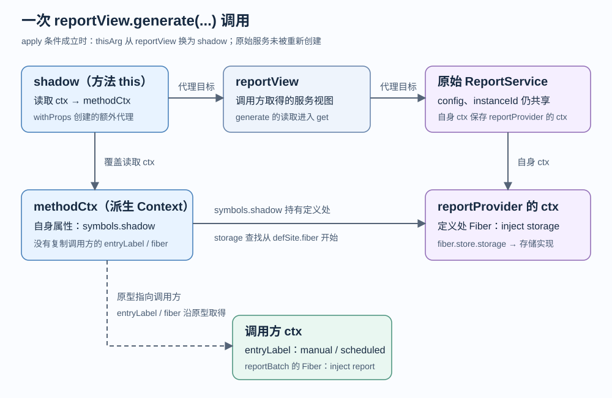

<!-- Generated from LearningTask.ipynb by scripts/render-lessons.py. -->

[运行此课 Notebook](LearningTask.ipynb) · [课程目录](../../README.md)

**Cordis 2012 · 方法调用中的 this 与依赖上下文**

[课程目录](../../README.md) · [环境与运行](../../SETUP.md)

# 本课导览

解释 generate 的 this 怎样确定，以及调用标签与声明依赖为何需要不同上下文。

本课先给具体代码和预期行为，再沿本课固定版本的源码解释原因。读到所选路径即可，不要求通读整个内核。

本课延续前课的 ReportDesk，所有文件与依赖独立保存在当前目录。先在本课目录安装依赖，再按 00 → 01 执行 Notebook，或使用 `npm run demo` 运行完成参考。

建议按 2–3 小时安排首次阅读、运行与回看；可分多次完成。

# 源码与阅读导航

本课使用独立、可编辑的 Cordis **4.0.0-rc.10**，固定 [上游提交 `c261dd2`](https://github.com/cordiverse/cordis/tree/c261dd2c13d65b1994adb1cdc10d7dba61542523/packages/core)（提交日期 2026-10-10；核验日期 2026-10-22）。[初始来源与哈希](materials/source-index.json)用于定位起点，不会自动覆盖学习时添加的注释或打印。

| 类型与位置 | 本课阅读范围与停止点 | 用途 |
| --- | --- | --- |
| 必读 · 本课应用 | [report-batch.ts](app/report-batch.ts) 的 `apply`、[report-service.ts](app/report-service.ts) 的 `generate` / `reportProvider`；配合 [main.ts](examples/01-reportdesk/main.ts) 的两入口，正文已摘录 | 明确调用对象、输入、定义处和结果 |
| 必读 · 官方实现 | [utils.ts](materials/cordis/src/utils.ts)：M2 的 `createTraceable` 方法分支、`createShadow`、`withProp/withProps`、`createShadowMethod`；[context.ts](materials/cordis/src/context.ts)：`extend` | 追踪方法读取、`this` 替换与派生 Context；各段到正文摘录末行停止 |
| 必读 · 官方实现 | [reflect.ts](materials/cordis/src/reflect.ts)：M3 的 80–87 行；`utils.ts:110–118,161–163` | 只沿本例成功命中 storage 的路径，到返回 storage 视图停止 |
| 选读 · 官方测试 | [shadow.spec.ts](materials/cordis/shadow.spec.ts) 第一项测试，至第 58 行；只对照 `shadow` 与 `outerShadow` 的断言 | 看到服务各自保留定义上下文；测试套件未作为本课运行任务 |
| 选读 · 官方实现 | `reflect.ts:241–258` 的 `mixin` | 只定位显式 `.bind`，与普通服务方法代理区分 |

源码摘录只调整为每级 4 空格；省略处显式标记。应用代码也只摘录当前调用需要的部分。

| 运行编号 | 入口 | 目的 |
| --- | --- | --- |
| 00 | 下方 Code cell / [shared/notebook.cjs](shared/notebook.cjs) | 初始化本课 JavaScript Notebook 入口 |
| 01 | M3 Code cell / [examples/01-reportdesk/main.ts](examples/01-reportdesk/main.ts) | 同一应用记录实际进入方法的对象关系，生成四份报告 |

首次运行时在**本课一级目录**执行 `npm ci`；`npm run check` 检查类型，`npm run demo` 独立运行 01。Notebook 选择 **JavaScript（jslab）**，先执行 00，再到 M3 执行 01。两种入口共用应用文件，每次运行启动新进程，源码改动立即生效。

# 沿场景理解源码

先在本课目录执行 `npm ci` 和 `npm run check`。Notebook 使用 JavaScript（jslab），按 00 → 01 运行；终端使用 `npm run demo`，两者加载同一份本课源码。各阶段的观察说明紧邻代码。

运行生成的报告、状态快照和声明位于本课 `runs/`。重跑会替换同一用途的结果；需要比较时先另行保存。只修改本课文件即可，不依赖其他课程的安装目录。VS Code 请单独打开本课目录，再选择对应调试配置。

```javascript
// 00 · ReportDesk：初始化本课 Notebook 入口。
var path = require("node:path");
var fs = require("node:fs");
var taskName = "2012.Cordis-ReportDesk-Method-Context";
var taskRoot = path.basename(process.cwd()) === taskName ? process.cwd() : path.join(process.cwd(), taskName);
if (!fs.existsSync(path.join(taskRoot, "package.json"))) throw new Error("请从仓库根或本课目录打开 Notebook。");
var reportdesk = require(path.join(taskRoot, "shared/notebook.cjs"));
console.log("本课目录：", taskRoot);
```

预期打印以 `2012.Cordis-ReportDesk-Method-Context` 结尾的目录；00 只准备入口，尚未生成报告。

## M1 恢复一次报告调用的现场

约 25 分钟。从调用处确定 `reportView`、传入参数和定义处；这一段到 `generate` 返回 Markdown 为止。

### M1.1 两个调用入口与一个报告服务

[main.ts](examples/01-reportdesk/main.ts) 先装载 storage、report、通知、统计和两个格式插件。下面只保留与入口有关的代码；装载等待与最终清理省略。`jobs` 来自本课 [fixtures](fixtures)，每项包含报告 `id` 和商品输入 `input`。

```typescript
const app = new Context();
app.entryLabel = "default";
const storage = app.plugin(storageProvider);
const report = app.plugin(reportProvider, { excerptLength: 8 });
// 省略已有观察与格式插件的装载，以及等待它们就绪的代码。
const manualCtx = app.extend({ entryLabel: "manual" });
const scheduledCtx = app.extend({ entryLabel: "scheduled" });
manual = manualCtx.plugin(reportBatch, {
    jobs: jobs.map((job) => ({ ...job, id: `manual-${job.id}` })),
});
await manual;
scheduled = scheduledCtx.plugin(reportBatch, {
    jobs: jobs.map((job) => ({ ...job, id: `scheduled-${job.id}` })),
});
await scheduled;
```

`scheduled` 只是本地模拟的第二个入口，运行一次。每个 `reportBatch` 的 `apply(ctx)` 收到属于本次插件装载的 Context；它沿原型链保留对应 `entryLabel`。下文的“调用方 ctx”专指这个 `apply` 参数，**不是直接把 `manualCtx` 与插件 `ctx` 当成同一对象**。

两个入口都调用同一份 `reportBatch.apply` 和 `ReportService.generate`。要对照的是：调用方的标签怎样进入共享方法，同时让报告服务继续使用自己声明的存储依赖。

### M1.2 从成员调用进入 generate

[report-batch.ts](app/report-batch.ts) 中，调用方只声明 `report` 依赖。摘录省略观察辅助、文件导出和完成通知：

```typescript
export const reportBatch = {
    name: "report-batch",
    inject: ["report"],
    async apply(ctx: Context, config: { jobs: ReportJob[] }): Promise<void> {
        const reportView = ctx.report;
        for (const job of config.jobs) {
            const markdown = reportView.generate(job.id, job.input);
            // 此后把 markdown 导出到 runs/reportdesk，再发送完成通知。
        }
    },
};
```

`reportView` 是围绕共享报告服务的访问代理。上一课已经看到两入口仍指向同一个原始 `ReportService`；本课从读取 `generate` 开始接着跟。

原始服务由 [report-service.ts](app/report-service.ts) 的 `reportProvider.apply` 创建。摘录省略日志和清理回调：

```typescript
export const reportProvider = {
    name: "report-provider",
    inject: ["storage"],
    apply(ctx: Context, config: ReportConfig) {
        const service = new ReportService(ctx, config);
        // 返回清理回调，完整实现见源文件。
    },
};
```

构造函数调用 `super(ctx, "report")`。`Service` 把这个 **reportProvider 的 ctx** 存在原始服务上，并附上跟踪信息 `tracker = { associate: "report", property: "ctx" }`（[service.ts:18–34](materials/cordis/src/service.ts)）。因此后续看到 `tracker.property`，本例就是字符串 `"ctx"`；它告诉框架哪个属性承载服务的 Context。

原方法的业务主体如下，来自同一文件；只省略首行只读观察辅助和打印：

```typescript
generate(id: string, input: ReportInput): string {
    const entryLabel = this.ctx.entryLabel;
    const markdown = this.ctx.waterfall("report/format", input, () => {
        return `来源入口：${entryLabel}\n\n` + renderReport(input, this.config.excerptLength);
    });
    this.ctx.storage.save(id, markdown);
    return markdown;
}
```

输入 `id/input` 来自当前 job；格式插件包装生成结果，storage 存储最终字符串。接下来只解释 `this` 与 `this.ctx`：先看它们怎么建立，再分别追踪标签和依赖。

## M2 从读取方法走到实际 this

约 65 分钟。把 `reportView.generate(...)` 分成“读取属性”和“调用所得函数”两个阶段。这里的 `shadow` 是源码中的局部变量名，表示给本次方法调用使用的服务代理；`symbols.shadow` 则是派生 Context 上记录定义上下文的属性键。先区分这两个实体，再逐行连接。

### M2.1 读取 generate：方法代理在哪里创建

进入 [utils.ts 的 `createTraceable`](materials/cordis/src/utils.ts) 后，`reportView` 就是其中返回的 `proxy`。这次读取的参数为：

| 源码变量 | 本次值 |
| --- | --- |
| `target` | 原始 ReportService |
| `prop` | `"generate"` |
| `receiver` | `reportView`，即本次取属性的服务视图 |
| `useSite` | 当前 `reportBatch.apply` 的 ctx |
| `tracker.property` | `"ctx"` |

`getPropertyDescriptor(target, prop)` 从对象自身沿原型链找描述符（101–108 行）。本例在 `ReportService.prototype` 找到 `generate`，其 `value` 就是原始方法。以下是 177–193 行的方法选择部分；读取普通 Symbol 和其他注册属性的前置分支省略，本次均不命中。

```typescript
let shadow: any, innerValue: any
const desc = getPropertyDescriptor(target, prop)
if (desc && 'value' in desc) {
    innerValue = desc.value
} else {
    shadow = createShadow(useSite, target, tracker.property, receiver)
    innerValue = Reflect.get(target, prop, shadow)
}
const innerTracker = innerValue?.[symbols.tracker]
if (innerTracker) {
    return createTraceable(useSite, innerValue, innerTracker)
} else if (!tracker.noShadow && typeof innerValue === 'function') {
    shadow ??= createShadow(useSite, target, tracker.property, receiver)
    return createShadowMethod(useSite, innerValue, receiver, shadow)
} else {
    return innerValue
}
```

这里 `desc` 含 `value`，所以 `innerValue` 直接成为原方法；原方法没有自己的 tracker，且服务未设置 `noShadow`，进入函数分支。它先创建本次调用需要的 `shadow`，再返回 `createShadowMethod(...)` 的结果。**此时只是取到方法，尚未进入 generate 方法体。**

先把 `createShadow` 看成“给当前服务视图配上一个同时记录使用处与定义处的 Context”；下面马上展开这一步，再回到方法代理的调用。

### M2.2 createShadow：保存定义处，继承使用处

[utils.ts:141–147](materials/cordis/src/utils.ts)，本例调用为 `createShadow(useSite, target, "ctx", reportView)`：

```typescript
function createShadow(useSite: Context, target: any, property: string | undefined, receiver: any) {
    if (!property) return receiver
    const value = getPropertyDescriptor(target, property)?.value
    if (!value) return receiver
    const defSite = (value[symbols.shadow] as Context | undefined) ?? value
    return withProp(receiver, property, useSite.extend({ [symbols.shadow]: defSite }))
}
```

逐行代入本次对象：

1. `property` 为 `"ctx"`，原始服务确实有这个属性。
2. 通过描述符读取 `target.ctx` 的原始值，拿到 reportProvider 的 ctx；这样不会经过 `reportView.ctx` 返回调用方的那条代理规则。
3. 本例该 ctx 没有已有的 `symbols.shadow`，所以 `defSite = value`，仍是 reportProvider 的 ctx。
4. `useSite.extend({ [symbols.shadow]: defSite })` 新建 Context：原型指向调用方，自己的 `symbols.shadow` 指向定义处。

`extend` 的实现来自 [context.ts:55–63](materials/cordis/src/context.ts)：

```typescript
extend(meta = {}): this {
    const shadow = Reflect.getOwnPropertyDescriptor(this, symbols.shadow)?.value
    const self = Object.create(getTraceable(this, this))
    for (const prop of Reflect.ownKeys(meta)) {
        Object.defineProperty(self, prop, Reflect.getOwnPropertyDescriptor(meta, prop)!)
    }
    if (!shadow) return self
    return Object.assign(Object.create(self), { [symbols.shadow]: shadow })
}
```

本例 `this` 是没有自身 shadow 的调用方 Context；`getTraceable(this, this)` 对这个没有服务 tracker 的普通 Context 返回原对象（utils.ts:110–118）。因此 `self` 的原型就是调用方；循环把 meta 自身的 Symbol 属性描述符定义到 self 上，随后 `if (!shadow) return self` 返回。末行处理已有 shadow 的输入，本次不进入。这里局部 `shadow` 表示已有的定义上下文值，与 createShadow 的服务代理局部变量分属不同函数。

后文为了描述方便，把这个派生对象称为 **methodCtx**；这是讲解与观察代码中的名字，源码在此直接把表达式传给 `withProp`。它没有复制调用方的全部属性，也没有修改原始服务上的 ctx。最后一行的 `withProp` 负责让服务代理读取 `ctx` 时得到 methodCtx，下一节读它。

### M2.3 withProp：只覆盖本次访问中的 ctx

[utils.ts:134–139](materials/cordis/src/utils.ts) 把一个属性和值整理成覆盖对象，再交给 `withProps`：

```typescript
function withProp(target: any, prop: string | symbol, value: any) {
    return withProps(target, Object.defineProperty(Object.create(null), prop, {
        value,
        writable: false,
    }))
}
```

本次 `target = reportView`，`prop = "ctx"`，`value = methodCtx`。`Object.create(null)` 创建无原型对象；`defineProperty` 在其自身定义 ctx。描述符未设置 enumerable，因此默认不可枚举，但 `prop in props` 仍然可以查到它。可枚举性不决定属性是否存在，也不决定能否读取。

`withProps` 的读取路径（120–127 行；省略 set 分支与结尾，由省略标记补齐结构）：

```typescript
export function withProps(target: any, props?: {}) {
    if (!props) return target
    return new Proxy(target, {
        get: (target, prop, receiver) => {
            if (prop in props && prop !== 'constructor') return Reflect.get(props, prop, receiver)
            return Reflect.get(target, prop, receiver)
        },
        // set 分支省略。
    })
}
```

返回值就是 M2.1 的 `shadow`：它以 `reportView` 为目标再包一层 Proxy。读 `shadow.ctx` 命中覆盖对象，得到 methodCtx；读 `shadow.config` 等属性则继续转交 reportView。没有重新构造 ReportService，也没有复制一份配置。`Reflect.get(target, ..., receiver)` 的 target 若仍是 Proxy，就继续经过它的 get；这里恰好用到了前面讨论过的规则。

### M2.4 createShadowMethod：调用时再选择 this

回到 M2.1，调用参数是 `createShadowMethod(useSite, innerValue, receiver, shadow)`。进入函数后，形参对应如下：`ctx` 是调用方，`value` 是原始 generate，`outer` 是 reportView，`shadow` 是刚建好的覆盖代理。

[utils.ts:149–156](materials/cordis/src/utils.ts)：

```typescript
function createShadowMethod(ctx: Context, value: any, outer: any, shadow: {}) {
    return new Proxy(value, {
        apply: (target, thisArg, args) => {
            if (thisArg === outer) thisArg = shadow
            return getTraceable(ctx, Reflect.apply(target, thisArg, args))
        },
    })
}
```

现在业务代码真正执行 `reportView.generate(job.id, job.input)`。调用的是函数 Proxy，因此触发 `apply`：

| 步骤 | this / 参数的实际变化 |
| --- | --- |
| 进入 apply | `target` 是原始 generate；成员调用传来的 `thisArg === reportView`；`args` 为 `[job.id, job.input]` |
| 条件判断 | `thisArg === outer` 成立，把局部变量 thisArg 改为 shadow |
| `Reflect.apply` | 用 shadow 作为原始 generate 的 this，原样传递 args，开始执行方法体 |
| 返回加工 | 原方法返回 Markdown 字符串；交给 getTraceable 后仍是同一字符串 |

`getTraceable` 的第一句是 `if (!isObject(value)) return value`（utils.ts:110–118）；字符串既不是对象也不是函数，所以到这里直接返回。随后 reportBatch 继续导出报告、发送通知。

这里没有调用 `.bind()`。替换只发生在 **`thisArg === outer`** 时，不能据此概括“普通服务方法无论怎样调用都绑定好了 this”。本课以已经出现的正常成员调用为停止点。

## M3 标签、依赖与运行观察

约 45 分钟。进入 generate 后，`this` 是 shadow，`this.ctx` 是 methodCtx。先分别追踪标签和依赖，再运行 01 对照；最后用对象图收束。

### M3.1 同一个 this.ctx，两种信息来源

先回到方法第一行：`const entryLabel = this.ctx.entryLabel`。读取 this.ctx 命中 M2.3 的覆盖属性，得到 methodCtx。methodCtx 自己没有 entryLabel，沿原型找到调用方 Context，最终得到 manual 或 scheduled。原始 ReportService 上的 ctx 仍属于 reportProvider，标签仍继承 default。

再看 `this.ctx.storage.save(id, markdown)` 的第一步 `this.ctx.storage`。此时读取的 Context 是 methodCtx，且它自己有 `symbols.shadow`，指向 reportProvider 的 ctx。

[reflect.ts:80–87](materials/cordis/src/reflect.ts) 的 Context get 处理路径如下；此前已处理普通属性和 accessor，本次 storage 进入服务查找。省略了完整 handler 的其他路径与命中失败分支：

```typescript
const defSite = (ctx[symbols.shadow] as Context | undefined) ?? ctx
if (!defSite.fiber.runtime) return ctx.reflect.get(prop, false)
return ctx.events.waterfall('internal/get', ctx, prop, error, () => {
    const key = target[symbols.isolate][prop]
    let fiber = defSite.fiber
    while (true) {
        const impl = fiber.store?.[prop]
        if (impl) return getTraceable(ctx, impl.value)
        // 本次第一轮已找到 storage；未命中处理省略。
    }
})
```

这里 handler 的 `ctx` 是 methodCtx，`prop` 为 `"storage"`。内部事件仍会经过已有的派发入口；本例没有新增处理器，最终执行上面给出的查找回调。`key` 为后续未命中时的边界检查准备，本次成功命中不使用它。

**关键是 `let fiber = defSite.fiber`。** 不是直接从 methodCtx.fiber 开始。reportProvider 声明了 `inject: ["storage"]`，它的 Fiber 已持有 storage 的实现记录，因此第一轮命中。调用方 reportBatch 只声明 report，并不需要代替报告服务声明 storage。

| 本次读取 | 信息来源 | 对应结果 |
| --- | --- | --- |
| `methodCtx.entryLabel` | 原型上的调用方 | manual / scheduled |
| `methodCtx.fiber` | 同样继承调用方 Fiber | 本例编号 7 / 8 |
| 查找 storage 的局部 `fiber` | `methodCtx[symbols.shadow].fiber` | reportProvider Fiber，本例编号 2 |

编号只用于本次顺序下定位对象，不能当成固定 API；关系才是判断依据。

### M3.2 找到 storage 后，仍保留调用方视图

上节 `getTraceable(ctx, impl.value)` 的 `ctx` 仍为 methodCtx，`impl.value` 是原始 storage 服务。storage 带有服务 tracker，因此进入 `createTraceable`（utils.ts:161–163）：

```typescript
function createTraceable(ctx: Context, value: any, tracker: Tracker) {
    const defSite = (ctx[symbols.shadow] as Context | undefined) ?? ctx
    const useSite = ctx[symbols.shadow] ? Object.getPrototypeOf(ctx) as Context : ctx
    // 后续代理创建省略，本节只定位这两个 Context 的来源。
}
```

methodCtx 有 shadow，因此 `defSite` 是报告服务的定义处，而 `useSite = Object.getPrototypeOf(methodCtx)` 回到原来的调用方。这里做的是建立 storage 的访问视图；没有把调用方的普通信息丢掉，也没有让 storage 依赖解析从调用方重新开始。

本课源码跟踪到返回 storage 视图为止。应用继续调用已有的 save，把 Markdown 存入同一个 storage；M3.3 用四份报告确认这条完整业务路径。

### M3.3 运行 01，先看两个入口的差异

现在执行下面的 Code cell；若重启过内核，先执行 00。它与终端 `npm run demo` 共用 [01 的入口](examples/01-reportdesk/main.ts)。

输出把 manual 和 scheduled 放在同一张表里，只对照三项：`this.ctx.entryLabel`、报告服务实例、存储服务实例。先看哪些值随入口改变，再联系 M2 的方法代理和 M3.1 的两种信息来源。

[observe-call.ts](shared/observe-call.ts) 在每个入口第一次进入 generate 时读取实际值，完整对象比较保存到 `runs/reportdesk/observations.json`。它是观察辅助，不负责替换 this 或选择依赖；阅读业务主流程时可以跨过这条调用。内部 Symbol 只用于固定版本观察。

```javascript
// 01 · ReportDesk：方法调用中的 this 与依赖上下文。
reportdesk.run();
```

先读输出中的两行，预期对应如下：

| 观察项 | manual 入口 | scheduled 入口 |
| --- | --- | --- |
| `this.ctx.entryLabel` | `manual` | `scheduled` |
| `this.instanceId`（报告服务） | `1` | `1` |
| `this.ctx.storage.instanceId`（存储服务） | `1` | `1` |

**变化的是方法读到的入口标签，report 和 storage 仍是共享的底层对象。** 表后的“同一底层对象”使用对象引用比较，预期 report、storage 都为 `true`；实例编号只帮助定位，不能单凭两个编号相同认定对象相同。

把这个结果接回刚读的代码：`generate` 的 this 是为当前调用生成的 shadow 代理；它的 `ctx` 沿原型继承当前调用方，所以标签不同。读取 `storage` 时，则沿 `ctx` 自身的 `symbols.shadow` 找到 reportProvider 的定义上下文，使用其声明的 storage 依赖。**调用方信息随入口变化，依赖仍按报告服务的定义处查找。**

报告格式、文件写入、完成通知和统计仍照常执行；本次观察只显示对照结果。四份 Markdown 与完整对象记录都在 `runs/reportdesk/`。

<details>
<summary>按需查看：observations.json 中的 this 与 Context 身份字段</summary>

下面是 `observations.json` 的 `calls` 字段说明；每个入口记录第一次 generate。这些细节用于回查 M2/M3 的具体对象关系，无需逐项抄写。

| 输出字段 | 预期值 | 含义 |
| --- | --- | --- |
| `methodThisIsReportView` / `methodThisIsOriginal` | 都为 false | 方法中的 this 是额外的 shadow 代理 |
| `originalSameAsViewTarget` | true | 包装后仍指向同一个原始报告服务 |
| `methodCtxIsCaller` / `methodCtxPrototypeIsCaller` | false / true | 方法 Context 是从调用方派生的对象 |
| `methodCtxOwnsShadow` / `definitionCtxIsOriginalCtx` | true / true | 自身保存的定义处等于原始服务持有的 ctx |
| `callerInject` / `definitionInject` | `["report"]` / `["storage"]` | 调用方和服务提供方声明各自需要的依赖 |
| `callerHasStorageImpl` / `definitionHasStorageImpl` | false / true | storage 的实现记录在提供方 Fiber 中被命中 |
| `methodCtxFiberUid` / `callerFiberUid` / `definitionFiberUid` | 7/7/2，随后 8/8/2 | 普通继承与服务查找使用的 Fiber 不同 |
| `reportInstanceId` / `storageInstanceId` | 两组都为 1 / 1 | 两入口共用服务实现 |
| `entryLabel` / `originalContextLabel` | manual 或 scheduled / default | 本次调用标签没有改写原始服务的 Context |

`reportId` 标识观察取自哪份报告。`storageIds` 应含 manual-lamp、manual-bottle、scheduled-lamp、scheduled-bottle。两入口底层对象的引用比较保存在 `sharedServices`。

</details>

若导入失败，先检查 00 打印的目录和本课 node_modules；若输出来自旧课，核对运行入口。

### M3.4 用一张图收束本次调用

图中的 methodCtx 是 M2.2 的讲解别名；箭头分别标明代理目标、属性持有和原型关系。



读取方法时创建方法 Proxy 和 shadow；调用时 apply 把 thisArg 从 reportView 换成 shadow。方法通过 shadow.ctx 读取 methodCtx：标签沿原型取得，storage 则由 symbols.shadow 指定的定义处决定依赖查找。原始服务、配置和 storage 实现仍然共享。

### M3.5 在 VS Code 中定位同一条调用（按需）

打开本仓库后，在“运行和调试”配置中选择 **Cordis 2012 · 01 · 方法调用与依赖上下文**，按 F5。配置的 cwd 是本课，程序与 Notebook 一致，使用 `--import tsx` 加载本课真实源码。

可在 [utils.ts:152](materials/cordis/src/utils.ts) 的 `if (thisArg === outer)` 设置断点；右击断点选择 **Edit Condition…**，在 **Expression** 中输入 `target.name === 'generate'` 后按 Enter，避免停在其他服务方法。首次停下时 `thisArg === outer` 为 true；用 F10 执行到下一行（单行条件和赋值可能分两次停靠）后 `thisArg === shadow` 为 true。随后在 [report-service.ts:32](app/report-service.ts) 观察实际 `this.ctx.entryLabel`。

调试控制台可按正文使用这些观察表达式：`this.ctx.fiber.uid` 和 `this.ctx[Symbol.for("cordis.shadow")].fiber.uid`。它们分别对应调用方 Fiber 和报告服务定义处 Fiber。若停在框架其他方法，先看调用栈或收紧条件；使用完移除本次断点，继续到程序自行清理退出即可。

### M3.6 选读：显式 bind 是另一处实现

普通服务方法的路径已在 M2 读完。若要对照以前见过的 Context 混入方法，只需定位 [reflect.ts 的 mixin:241–258](materials/cordis/src/reflect.ts)：它为 Context 属性安装 accessor，getter 从 service 取出函数后，明确执行 `return value.bind(mixin ?? service)`。这里出现了真正的 bind。

这一句与 `createShadowMethod` 的条件替换写法不同；本课到这个差异为止。另可选读 [shadow.spec.ts](materials/cordis/shadow.spec.ts) 第一项测试中 Outer/Inner 的定义位置断言，它们对应本课服务各自保留定义上下文的关系。可按当前问题选择是否继续阅读。

### M3.7 进一步理解：调用方 Context 与 shadow 的必要性

**本课的关键：服务方法既能读取当前调用方的信息，又能按服务定义处声明的依赖查找其他服务。仅观察入口标签，不能说明 shadow 的必要性。**

**两个入口共享什么**

本例先在 `app` 安装一次 storage、report，再派生 manual、scheduled 两个入口，并分别装载 reportBatch。两入口使用的 report 底层是同一个 ReportService；通过报告服务使用的 storage 底层也是同一个 StorageService。report 与 storage 彼此是两个不同对象，调用方 Context 和代理视图也要与底层服务区分。

“先 plugin、后 extend”是本例的装配顺序；共享来自两入口复用同一套服务实现。`extend` 派生 Context，不会复制一套服务。入口见 [main.ts](examples/01-reportdesk/main.ts)。

**从 ctx.report 走到 generate 的 this**

1. [report-batch.ts:13](app/report-batch.ts) 的 `ctx` 是 reportBatch 装载时创建的 Context。[Fiber 构造函数](materials/cordis/src/fiber.ts) 通过 `parent.extend({ fiber: this })` 创建它，再传给插件的 `apply`。manual 分支的原型关系是 `ctx → manualCtx → app`；`app` 已经是 [Context 构造函数](materials/cordis/src/context.ts) 返回的根代理。
2. 读取 `ctx.report` 时，属性查找沿原型链到达根代理，触发 [ReflectService.handler.get](materials/cordis/src/reflect.ts)。此时 `target` 是根 Context 的原始对象，`prop` 是 `"report"`，第三个参数 `ctx` 是最初的接收者，即 reportBatch 的 Context。**命中根代理不会把接收者换成根 Context。**
3. 本次接收者没有自身的 `symbols.shadow`，所以 `defSite = ctx`。通过 `internal/get` 的 waterfall，从调用方 Fiber 的已注入依赖中找到 report，然后执行 `getTraceable(ctx, impl.value)`。`createTraceable` 创建 report 的服务代理，并在闭包中保留调用方 `useSite`；返回值就是 `reportView`。
4. **读取** `reportView.generate` 时，触发服务代理的 `get`（[utils.ts:165–190](materials/cordis/src/utils.ts)）。找到原始 generate 方法后，`createShadow` 创建一层服务代理 `shadow`，让它的 `ctx` 返回从调用方派生的 Context，并在该 Context 自身的 `symbols.shadow` 属性中保存报告服务的定义处。随后 `createShadowMethod` 返回包装原始 generate 的函数代理；此时还没执行方法体。
5. **调用** `reportView.generate(...)` 时，触发函数代理的 `apply` 拦截器。普通成员调用传入的 `thisArg` 等于 `reportView`，也就是闭包中的 `outer`，所以 `if (thisArg === outer) thisArg = shadow` 成立，再由 `Reflect.apply` 执行原始 generate。这里设置的是 Proxy 的调用拦截器，没有改写原函数的 `.apply` 属性；this 的替换有上述条件。

这里的 `shadow` 是包在服务视图外的代理；`symbols.shadow` 是 Context 上保存定义处的属性键。

**为什么取得 entryLabel 不足以解释 shadow**

`reportView` 自己已经有下面的属性读取规则（[utils.ts:168](materials/cordis/src/utils.ts)，源码摘录）：

```typescript
if (prop === tracker.property) return useSite
```

本例 `tracker.property === "ctx"`，所以 `reportView.ctx` 已经返回调用方 Context。假如让原始方法直接以 `reportView` 为 this 执行，`this.ctx.entryLabel` 同样能得到 manual 或 scheduled。

需要解决的是随后读取 `this.ctx.storage` 的上下文：reportBatch 只声明 `inject: ["report"]`，reportProvider 才声明 `inject: ["storage"]`。若完全使用调用方 Context，本例读取 storage 会因未声明该依赖而失败。

`createShadow` 的最后一步可以展开为下面两行，`methodCtx` 是讲解别名，`defSite` 是报告服务原始 ctx 所指的定义处；这是对 [utils.ts:141–146](materials/cordis/src/utils.ts) 的说明性改写：

```typescript
const methodCtx = useSite.extend({ [symbols.shadow]: defSite });
const shadow = withProp(reportView, "ctx", methodCtx);
```

| 方法中的读取 | 采用的信息来源 | 本例结果 |
| --- | --- | --- |
| `this.ctx.entryLabel` | methodCtx 沿原型继承调用方 | manual / scheduled |
| `this.ctx.storage` | `ctx[symbols.shadow]` 指向报告服务定义处，依赖查找从其 Fiber 开始 | 使用 reportProvider 声明的 storage |

服务查找的依据是 [reflect.ts:80–87](materials/cordis/src/reflect.ts) 中的 `const defSite = ctx[symbols.shadow] ?? ctx` 与 `let fiber = defSite.fiber`。原始 ReportService 保存的 ctx 没有被改写；调用方只需声明 report，无须再声明 report 内部需要的 storage。

# 本课收束

读取服务、读取方法、调用方法是三个时点。服务视图关联 useSite；方法代理按调用条件替换 this；shadow 让普通属性沿调用方继承，同时把服务依赖解析交回定义处。只看到 entryLabel 正确，无法证明 shadow 的必要性。
