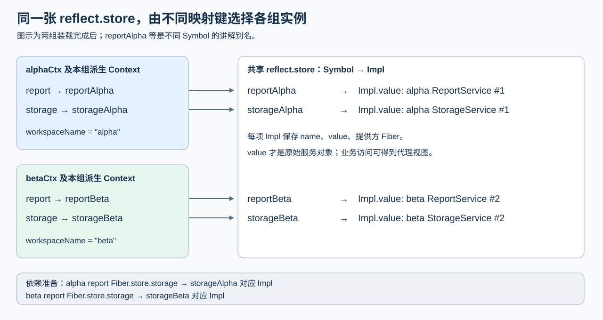

<!-- Generated from LearningTask.ipynb by scripts/render-lessons.py. -->

[运行此课 Notebook](LearningTask.ipynb) · [课程目录](../../README.md)

**Cordis 2013 · 两个独立工作区**

[课程目录](../../README.md) · [环境与运行](../../SETUP.md)

# 本课导览

让 alpha、beta 各自装载 report/storage，用隔离键选择实例，关闭一组后另一组继续。

本课先给具体代码和预期行为，再沿本课固定版本的源码解释原因。读到所选路径即可，不要求通读整个内核。

本课延续前课的 ReportDesk，所有文件与依赖独立保存在当前目录。先在本课目录安装依赖，再按 00 → 01 执行 Notebook，或使用 `npm run demo` 运行完成参考。

建议按 2–3 小时安排首次阅读、运行与回看；可分多次完成。

# 源码与阅读导航

本课独立保存 Cordis **4.0.0-rc.10 / c261dd2c13d65b1994adb1cdc10d7dba61542523**（上游提交 2026-10-10 UTC；本课核验 2026-10-24）。Markdown 中的片段供阅读，实际执行加载本课 `materials/cordis/src/`；可以直接注释、设断点和修改，其他课程不受影响。

| 资料与类型 | 指定范围、停止点 | 作用 |
|---|---|---|
| S1 · [main.ts](examples/01-reportdesk/main.ts)、[workspace.ts](app/workspace.ts)、[report-batch.ts](app/report-batch.ts)；本课应用 | M1 的装配与调用片段，到 beta 第二次保存；观察辅助模块只按需查看 | 先认识调用对象和结果 |
| S2 · [context.ts](materials/cordis/src/context.ts)；官方实现 | M2.1：65–69 的 isolate；55–63 的 extend 只复用对象派生结论 | 形成每个分支的名字映射 |
| S3 · [reflect.ts](materials/cordis/src/reflect.ts)；官方实现 | M2：177–193 的登记、156–162 的查找、80–87 的成功注入访问；M3：197–202 的清理、207–219 的通知筛选 | 连接写入、读取和隔离范围 |
| S4 · [fiber.ts](materials/cordis/src/fiber.ts)；官方实现 | M2.3：375–386 的成功依赖查找和 420–426 的本轮快照；M3 只回顾子插件清理归父 Fiber 管理 | 解释业务读取为何已拿到正确依赖 |
| S5 · [isolate.spec.ts](materials/cordis/isolate.spec.ts)；官方测试，选读 | 第一项 `isolated context` 到结尾：根、ctx1、ctx2 各有 foo，移除根 foo 后另外两处保留；不要求运行测试套件 | 对照同名服务的范围 |

完整来源与初始哈希见 [source-index.json](materials/source-index.json)；文件学习后产生差异是允许的，不自动覆盖恢复。

# 沿场景理解源码

先在本课目录执行 `npm ci` 和 `npm run check`。Notebook 使用 JavaScript（jslab），按 00 → 01 运行；终端使用 `npm run demo`，两者加载同一份本课源码。各阶段的观察说明紧邻代码。

运行生成的报告、状态快照和声明位于本课 `runs/`。重跑会替换同一用途的结果；需要比较时先另行保存。只修改本课文件即可，不依赖其他课程的安装目录。VS Code 请单独打开本课目录，再选择对应调试配置。

```javascript
// 00 · ReportDesk：初始化本课 Notebook 入口。
var path = require("node:path");
var fs = require("node:fs");
var taskName = "2013.Cordis-ReportDesk-Workspace-Isolation";
var taskRoot = path.basename(process.cwd()) === taskName ? process.cwd() : path.join(process.cwd(), taskName);
if (!fs.existsSync(path.join(taskRoot, "package.json"))) throw new Error("请从仓库根或本课目录打开 Notebook。");
var runnerPath = path.join(taskRoot, "shared/notebook.cjs");
delete require.cache[require.resolve(runnerPath)];
var reportdesk = require(runnerPath);
console.log("本课目录：", taskRoot);
```

00 只准备运行入口，预期打印以本课目录名结尾的路径。每次 01 都启动新进程，读取刚保存的本课源码。

## M1 先让两个工作区各自保存

约 40 分钟，含阅读、操作和自由笔记。先看应用变化，再执行同一个完整例子。

### M1.1 从共享服务转为两组服务

本课仍使用台灯、水杯这两份确定性输入：[lamp.txt](fixtures/lamp.txt)、[bottle.txt](fixtures/bottle.txt)。alpha、beta 各先保存一份台灯报告，工作区内部的报告 id 都叫 `lamp`；关闭 alpha 后，beta 再保存 `bottle`。

| 角色 | 由谁装载 | 本课职责 |
|---|---|---|
| workspacePlugin | alphaCtx / betaCtx 各装一次 | 成组装载 storageProvider、reportProvider |
| reportProvider | 各组的插件 Context | 新建本组 ReportService，声明依赖 storage |
| storageProvider | 同一组的插件 Context | 新建本组 StorageService 和内存 Map |
| reportBatch | 各组的 `alpha.ctx` / `beta.ctx` | 只声明 report，调用 generate 并导出快照 |
| 格式、通知、统计插件 | 根 app，各装一次 | 继续包装报告、接收全部完成事件；详细打印默认关闭 |

ReportService 的正文生成、waterfall 格式处理、保存顺序仍沿用原应用。报告写入内存后，reportBatch 将文件导出并发送完成事件。文件名增加工作区前缀：alpha-lamp.md、beta-lamp.md、beta-bottle.md；**前缀仅避免导出文件重名，内存服务隔离由下面的 Context 配置实现**。

### M1.2 先隔离服务名，再装载插件组

先读 [main.ts](examples/01-reportdesk/main.ts) 的核心装配选段，省略输入、共用插件和观察辅助代码：

```ts
const app = new Context();
const alphaCtx = app.isolate("report").isolate("storage")
    .extend({ workspaceName: "alpha" });
const betaCtx = app.isolate("report").isolate("storage")
    .extend({ workspaceName: "beta" });
const alpha = alphaCtx.plugin(workspacePlugin);
const beta = betaCtx.plugin(workspacePlugin);
await alpha;
await beta;
```

每次 `isolate(name)` 返回一个派生 Context，为指定服务名选择一个新的登记键；它本身还没有创建服务。这里两次都从 app 出发，alphaCtx 与 betaCtx 为 report、storage 各持有不同的键。

`workspaceName` 是报告中的业务标签，和上课 entryLabel 一样通过普通属性继承；改变这个字符串不会自动分离服务。真正的边界来自 `isolate("report")` 与 `isolate("storage")`。

`alpha`、`beta` 是两次插件装载返回的句柄，内部关联各自的 Fiber。`await` 等本次装载完成；后面使用 `alpha.ctx`、`beta.ctx`，是在各自组的 Context 下再装调用方。

### M1.3 每个组都新建 report 和 storage

[workspace.ts](app/workspace.ts) 的核心实现如下，导入语句省略：

```ts
export async function workspacePlugin(ctx: Context): Promise<void> {
    const storage = ctx.plugin(storageProvider);
    await storage;
    const report = ctx.plugin(reportProvider, { excerptLength: 8 });
    await report;
}
```

这段代码会在 alpha、beta 各执行一次。每次 storageProvider 都 `new StorageService(ctx)`，每次 reportProvider 都 `new ReportService(ctx, config)`；它们继承本组的服务名映射。两份 ReportService 仍使用同一个类和相同配置，但底层对象不同，内存 Map 也不同。

调用方仍用熟悉的声明，见 [report-batch.ts](app/report-batch.ts) 与 [report-service.ts](app/report-service.ts)，以下为串联后的阅读摘录：

```ts
// reportBatch：inject: ["report"]
const reportView = ctx.report;
const markdown = reportView.generate(job.id, job.input);

// ReportService.generate 内，省略正文及格式处理：
this.ctx.storage.save(id, markdown);
// reportProvider：inject: ["storage"]
```

两组里的依赖方向都是 **reportBatch → report → storage**。上课的 shadow 机制继续让 report 按自身定义处访问 storage；本课把 report 的定义处也放进本组，因此它会使用本组 storage。只让调用方换一个标签、却继续复用根部 report，不会产生这两组独立服务。

### M1.4 运行 01，观察关闭前后

现在运行下面的 01；它与本课终端的 `npm run demo` 共用 [main.ts](examples/01-reportdesk/main.ts)。只需看输出表的三个阶段：“各写一份”“关闭 alpha”“beta 再写一份”。

完整实现中，真正改变应用状态的语句是以下选段；`jobs[0]` 是台灯，`jobs[1]` 是水杯：

```ts
await alpha.ctx.plugin(reportBatch, { jobs: [jobs[0]!] });
await beta.ctx.plugin(reportBatch, { jobs: [jobs[0]!] });
await alpha.dispose();
await beta.ctx.plugin(reportBatch, { jobs: [jobs[1]!] });
```

这里 `!` 是 TypeScript 的非空断言，告诉类型检查器已知这两项存在，不改变数组或运行值。

```javascript
// 01 · ReportDesk：两个独立工作区。
reportdesk.run();
```

预期在一次新进程中看到：

| 阶段 | alpha | beta |
|---|---|---|
| 各写一份 | report 1、storage 1；ids = lamp | report 2、storage 2；ids = lamp |
| 关闭 alpha | 服务已撤下 | 仍是 report 2、storage 2；ids = lamp |
| beta 再写一份 | 已关闭 | 同一组实例；ids = lamp, bottle |

表前的 **“汇总打印位置”** 指向 [shared/observe-workspaces.ts](shared/observe-workspaces.ts) 的 `saveObservations()`；表内的 **“采集位置”** 指向 [main.ts](examples/01-reportdesk/main.ts) 中生成该行状态的 `snapshot(...)` 调用。位置采用相对本课目录的 `文件:行号`，行号在运行时根据当前源码取得；在对应行设断点即可观察该阶段。

三个阶段的状态先分别采集，最后执行 `beta.dispose()` 后再统一打印。因此，表格呈现的是各行所标阶段的快照，而不是打印时所有服务的当前状态。

实例号分别是两个类各自的计数，只帮助阅读。输出还会对底层对象作引用比较，确认两组对象不同、beta 关闭前后仍是原对象；不能只用打印的编号代替对象身份。

`已撤下` 表示在该分支查不到活动服务，表中的“—”表示没有可查询的 storage；它不证明旧 Map 被逐项清空或对象已被垃圾回收。磁盘中的三份报告是观察快照，关闭插件不会删除这些快照。细节见 `runs/reportdesk/observations.json`。

## M2 服务名如何找到不同实例

约 70 分钟，含阅读、操作和自由笔记。从 alphaCtx 的第一次 isolate 进入，沿登记与查找解释刚才的结果。

### M2.1 isolate 派生的是一张名字映射

先看 [context.ts:65–69](materials/cordis/src/context.ts)，以下仅调整缩进并加注释：

```ts
isolate(name: string, label?: symbol) {
    const shadow = Object.create(this[symbols.isolate]);
    shadow[name] = label ?? Symbol(name);
    return this.extend({ [symbols.isolate]: shadow });
}
```

`symbols.isolate` 标识 Context 上“服务名 → Symbol 键”的映射。第一句创建新映射，让其原型指向原映射；第二句为本次 name 写入自己的键；第三句通过已学的 extend 返回带有这张映射的派生 Context。未覆盖的其他名字仍可以沿映射的原型查找。

这里的局部变量 **shadow 是一张普通映射对象**，不是上课方法调用的 shadow 代理，也不是 `symbols.shadow` 保存的定义处 Context。判断含义应看它实际保存什么。

本课省略可选 label，于是每次执行都会创建新的 Symbol。两次 `Symbol("report")` 的描述虽然相同，引用并不相等；打印成相同文字不代表同一键。下面用 reportAlpha/reportBeta 等名字给这些 Symbol 作**讲解用别名**：

| Context | report 映射 | storage 映射 |
|---|---|---|
| alphaCtx 及本组后代 | reportAlpha | storageAlpha |
| betaCtx 及本组后代 | reportBeta | storageBeta |

链式调用第二次 `isolate("storage")` 的新映射只自有 storage，report 从第一次映射继承。最后的 extend 只加 workspaceName，继续使用这组映射。**Context 和映射发生派生；全局服务登记表仍共享。**

### M2.2 provide 把实例写到映射选中的键

进入 [storage-service.ts](app/storage-service.ts) 的构造器：`super(ctx, "storage")` 把本组 Context 交给 Service。[Service 构造器](materials/cordis/src/service.ts)（18–34 行）保存 ctx，再登记实例。以下省略 tracker 与特殊可调用服务分支；report 的构造器采用相同方式：

```ts
let self = this; // 普通 Service 分支：当前正在构造的服务实例。
self.ctx = ctx;
self.ctx.reflect.provide(name, self, this[symbols.check]);
```

[reflect.ts:186–193](materials/cordis/src/reflect.ts) 是 `provide` 的登记部分。以下省略外层 effect 与已认识的错误分支，保留本例关键赋值：

```ts
this.ctx.root[symbols.isolate][name] ??= Symbol(name);
const key = this.ctx[symbols.isolate][name];
const impl: Impl = { name, value, fiber: this.ctx.fiber, check };
// 原实现会检查 this.store[key] 是否已经登记；本例两组 key 不同。
this.store[key] = impl;
this.ctx.fiber.store![name] = impl;
```

此处 `this` 是使用本组提供方 Context 的 ReflectService 视图。第一行保证根映射存在默认键，但 alpha/beta 的映射已经覆盖对应名字，所以第二行读到各自的隔离键；不会把它覆盖回根键。

`impl` 是登记项，保存服务名、实际服务对象 value、提供它的 Fiber 和可选检查函数。本例没有自定义检查。两张表各有用途：

| 表 | 键 | 值与作用 |
|---|---|---|
| 共享的 `reflect.store` | Symbol 键 | 全应用的 Impl 登记项，可同时容纳同名服务 |
| 提供方的 `fiber.store` | 字符串名字，如 storage | 该 Fiber 当前轮次可用的登记项；业务依赖也会在相应 Fiber 的表中保留 |

因此共享 reflect.store 中能同时存在 `storageAlpha → alpha 的存储登记项` 和 `storageBeta → beta 的存储登记项`。isolate 不复制这张共享表，而是改变写入和查找它时使用的 key。

### M2.3 inject 先按本组映射准备依赖

reportProvider 声明 `inject: ["storage"]`。装载它的 Fiber 时，会对声明的每个名字调用 `_checkImpl(name)`；正常登记或状态变化时 notify 也会再次检查。这里先沿首次成功装载，只追踪 storage。触发处是 [Fiber 构造器](materials/cordis/src/fiber.ts) 的 167–169 行：

```ts
for (const name of Object.keys(this.inject)) {
    this._checkImpl(name);
}
```

这时 this 是新建的 reportProvider Fiber，它的 ctx 已由本组 Context 派生；循环中的 name 为 `"storage"`。

[reflect.ts:156–162](materials/cordis/src/reflect.ts) 的 `_getImpl` 完整选段，缩进调整：

```ts
_getImpl(name: string, strict = true) {
    const key = this.ctx[symbols.isolate][name];
    const impl = key && this.store[key];
    if (!impl) return;
    if (strict && impl.fiber.state !== FiberState.ACTIVE) return;
    return impl;
}
```

alpha 的 reportProvider 继承 storageAlpha，所以从共享表取到 alpha storage 的登记项；beta 对应 storageBeta。strict = true 只接受活动提供方；本例先等待本组 storage 装载完成，再装 report。

下面将 [fiber.ts:375–386、420–426](materials/cordis/src/fiber.ts) 的成功路径连接起来。省略可选检查和异常处理；两个片段之间还会经过 `_refresh → _setEpoch` 判断本轮依赖是否齐全，沿用 2008 的正常装载路径：

```ts
// _checkImpl(name) 中：this 是 reportProvider 的 Fiber。
const impl = this.ctx.reflect._getImpl(name, true);
if (!impl) return delete this._store[name];
this._store[name] = impl;

// 随后 _reload() 中，进入插件回调前：
this.store = { ...this._store };
```

`_store` 收集最新依赖，`store` 是当前执行轮次的可用记录。至此 alpha 的 report Fiber 内，`store.storage` 已指向 alpha storage 的 Impl；beta 的记录指向 beta storage。这里停在正确依赖已进入本轮 store，不重读整段异步重载。

### M2.4 回到业务读取与上一课的 shadow

当本组 reportBatch 运行时，inject 同理准备本组的 report 登记项。读取 `ctx.report` 后得到服务视图；成员调用进入方法代理后，report 的方法 Context 保存自身定义处。

[reflect.ts:80–87](materials/cordis/src/reflect.ts) 中，本例命中的部分如下。此时 ctx 是 report 方法使用的 Context，prop 为 `"storage"`。省略根 Context 分支和失败时向父级寻找的分支：

```ts
const defSite = (ctx[symbols.shadow] as Context | undefined) ?? ctx;
// 在 internal/get 的默认回调中：
let fiber = defSite.fiber;
const impl = fiber.store?.[prop];
if (impl) return getTraceable(ctx, impl.value);
```

report 方法里的 `this.ctx.storage` 以 reportProvider 为定义处，直接命中 M2.3 准备好的 `store.storage`。因此每次业务属性访问不必重新遍历全局表；**按隔离键选对 Impl 的关键工作，已经在依赖准备时完成**。

这同时解释两层职责：isolate 决定本组的服务登记与依赖解析；方法 shadow 继续保留 report 定义处的依赖。调用方仍只声明 report，无须额外声明 storage。

### M2.5 把两组对象放回同一张图

图中的 reportAlpha 等是 M2.1 为不同 Symbol 取的讲解别名；编号 1、2 对应本例新进程的实际服务实例。



沿 alpha 看一条完整路径：alphaCtx 的映射给出 storageAlpha → 共享 reflect.store 返回 alpha storage 的 Impl → alpha report Fiber 的 store.storage 保存该 Impl → report 方法通过自己的定义处取得它。beta 重复同一路径，但起始键与最终实例不同。

根 app、Registry 和 ReflectService 继续共享；两次 workspacePlugin 使用同一份函数代码、各有自己的 Fiber 与子插件。这里的“工作区”是应用组织方式，不是独立进程，也不是用于执行不可信代码的安全沙箱。

### M2.6 进一步理解：隔离服务登记与根默认键

**1. alphaCtx.plugin(workspacePlugin) 中装载 storage，隔离在哪里生效？**

`plugin()` 本身沿用同一套装载流程。关键是子插件继承了调用方的隔离映射，而 `provide()` 使用这张映射选择登记键。

在 [workspace.ts](app/workspace.ts) 中，`workspacePlugin` 调用 `ctx.plugin(storageProvider)`。[RegistryService.plugin（registry.ts:207）](materials/cordis/src/registry.ts) 把当前 Context 交给 `new Fiber(this.ctx, ...)`；[Fiber 构造器（fiber.ts:135）](materials/cordis/src/fiber.ts) 再执行：

```ts
this.ctx = this.context = parent.extend({ fiber: this });
```

因此，本例沿父 Context 继承的关系可以概括为：`storageProvider 的 ctx → workspacePlugin 的 ctx → alphaCtx`。这两次 `extend()` 只设置新的 `fiber`，没有替换 `symbols.isolate`，所以 storageProvider 仍能沿继承关系取得 alpha 分支的隔离映射。

[storageProvider](app/storage-service.ts) 随后执行 `new StorageService(ctx)`，经 `super(ctx, "storage")` 进入 [Service 构造器（service.ts:18–34）](materials/cordis/src/service.ts)，保存 `ctx` 并调用：

```ts
self.ctx.reflect.provide(name, self, this[symbols.check]);
```

此时 `ReflectService.provide()` 中的 `this.ctx` 对应 storageProvider 的 Context。**决定实例登记到哪个位置的是 [reflect.ts:187](materials/cordis/src/reflect.ts)：**

```ts
const key = this.ctx[symbols.isolate][name];
```

未隔离的分支读到根默认键；alpha、beta 分支分别读到自己的隔离键。它们共用 `reflect.store`，但使用不同的键登记实例。两组 storage 实例来自各自执行的 `new StorageService(ctx)`；`isolate()` 负责提供不同的键，不会复制已有服务或整张登记表。

**2. reflect.ts:186 是否把根映射改成了 alpha 的局部 Symbol？**

没有。把第 186–193 行连起来看，下面省略了重复登记检查：

```ts
this.ctx.root[symbols.isolate][name] ??= Symbol(name);
const key = this.ctx[symbols.isolate][name];
const impl: Impl = { name, value, fiber: this.ctx.fiber, check };
this.store[key] = impl;
this.ctx.fiber.store![name] = impl;
```

第一行只在根映射对应值为 `null` 或 `undefined` 时，新建一个根默认键；若已有值，连右侧的 `Symbol(name)` 都不会执行。它没有读取或赋入 alpha 的局部键。

`isolate("storage")` 早已在 [context.ts:65–69](materials/cordis/src/context.ts) 创建了另一个 Symbol。**每次 `Symbol("storage")` 都产生独立身份，打印出的描述相同不表示它们是同一个 Symbol。**

用 `storageRoot`、`storageAlpha`、`storageBeta` 给这些 Symbol 起讲解别名（它们不是源码变量名），两组均登记后，有效映射如下：

| 读取表达式 | 取得的键 | 来源 |
| --- | --- | --- |
| `app[symbols.isolate].storage` | `storageRoot` | 首次 provide 时补建的根默认键 |
| `alphaCtx[symbols.isolate].storage` | `storageAlpha` | alpha 分支调用 isolate 时创建 |
| `betaCtx[symbols.isolate].storage` | `storageBeta` | beta 分支调用 isolate 时创建 |

alpha 的局部映射优先于继承到的根映射。因此，第 186 行补好 `storageRoot` 后，第 187 行仍然取得 `storageAlpha`，最后写入 `reflect.store[storageAlpha]`。

**3. 为什么局部登记时仍要补根默认键？**

根映射为未隔离的 Context 分支提供共同的默认键。`provide()` 统一保证服务名有这个默认键，再根据当前 Context 的映射决定本次实际使用哪个键；局部隔离键仍然保留。

要区分两件事：**根映射存在 `storage → storageRoot`，不表示根默认键下已经登记了 storage 实例。** 本课只在 alpha、beta 两组内提供 storage，实际写入的是 `reflect.store[storageAlpha]` 和 `reflect.store[storageBeta]`。

[ReflectService._getImpl（reflect.ts:156–161）](materials/cordis/src/reflect.ts) 查找时同样先选键，再查登记表：

```ts
const key = this.ctx[symbols.isolate][name];
const impl = key && this.store[key];
if (!impl) return;
```

所以，按本课源码，在只有这两组局部服务的情况下，根 Context 的 `app.get("storage")` 仍会得到 `undefined`：它查的是 `storageRoot`，该键下没有 Impl。这个结论来自源码路径分析，可对照本课快照中的 rootHasStorage 观察。

## M3 关闭一组，另一组继续使用

约 25 分钟，含阅读、操作和自由笔记。回看 01 中的一次 alpha.dispose，只补清隔离范围，不重走全部清理实现。

### M3.1 插件组负责哪些资源

[workspace.ts](app/workspace.ts) 使用自身的 ctx 安装两个服务提供方；[main.ts](examples/01-reportdesk/main.ts) 又通过 alpha.ctx / beta.ctx 安装 reportBatch。这些子插件都归对应组管理。`plugin()` 内部将子 Fiber 的释放动作登记到父 Fiber 的 effect 资源中，见 [fiber.ts:171 起](materials/cordis/src/fiber.ts)，这里复用 2007 的清理结论。

```text
alpha 的 Fiber
  ├─ storageProvider 的 Fiber → alpha 的 storage 登记项
  ├─ reportProvider 的 Fiber  → alpha 的 report 登记项
  └─ reportBatch 的 Fiber

beta 的 Fiber
  ├─ storageProvider 的 Fiber → beta 的 storage 登记项
  ├─ reportProvider 的 Fiber  → beta 的 report 登记项
  └─ 两次 reportBatch 的 Fiber
```

`await alpha.dispose()` 等本组释放完成。提供方清理时会撤下自己保存的 key，见 [reflect.ts:197–202](materials/cordis/src/reflect.ts)，完整清理回调选段：

```ts
return async () => {
    delete this.store[key];
    const fibers = this.notify([name]);
    await Promise.allSettled(fibers.map(fiber => fiber.await()));
    delete this.ctx.fiber.store![name];
};
```

这里的 this.store 是共享 reflect.store，但 key 是登记时闭包保存的 alpha 对应键，删除不会触及 beta 的键。插件组负责资源归属，isolate 负责名字查找范围；两者共同支撑本例的成组关闭。

### M3.2 服务通知也按相同的键筛选

撤下服务会通知依赖方重新检查。为什么同样声明 storage/report 的 beta 不受影响？[reflect.ts:207–219](materials/cordis/src/reflect.ts) 的默认筛选先比较同名服务对应的键。以下按原表达式展开，省略循环与其余通知：

```ts
// notify 的默认 filter：ctx 是待检查的依赖方 Context；
// this.ctx 是本次服务通知所在的提供方 Context。
(ctx, name) => ctx[symbols.isolate][name] === this.ctx[symbols.isolate][name]

// 遍历每个 Fiber 的声明依赖时：
if (!(name in fiber.inject)) continue;
if (!filter(fiber.ctx, name)) continue;
fiber._checkImpl(name);
```

alpha storage 撤下时，beta 的 storageBeta 不等于 storageAlpha，所以不会因这次变更重新检查 beta。表中 beta 仍保留实例 2 和已有 lamp，再保存 bottle；观察文件还比较了前后底层对象引用。

本例保留根部的一组格式、通知和统计插件。普通 `ctx.emit("report/completed", ...)` 没有携带筛选对象，会通知这组全应用监听；**服务名隔离不自动隔离所有事件**。我们只用这个已知行为维持统一格式与总完成计数，不引入新的事件过滤实现。

### M3.3 在 VS Code 中定位一次隔离查找（按需）

独立入口为 [main.ts](examples/01-reportdesk/main.ts)。在仓库根或单独本课工作区中，选调试配置 **Cordis 2013 · 01 · 两个独立工作区**；依赖与声明准备好后按 F5。配置把 cwd 和运行临时目录都设在本课。

可只选择一个断点：在 [context.ts](materials/cordis/src/context.ts) 的 isolate 中查看新映射，或在 [reflect.ts](materials/cordis/src/reflect.ts) 的 `_getImpl` 中查看 `name`、`key`、`impl.value.instanceId`。后者条件用 `name === "storage"`，再从调用栈进入 alpha/beta 的 reportProvider 依赖准备；源码行号与范围见导航。

查看 Symbol 时比较引用或实际登记项，不仅看控制台显示的描述文字。找到两组不同 key 指向不同实例即可停止，不要求逐语句单步整个启动流程。默认输出已够观察；需要追踪旧流程时可在终端设置 REPORTDESK_VERBOSE=1 后运行同一 demo。


本课收束在：不同的映射键选出不同服务实例，组内资源归各自 Fiber 管理，关闭一组后另一组的登记和已有数据保留。

# 本课收束

isolate 派生名字到 Symbol 的映射；provide 和 _getImpl 使用当前映射选择共享登记表中的条目。不同实例来自各自的插件装载，isolate 本身不克隆服务。根默认键存在不代表该键已登记实现。
